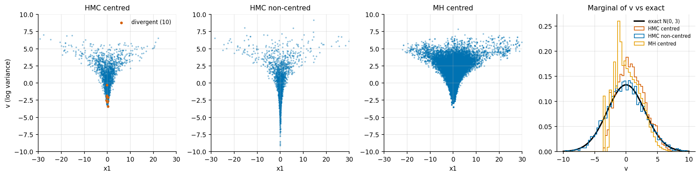
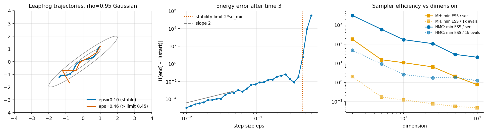
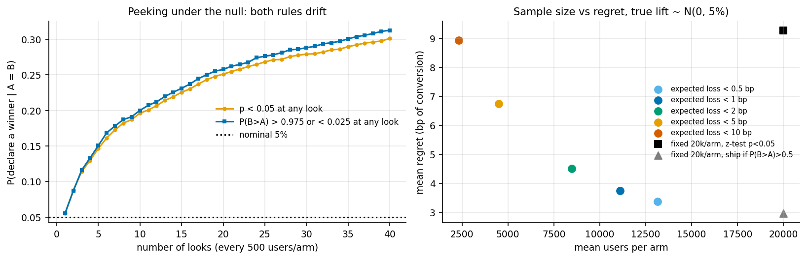
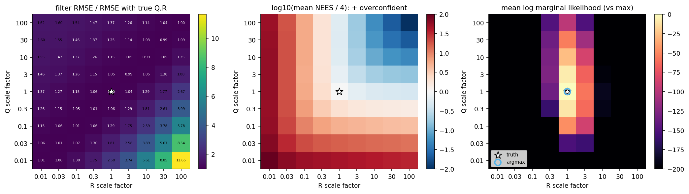
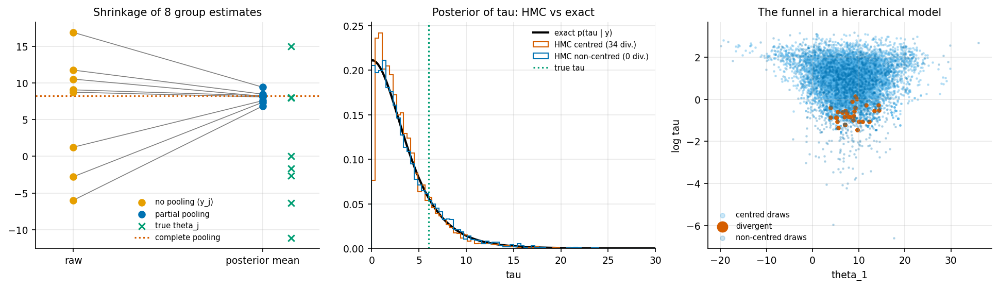

# bayesian-methods

**Bayesian inference and state estimation built from scratch in numpy, in nine chapters. Grid and conjugate posteriors, Metropolis-Hastings, HMC with dual averaging, A/B testing as a decision problem, hierarchical models, Bayesian regression, Kalman and particle filters, and WAIC / PSIS-LOO. Every sampler or filter is scored against an exact or analytic answer, and every diagnostic is tested on inputs where its correct value is known.**

No PyMC, Stan, ArviZ or filterpy. The samplers, ESS, R-hat, divergence detection, RTS smoother, resampling schemes and the generalised-Pareto fit behind PSIS are each roughly a page of commented code in [`bayeslab/`](bayeslab). Each chapter script prints its tables, writes the numbers to `results/`, and draws its figures into `figures/`.



*Neal's funnel. Only 10 of 8000 HMC transitions diverge, and all of them sit in the neck that the centred sampler never reaches, so its 5% quantile of v is −2.5 instead of the exact −4.9. Non-centring removes the bias ([Chapter 3](docs/03-hamiltonian-monte-carlo.md)).*

## Table of contents

| # | Chapter | Script | What it builds | Reference answer it is checked against |
|---|---|---|---|---|
| 1 | [Bayes by grid and conjugate priors](docs/01-grid-and-conjugate.md) | `ch01_grid_and_conjugate.py` | 1-D and 2-D grid posteriors; beta-binomial, normal-normal, normal-inverse-gamma | closed-form posteriors |
| 2 | [Metropolis-Hastings and diagnostics](docs/02-metropolis-hastings.md) | `ch02_metropolis_hastings.py` | adaptive random-walk MH; autocorrelation, multi-chain ESS, split and rank R-hat, MCSE | AR(1) chains with exact ESS; chains with planted defects; exact posteriors |
| 3 | [Hamiltonian Monte Carlo](docs/03-hamiltonian-monte-carlo.md) | `ch03_hamiltonian_monte_carlo.py` | leapfrog, divergence detection, dual-averaging step size, diagonal mass adaptation; MH vs HMC on 2-100-D | exact Gaussian moments; exact funnel marginal |
| 4 | [Bayesian A/B testing](docs/04-bayesian-ab-testing.md) | `ch04_bayesian_ab_testing.py` | P(B>A), expected loss, an expected-loss stopping rule; peeking study; z-test comparison | exact quadrature; simulated ground-truth lifts |
| 5 | [Hierarchical models](docs/05-hierarchical-models.md) | `ch05_hierarchical_partial_pooling.py` | centred vs non-centred HMC; no / complete / partial pooling | exact posterior by quadrature over tau; synthetic true effects |
| 6 | [Bayesian regression](docs/06-bayesian-regression.md) | `ch06_bayesian_regression.py` | linear and logistic regression via HMC; posterior predictive checks; calibration; coverage | exact NIG posterior; held-out data; truth drawn from the prior |
| 7 | [Kalman filter and RTS smoother](docs/07-kalman-filter.md) | `ch07_kalman_filter.py` | 1-D and 2-D constant-velocity tracking; NEES; Q/R mis-specification study | batch Gaussian posterior (to 1e-15) |
| 8 | [Particle filter](docs/08-particle-filter.md) | `ch08_particle_filter.py` | bootstrap PF, 4 resampling schemes, EKF; degeneracy study | Kalman filter on a linear-Gaussian model |
| 9 | [Model comparison](docs/09-model-comparison.md) | `ch09_model_comparison.py` | WAIC, IS-LOO, PSIS-LOO with k-hat | exact LOO (closed form) and the true out-of-sample elpd |

Library modules: [`diagnostics.py`](bayeslab/diagnostics.py), [`samplers.py`](bayeslab/samplers.py), [`targets.py`](bayeslab/targets.py), [`filters.py`](bayeslab/filters.py), [`model_compare.py`](bayeslab/model_compare.py). The test suite is [`tests/test_bayeslab.py`](tests/test_bayeslab.py): 14 known-answer tests that cover every module.

## How to read this

* **Learning Bayesian computation?** Read 1 → 2 → 3 in order. Each chapter's doc explains the algorithm, then shows where it breaks.
* **Need A/B testing or hierarchical models for real work?** Read 4 and 5. The tables there come from simulation studies with known truth. Rerun them with your own baseline rates and effect-size prior.
* **Tracking or time series?** Read 7, then 8. Chapter 7's mis-specification heatmaps are the most practically useful figure in the repo.
* **Choosing between models?** Read 9, and treat k-hat as a to-do list.

Each doc puts its numbers next to the CSV they came from, so every claim traces back to `results/`.

## What's different here

The projects listed under References inspired the scope. This repo is organised around **verification** rather than exposition:

1. **Every sampler result is compared against an exact answer.** Conjugate posteriors in chapters 1, 2 and 6, exact Gaussian moments in chapter 3, a quadrature-exact hierarchical posterior in chapter 5, a batch Gaussian solve in chapter 7, the Kalman filter in chapter 8, and closed-form LOO in chapter 9. Errors are reported in units of their Monte Carlo standard error.
2. **The diagnostics are written here and tested on inputs with known answers.** ESS is checked on AR(1) chains with exact ESS. R-hat variants are checked on chains with planted defects (shift, scale mismatch, shared trend). The MCSE calibration is checked across 120 repeated runs. Divergences are located in the funnel neck. The PSIS k-hat estimator is checked on GPD draws with known shape, and on a planted outlier.
3. **Two robustness and efficiency studies.** One measures sampler efficiency as ESS per second and per evaluation, for MH vs HMC from 2 to 100 dimensions. The other measures filter robustness as RMSE, NEES and marginal likelihood over an 81-cell grid of mis-scaled Q and R.
4. **A/B testing is framed as a decision problem.** Expected-loss thresholds are compared with fixed-horizon tests on sample size, regret and error rates, over 3000 simulated experiments. The peeking problem is shown to affect P(B>A) thresholds as much as p-values.
5. **One test suite for all modules** (`python3 tests/test_bayeslab.py`): leapfrog reversibility and second-order accuracy, dual-averaging targets, gradient finite-difference checks, RTS = batch posterior, PF log-likelihood ≈ KF log-likelihood, unbiased resampling, GPD shape recovery, PSIS-LOO = exact LOO.

## Results

All numbers come from `python3 examples/run_all.py` on an Apple-silicon laptop. Seeds are fixed, so the sampler outputs are reproducible. Wall-clock times are not, because other jobs shared the machine.

### Samplers vs exact answers

| check | result | file |
|---|---|---|
| grid posterior, 200 points/axis, vs conjugate (1-D models) | error ≤ 2e-15 | `ch01_grid_vs_exact.csv` |
| MH on 2-D Gaussian and beta-binomial, mean error / MCSE | 0.15, −1.10, −1.23 | `ch02_mh_vs_exact.csv` |
| MCSE calibration over 120 MH runs: sd(err/MCSE), 95% coverage | 0.95, 0.975 | `ch02_summary.json` |
| HMC on 50-D correlated Gaussian: max mean error (sd units), max sd error | 0.070, 3.8% (MH: 0.35, 51%) | `ch03_50d_vs_exact.csv` |
| HMC linear regression vs exact NIG posterior: max \|err\|/MCSE | 1.58 | `ch06_linear_hmc_vs_exact.csv` |
| non-centred HMC hierarchical model vs quadrature: max sd error | 0.10 (2% of 5.9) | `ch05_hmc_vs_exact.csv` |
| logistic-regression credible-interval coverage, truth drawn from the prior | 48.8 / 79.2 / 90.2% at 50 / 80 / 90% | `ch06_logistic_coverage.csv` |
| RTS smoother vs batch Gaussian posterior | 6e-15 | `ch07_summary.json` |
| PSIS-LOO vs exact LOO, RMSE over 900 fits (WAIC) | 0.19 nats (0.37) | `ch09_repeated_datasets.csv` |

### Diagnostics on known-answer inputs

| input | true value | ours |
|---|---|---|
| ESS of AR(1), phi = 0.9, 4 × 2500 | 526 | 514 ± 60 |
| ESS of AR(1), phi = 0.98 | 101 | 102 ± 23 |
| R-hat, one chain 3× wider (classic split / rank) | should flag | 1.006 / **1.145** |
| R-hat, shared trend (basic / split) | should flag | 1.000 / **1.274** |
| GPD shape, k = 0.5 / 0.9 (200 exceedances) | 0.5 / 0.9 | 0.51 / 0.87 |
| k-hat of planted outlier vs other points | > 0.7 | **0.97** vs ≤ 0.53 |

### Sampler efficiency (min bulk-ESS over coordinates, 4 chains)

| dim | MH ESS / 1k evals | HMC ESS / 1k grads | MH ESS/s | HMC ESS/s | MH max R-hat |
|---|---|---|---|---|---|
| 2 | 1.99 | 48.0 | 181 | 3176 | 1.03 |
| 10 | 0.12 | 2.54 | 10.6 | 170 | 1.28 |
| 50 | 0.055 | 1.82 | 2.0 | 28.9 | 2.00 |
| 100 | 0.046 | 1.21 | 0.75 | 20.5 | 2.82 |



### A/B decision rules (3000 simulated experiments, true lift ~ N(0, 5%) on a 10% baseline)

| rule | mean users/arm | P(ship worse) | mean regret (bp) | P(ship B \| B worse) |
|---|---|---|---|---|
| expected loss < 0.5 bp | 13,140 | 0.19 | 3.4 | 0.19 |
| expected loss < 2 bp | 8,472 | 0.22 | 4.5 | 0.22 |
| expected loss < 10 bp | 2,326 | 0.31 | 8.9 | 0.32 |
| fixed 20k/arm, z-test p < 0.05 | 20,000 | 0.34 | 9.3 | 0.008 |

Under the null with 40 looks, "p < 0.05 at any look" fires in 30.1% of experiments and "P(B>A) outside [0.025, 0.975] at any look" in 31.3%.



### Filtering

| study | result |
|---|---|
| 2-D tracking, position RMSE: raw / KF / RTS | 2.70 / 1.61 / 0.81; NEES 3.98 (ideal 4) |
| Q × 0.01 / R × 0.01 / R × 100 | RMSE × 2.58 / 1.37 / 2.67; NEES 176 / 226 / 1.8 |
| both × 10 (same Q/R ratio) | RMSE × 0.99, but NEES 0.39: right means, dishonest covariance |
| marginal likelihood argmax over the 9 × 9 grid | exactly the true Q, R |
| nonlinear growth model RMSE, EKF vs PF (N = 1000), 50 series | 19.5 vs 4.56 |
| PF vs exact KF filtering mean, N = 50 → 10000 | 0.14 → 0.0097 (∝ N^−½) |



### Hierarchical pooling (RMSE of 8 group effects, 400 datasets per tau)

| true tau | no pooling | complete pooling | partial pooling |
|---|---|---|---|
| 0 | 13.9 | **4.3** | 4.9 |
| 5 | 13.8 | 6.5 | **6.4** |
| 20 | 13.7 | 19.6 | **12.7** |
| 40 | 13.4 | 38.3 | **13.2** |



## Takeaways

* **A few divergences can mean a lot of bias.** 0.13% divergent transitions in the funnel came with a 5% quantile that was off by 2.4 sd. MH showed the same bias with no warning at all.
* **The diagnostics need tests of their own.** Plain R-hat misses scale mismatch, and unsplit R-hat misses shared trends. Both failures are reproduced here with numbers.
* **RMSE alone can't validate a filter.** Scaling Q and R together leaves the means alone and breaks the covariances by 10×. NEES catches it, and the marginal likelihood finds the true noise levels.
* **Peeking is not only a frequentist problem.** It affects any threshold rule. A decision rule should target the loss you care about, and its operating characteristics should be simulated.
* **PSIS-LOO approximates exact LOO about twice as well as WAIC**, but both are about 4 nats from the true elpd on 30 points. The sampling variability of a small dataset dominates the choice of estimator.

## Caveats

* **Static HMC, not NUTS.** The path length is fixed by hand (1.5-4 time units). With an identity or diagonal mass matrix and a well-chosen path length, it is a fair comparison with MH, but it is not what Stan runs. The dual-averaging step size ends up slightly conservative: realised acceptance is 0.84-0.91 against a target of 0.8.
* **MH uses an isotropic proposal.** A random walk preconditioned with the posterior covariance would do much better on the correlated Gaussian. The study measures "untuned MH vs HMC with diagonal adaptation", which is the usual situation in practice.
* **Wall-clock numbers are noisy.** Several projects shared the machine. Chapter 3 took 39 s when run alone and 162 s inside the full run. ESS per evaluation is the reproducible metric. ESS per second is reported because it was asked for.
* **Pure-Python loops.** One HMC gradient costs about as much as one MH density evaluation here, because both are one numpy matrix-vector product plus interpreter overhead. With compiled code and expensive likelihoods, the relative costs change.
* **Sizes are small on purpose.** There are 4 chains of 1000-2000 HMC draws, 40 Monte Carlo runs per Kalman cell and 100 datasets in chapter 9. Every table states its replicate count, and differences smaller than about 2 standard errors (for example between the three low-variance resampling schemes) are not claimed.
* **Coverage in chapter 5 is below nominal for large true tau** (81-82% for 90% intervals). The half-Cauchy(0, 5) prior is too tight for tau = 10-20 with only 8 groups. That is an honest consequence of the prior, not a bug, and chapter 6 shows nominal coverage when the truth is drawn from the prior.
* **The A/B results depend on the simulated effect-size prior** (relative lift ~ N(0, 5%)) and on symmetric losses. Different priors or asymmetric costs change the ranking.
* **All data are synthetic.** That is deliberate, so that the truth is known, but none of the conclusions has been tested on a real dataset here.

## Run it

```bash
pip3 install -r requirements.txt      # numpy, scipy, matplotlib
python3 tests/test_bayeslab.py        # 14 known-answer tests, ~2 s
python3 examples/run_all.py           # tests + all 9 chapters: ~5.5 min wall clock (about 3 min with an idle CPU)
python3 examples/run_all.py ch03 ch07 # a subset, by prefix
```

Each chapter also runs on its own, for example `cd examples && python3 ch05_hierarchical_partial_pooling.py`. Tested with Python 3.9.6, numpy 2.0.2, scipy 1.13.1 and matplotlib 3.9.4.

```
bayeslab/        diagnostics, samplers, targets, filters, model_compare, plotting
examples/        ch01..ch09 scripts + run_all.py
docs/            one markdown chapter per script
tests/           test_bayeslab.py
figures/         18 PNGs, regenerated by the scripts
results/         CSV / JSON behind every table (run.log = full console output)
```

## Roadmap

* NUTS (the recursive doubling tree with multinomial sampling) and a dense mass matrix, then rerunning the chapter 3 efficiency study.
* Simulation-based calibration with rank histograms (Talts et al. 2018) for every model in chapters 5 and 6.
* Unscented Kalman filter and an auxiliary or optimal-proposal particle filter in chapter 8, plus particle MCMC for learning Q and R.
* Moment-matching and exact refits for k-hat > 0.7 points in PSIS-LOO; stacking weights.
* A Thompson-sampling bandit to contrast with the fixed A/B design in chapter 4.

## References

Methods (code written from these papers and books):

* Gelman, Carlin, Stern, Dunson, Vehtari & Rubin, *Bayesian Data Analysis*, 3rd ed. (2013). Conjugate models, hierarchical normal model (ch. 5), R-hat (ch. 11). [stat.columbia.edu/~gelman/book](http://www.stat.columbia.edu/~gelman/book/)
* Vehtari, Gelman, Simpson, Carpenter & Bürkner (2021), "Rank-normalization, folding, and localization: an improved R-hat for assessing convergence of MCMC". [arXiv:1903.08008](https://arxiv.org/abs/1903.08008)
* Betancourt (2017), "A Conceptual Introduction to Hamiltonian Monte Carlo". [arXiv:1701.02434](https://arxiv.org/abs/1701.02434)
* Hoffman & Gelman (2014), "The No-U-Turn Sampler", section 3.2, dual averaging. [arXiv:1111.4246](https://arxiv.org/abs/1111.4246)
* Neal (2003), "Slice sampling", *Annals of Statistics*: the funnel distribution. Neal (2011), "MCMC using Hamiltonian dynamics". [arXiv:1206.1901](https://arxiv.org/abs/1206.1901)
* Roberts, Gelman & Gilks (1997), "Weak convergence and optimal scaling of random walk Metropolis algorithms", *Annals of Applied Probability*.
* Vehtari, Gelman & Gabry (2017), "Practical Bayesian model evaluation using leave-one-out cross-validation and WAIC". [arXiv:1507.04544](https://arxiv.org/abs/1507.04544)
* Vehtari, Simpson, Gelman, Yao & Gabry (2024), "Pareto Smoothed Importance Sampling". [arXiv:1507.02646](https://arxiv.org/abs/1507.02646)
* Zhang & Stephens (2009), "A new and efficient estimation method for the generalized Pareto distribution", *Technometrics*. The `gpd_fit` structure mirrors the reference routine in the R [`loo`](https://github.com/stan-dev/loo) package, as noted in the code.
* Särkkä (2013), *Bayesian Filtering and Smoothing*, Cambridge University Press: Kalman filter and RTS smoother. [lecture notes](https://users.aalto.fi/~ssarkka/course_k2016/handout7.pdf)
* Gordon, Salmond & Smith (1993), "Novel approach to nonlinear/non-Gaussian Bayesian state estimation", *IEE Proceedings F* 140(2). [doi:10.1049/ip-f-2.1993.0015](https://digital-library.theiet.org/doi/epdf/10.1049/ip-f-2.1993.0015)
* Kitagawa (1996), "Monte Carlo filter and smoother for non-Gaussian nonlinear state space models", *JCGS*: the growth-model benchmark.
* Stucchio (2015), "Bayesian A/B Testing at VWO" (whitepaper on expected-loss stopping). [vwo.com whitepaper](https://vwo.com/downloads/VWO_SmartStats_technical_whitepaper.pdf)
* Stan User's Guide, reparameterisation section (non-centred hierarchical models). [mc-stan.org](https://mc-stan.org/docs/2_18/stan-users-guide/reparameterization-section.html)

Inspirations:

* [CamDavidsonPilon/Probabilistic-Programming-and-Bayesian-Methods-for-Hackers](https://github.com/CamDavidsonPilon/Probabilistic-Programming-and-Bayesian-Methods-for-Hackers) inspired the scope of the A/B testing and "Bayes for programmers" framing.
* [rlabbe/Kalman-and-Bayesian-Filters-in-Python](https://github.com/rlabbe/Kalman-and-Bayesian-Filters-in-Python) inspired the scope of chapters 7-8 (Kalman, EKF and particle filters taught by code).
* [AllenDowney/ThinkBayes2](https://github.com/AllenDowney/ThinkBayes2) inspired the scope of the grid-first approach in chapter 1.

## License

MIT, Copyright (c) 2026 Abyn Scaria. See [LICENSE](LICENSE).
