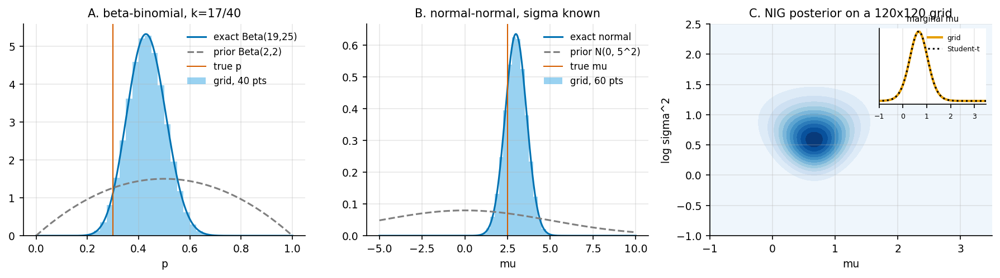
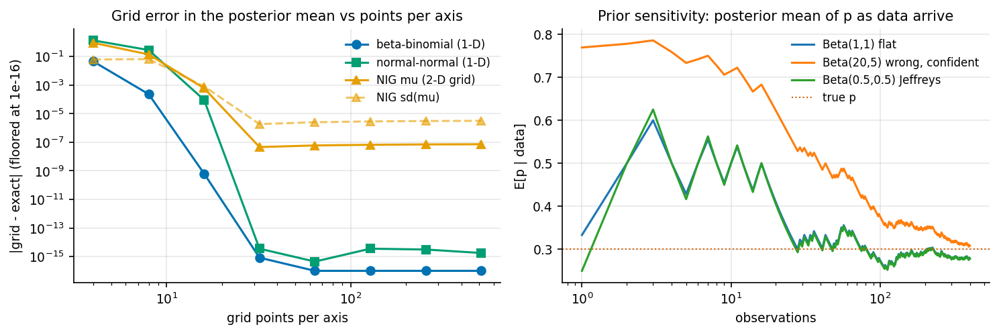

# 1. Bayes by grid, Bayes by algebra

Code: [`examples/ch01_grid_and_conjugate.py`](../examples/ch01_grid_and_conjugate.py)

## The idea

Bayes' rule says the posterior is proportional to the prior times the likelihood:

    p(theta | y)  ∝  p(y | theta) p(theta)

With one or two parameters you can just evaluate that product on a grid of theta values and
normalise. No sampling and no approximations beyond the grid itself. With a *conjugate*
prior the product stays in the prior's family, so the posterior can be written down exactly.
Each later chapter uses one of these two as the reference answer.

| Model | Prior | Exact posterior |
|---|---|---|
| beta-binomial | p ~ Beta(a, b) | Beta(a + k, b + n - k) |
| normal-normal (sigma known) | mu ~ N(m0, s0²) | N with precision 1/s0² + n/sigma² |
| normal, mean and variance unknown | mu given sigma² ~ N(m0, sigma²/k0), sigma² ~ IG(a0, b0) | NIG(m_n, k_n, a_n, b_n); marginal of mu is Student-t with 2a_n dof |

## What the script does

1. Puts each posterior on a midpoint grid. The NIG model uses a 2-D grid over
   (mu, log sigma²). Because that axis is on the log scale, the density picks up the
   Jacobian sigma².
2. Compares grid mean and sd against the closed forms.
3. Sweeps the grid size from 4 to 512 points per axis.
4. Streams 400 Bernoulli observations and tracks the posterior mean under three priors.

## Results

With 200 points per axis, the grid matches the exact posterior to about 1e-15 for both 1-D
models. For the 2-D NIG model it matches to 7e-8 (mean of mu) and 4e-4 (relative error in
sd of sigma²). Table: `results/ch01_grid_vs_exact.csv`.

Two things in the left panel are worth noticing:

* **Convergence is exponential, not polynomial.** For a smooth density that is close to zero
  at the edges of the grid, the midpoint rule acts like the trapezoid rule on a periodic
  function, so its error falls faster than any power of the grid spacing. Going from 16 to
  32 points takes the beta-binomial error from 6e-10 to 1e-15.
* **The 2-D error stops falling at about 1e-7.** No amount of refinement fixes that, because
  the error comes from the grid's finite *range* (mu in [-3, 5], sigma² in [0.1, 20]), not its
  spacing. A sampler can't detect this kind of truncation error, but a grid can if you
  widen the range.

The right panel shows prior sensitivity. A flat prior and Jeffreys' prior agree after about
20 observations. A confident, wrong Beta(20, 5) prior pulls the posterior mean towards 0.8,
and its effect fades only as data accumulate: it is still 0.03 above the others at
n = 400 (0.308 vs 0.279) (`results/ch01_prior_sensitivity.json`).

## Why we leave grids behind

A grid with G points per axis in d dimensions needs G^d evaluations. At G = 32 that is
1 thousand points in 2-D, 1 million in 4-D and 10^15 in 10-D. Chapters 2 and 3 replace the
grid with Markov chains, whose cost grows roughly linearly (MH) or as d^(1/4) per effective
sample (HMC, in theory) with dimension.

## Takeaways

* Use the exact posterior whenever you have one, even if only to test the sampler you
  actually need.
* Grid error has two parts, spacing and range. The second is the one that bites.
* A strong prior is a strong statement. Its influence fades at a rate set by its pseudo-count
  (a + b = 25 here).
