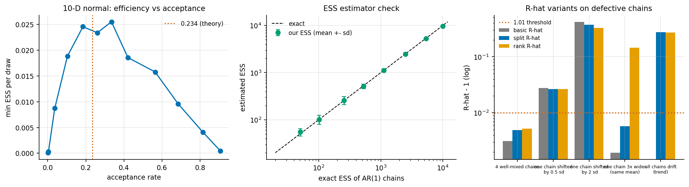
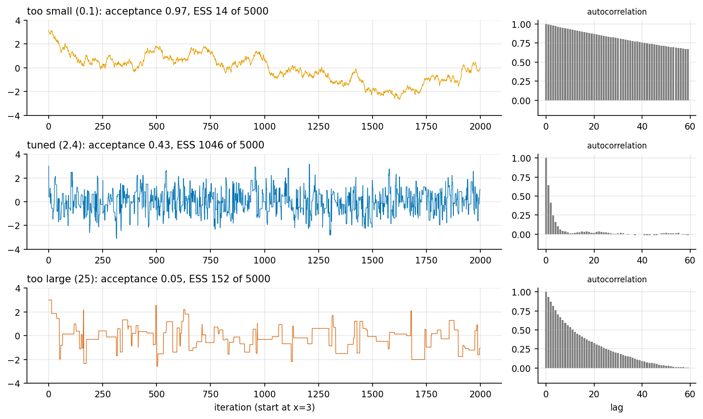

# 2. Metropolis-Hastings, and testing the diagnostics

Code: [`examples/ch02_metropolis_hastings.py`](../examples/ch02_metropolis_hastings.py),
[`bayeslab/samplers.py`](../bayeslab/samplers.py) (`rw_metropolis`),
[`bayeslab/diagnostics.py`](../bayeslab/diagnostics.py)

## The algorithm

Random-walk Metropolis proposes x' = x + s · L z with z ~ N(0, I). It accepts with
probability min(1, p(x') / p(x)) and otherwise stays put. The proposal is symmetric, so the
Hastings correction cancels. All we need is the log density up to a constant. During warmup
the code adapts log s by a Robbins-Monro step, (accepted − 0.234) / t^0.6.

## Diagnostics, implemented here

| Diagnostic | Definition used | Where |
|---|---|---|
| autocorrelation | FFT of the zero-padded, centred chain | `autocorrelation` |
| ESS | multi-chain rho_t = 1 − (W − mean acov_t) / var⁺, pairwise sums truncated by Geyer's initial-monotone rule, ESS = MN / tau | `ess` |
| split-R-hat | BDA3 eq. 11.4 on half-chains | `split_rhat` |
| rank-normalised R-hat | max of split-R-hat on normal scores of ranks, and on folded ranks \|x − median\| | `rank_rhat` |
| bulk / tail ESS | ESS of rank-normalised split chains / of quantile indicators | `ess_bulk`, `ess_tail` |

## Do the diagnostics work? We test them first

AR(1) chains x_t = phi x_{t−1} + e_t have an exact ESS of MN (1 − phi)/(1 + phi). Here are
20 replicates of 4 × 2500 draws (`results/ch02_ess_check.csv`):

| phi | exact ESS | our ESS (mean ± sd) | ratio |
|---|---|---|---|
| 0.0 | 10000 | 9740 ± 328 | 0.97 |
| 0.6 | 2500 | 2486 ± 176 | 0.99 |
| 0.9 | 526 | 514 ± 60 | 0.98 |
| 0.98 | 101 | 102 ± 23 | 1.01 |
| 0.99 | 50 | 55 ± 10 | 1.10 |

The estimator is unbiased to within a few percent until phi = 0.99. There it overestimates
by 10%, because a 2500-draw chain spans only about 25 autocorrelation times.

R-hat variants on chains with *planted* defects (mean of 20 replicates, `results/ch02_rhat_check.csv`):

| scenario | basic | split | rank |
|---|---|---|---|
| 4 well-mixed chains | 1.003 | 1.005 | 1.005 |
| one chain shifted 0.5 sd | 1.028 | 1.026 | 1.026 |
| one chain 3× wider, same mean | **1.002** | **1.006** | **1.145** |
| all chains share a trend | **1.000** | 1.274 | 1.267 |

These rows show the known failure modes from Vehtari et al. (2021). Without splitting, R-hat
misses a trend that every chain shares. Without the folded rank version, it misses chains
that agree in location but not in scale.

## Tuning the proposal

On N(0, 1), a step of 0.1 accepts 97% of proposals and yields 13 effective draws out of
5000. A step of 25 accepts 5% and yields 152. A step of 2.4 accepts 44% and yields 1046.

On a 10-D standard normal, the best efficiency in the sweep came at 0.85 × 2.38/√d. That
scale accepted 33% of proposals and gave min-ESS/draw = 0.026. Efficiency stays within about 10% of that best value for acceptance rates between 0.18 and
0.33, and drops by about 27% at 0.42. That matches the theory: 0.234 is the d → ∞ optimum,
and the optimum is broad.

## Accuracy against the exact posterior

Here are 4 × 5000 draws (`results/ch02_mh_vs_exact.csv`). err/MCSE is the error divided by
its Monte Carlo standard error, sd/√ESS:

| quantity | exact mean | MH mean | exact sd | MH sd | ESS | err / MCSE |
|---|---|---|---|---|---|---|
| 2-D Gaussian x1 | 1.000 | 1.003 | 1.000 | 0.992 | 1979 | 0.15 |
| 2-D Gaussian x2 | −2.000 | −2.059 | 2.000 | 2.002 | 1389 | −1.10 |
| beta-binomial p (logit scale) | 0.4318 | 0.4302 | 0.0738 | 0.0730 | 3053 | −1.23 |

If our ESS is right, err/MCSE should look like N(0, 1). Over 120 repeated runs its sd was
0.947 and ±1.96 MCSE covered the truth 97.5% of the time. So the ESS, and hence the error
bars, are trustworthy, perhaps slightly conservative.

The beta-binomial row samples z = logit(p). The log density then picks up the Jacobian
p(1 − p), which is why the code uses exponents a + k and b + n − k rather than
a + k − 1 and b + n − k − 1.

## Takeaways

* Test a diagnostic on chains where you know the answer before trusting it on chains where
  you do not.
* Acceptance rate is a proxy. What you care about is ESS per unit cost, and that curve is flat
  near its optimum.
* Report MCSE next to every MCMC estimate. Without it, "1.003 vs 1.000" is meaningless.
