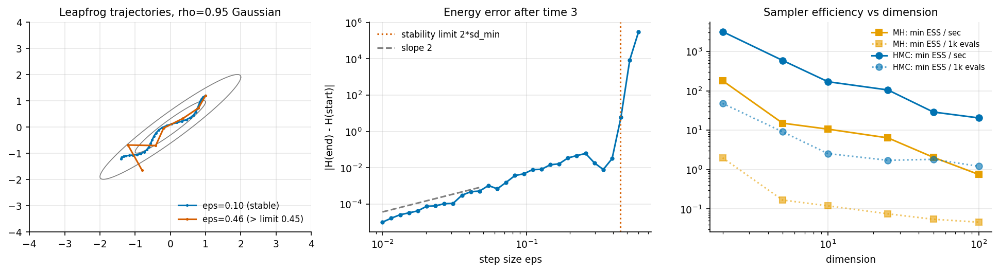
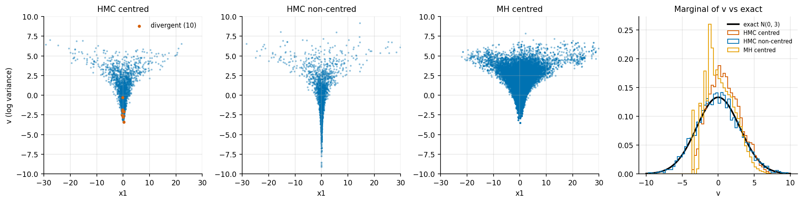

# 3. Hamiltonian Monte Carlo from scratch

Code: [`examples/ch03_hamiltonian_monte_carlo.py`](../examples/ch03_hamiltonian_monte_carlo.py),
[`bayeslab/samplers.py`](../bayeslab/samplers.py) (`leapfrog`, `DualAveraging`, `hmc`),
[`bayeslab/targets.py`](../bayeslab/targets.py)

## The idea in one paragraph

HMC adds a momentum p ~ N(0, M) and simulates Hamiltonian dynamics for
H(x, p) = −log p(x) + ½ pᵀM⁻¹p. Exact dynamics conserve H and preserve volume, so the
endpoint could be accepted with probability 1. The leapfrog integrator keeps the volume
property exactly and conserves H only approximately. A Metropolis step on the energy error
ΔH corrects for that. Moving along level sets of H lets one proposal travel across the
distribution, instead of diffusing like a random walk.

## Pieces implemented here

* **Leapfrog**, written as kick-drift-kick so the energy can be checked after every step. The
  tests check it is exactly reversible (to 1e-10), and that its energy error falls about 4×
  when eps is halved (second order).
* **Divergences.** A transition is flagged as divergent if ΔH > 1000 at any step (the
  threshold Stan uses), and the trajectory stops early.
* **Dual-averaging step size**, following the update equations of Hoffman & Gelman (2014),
  sec. 3.2. It uses gamma = 0.05, t0 = 10 and kappa = 0.75, and targets an acceptance of 0.8.
* **Diagonal mass matrix.** Variances are estimated on the window from 25% to 75% of warmup
  and regularised. Dual averaging then restarts.
* **Fixed integration time** with step-size jitter of ±10% after warmup, to avoid resonant
  trajectories. This is static HMC, not NUTS.

## Leapfrog stability, and what a divergence is

For a Gaussian, leapfrog is stable only if eps < 2 · sd_min, where sd_min is the sd of the
narrowest direction. For the rho = 0.95 target, sd_min = 0.224, so the limit is 0.447. Below
the limit the energy error grows like eps². Just past it, the error explodes from about 0.01
to more than 10^5. A divergence is exactly that: the step size exceeds the local stability
limit somewhere along the trajectory.

## Efficiency study: MH vs HMC vs dimension

The target is a correlated Gaussian with AR(1) correlation 0.9 and marginal sds log-spaced
between 0.1 and 1. Each sampler ran 4 chains. MH took 20000 draws per chain after 5000 warmup
iterations. HMC took 1000 draws per chain after 1000 warmup iterations, with path length 3
and mass adaptation. The table reports min bulk-ESS over all coordinates
(`results/ch03_efficiency_vs_dim.csv`):

| dim | MH min ESS | HMC min ESS | MH ESS / 1k evals | HMC ESS / 1k grads | MH ESS/s | HMC ESS/s | MH max R-hat | HMC max R-hat |
|---|---|---|---|---|---|---|---|---|
| 2 | 199 | 10906 | 1.99 | 48.0 | 181 | 3176 | 1.03 | 1.04 |
| 10 | 12.0 | 817 | 0.120 | 2.54 | 10.6 | 170 | 1.28 | 1.00 |
| 50 | 5.5 | 798 | 0.055 | 1.82 | 2.0 | 28.9 | **2.00** | 1.01 |
| 100 | 4.6 | 602 | 0.046 | 1.21 | 0.75 | 20.5 | **2.82** | 1.01 |

At d = 50, MH has a worst-coordinate mean error of 0.35 sd and an sd error of 51%. HMC's are
0.07 sd and 3.8% (`results/ch03_50d_vs_exact.csv`). MH's R-hat of 2.0 correctly says "do not
trust this". The fault is not MH as such: an isotropic random walk can't handle a 10×
spread of scales plus strong correlation without a preconditioner. HMC with a diagonal mass
matrix sees the scale problem removed, and the correlation is left for the dynamics to handle.

The ESS-per-evaluation column is the hardware-independent one. HMC's advantage per gradient
grows from 24× at d = 2 to 26-33× at d = 50-100. A gradient is not free, though: in this
numpy code one HMC gradient costs about as much as one MH density evaluation, because both are
dominated by one matrix-vector product.

## Neal's funnel: divergences as a warning light

Neal's funnel puts v ~ N(0, 3²) and x_i | v ~ N(0, e^v) for i = 1..9. The exact marginal of
v is N(0, 9), so its 5% quantile is −4.93 (`results/ch03_funnel.csv`):

| sampler | divergent % | mean of v | sd of v | 5% quantile of v | bulk ESS (v) | R-hat (v) |
|---|---|---|---|---|---|---|
| HMC centred | 0.13 | 0.82 | 2.13 | −2.52 | 70 | 1.06 |
| HMC centred, target accept 0.99 | 0.01 | 0.52 | 2.40 | −3.15 | 103 | 1.04 |
| HMC non-centred | 0 | −0.04 | 2.97 | −4.86 | 4519 | 1.00 |
| MH centred (40k/chain) | n/a | 0.28 | 2.01 | −2.58 | 31 | 1.12 |

There are only 10 divergences in 8000 transitions, but they all sit in the neck. The median v
at a divergence is −2.55, against a median of 0.68 overall. That is the region the sampler
never reaches, and the true 5% quantile of −4.93 lies deep inside it. Raising the target
acceptance to 0.99 shrinks the step size from 0.39 to 0.14. That cuts the divergences to 1,
but the bias stays. **Few divergences is not the same as no bias.** The real fix is to
reparameterise: sample z ~ N(0, 1) and set x = e^(v/2) z. MH shows the same bias with no
divergence signal at all, so in this example only HMC told us something was wrong.

## Takeaways

* A divergence is a numerical-stability event with a geometric meaning: the curvature at that
  point is too high for the step size. Look at where divergences happen, not just how many.
* Compare samplers on ESS per gradient (or per density evaluation) and per second, and say
  which is which.
* Static HMC needs a path length. NUTS chooses it automatically, and implementing it is the
  natural next step (see the roadmap).
