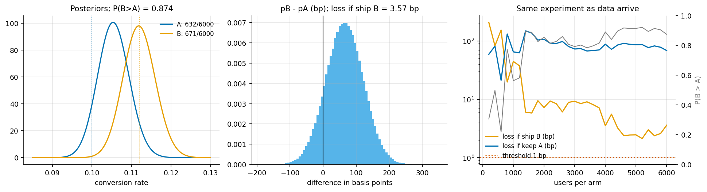
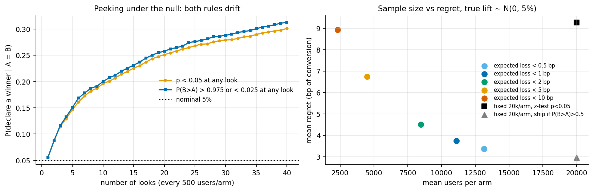

# 4. Bayesian A/B testing as a decision problem

Code: [`examples/ch04_bayesian_ab_testing.py`](../examples/ch04_bayesian_ab_testing.py)

All conversion data in this chapter are simulated.

## Three quantities

With independent Beta(1, 1) priors, the posteriors after kA/nA and kB/nB conversions are
Beta(1 + k, 1 + n − k).

* **P(B > A)** = ∫ f_B(x) F_A(x) dx, computed here by 1-D quadrature.
* **Expected loss of shipping B** = E[max(pA − pB, 0)]: how much conversion you expect to give
  up if B is actually worse. The code integrates an exact inner expectation,
  E[(a − pB)⁺] = a F_B(a) − mean_B · I_a(alpha_B + 1, beta_B), over pA.
* **Expected loss of keeping A** = E[max(pB − pA, 0)].

P(B > A) treats a 0.01 pp loss and a 2 pp loss as the same. Expected loss is in units of the
metric, so it can be compared with what a wrong decision actually costs.

## One experiment

The true rates are 10.0% vs 11.2%, with 6000 users per arm. Observed: A converted 632
(10.53%) and B 671 (11.18%). Monte Carlo used 400k draws (`results/ch04_single_experiment.csv`):

| quantity | Monte Carlo | exact quadrature |
|---|---|---|
| P(B > A) | 0.8741 | 0.8737 |
| expected loss if ship B | 0.000356 (3.6 bp) | 0.000357 |
| expected loss if keep A | 0.006850 (68.5 bp) | 0.006855 |

For comparison, the two-proportion z-test gives p = 0.25. Here 1 bp is 0.01 percentage
points.

The frequentist test says "not significant". The decision analysis says "shipping B risks
3.6 bp, keeping A risks 68.5 bp". Those answer different questions. The 95% Wald interval and
the 95% credible interval for pB − pA agree to 4 decimals here (−0.0046..0.0176), as they
should with flat priors and this much data.

## Peeking: the posterior drifts too

Under the null (A = B = 10%), 2000 experiments, a look every 500 users per arm, up to 40 looks
(`results/ch04_peeking_null.csv`):

| looks | users/arm | P(p < 0.05 at any look) | P(P(B>A) ∉ [0.025, 0.975] at any look) |
|---|---|---|---|
| 1 | 500 | 0.056 | 0.055 |
| 5 | 2500 | 0.147 | 0.151 |
| 10 | 5000 | 0.196 | 0.200 |
| 40 | 20000 | **0.301** | **0.313** |

**Be honest about this.** A rule like "stop when P(B > A) > 0.975" inflates false positives
exactly as much as "stop when p < 0.05". With flat priors the two statistics are nearly
monotone functions of each other. The Bayesian *posterior* stays valid under optional
stopping, in the sense that it is still the right belief given the data and the prior. That
does not give any particular *threshold rule* a frequentist error guarantee.

## A decision rule that targets what you care about

Stop when the smaller of the two expected losses falls below eps, and ship that arm. If the
40-look horizon (20k/arm) arrives first, ship whichever loss is smaller. Evaluation: 3000
experiments on a 10% baseline, with true relative lifts drawn from N(0, 5%), so most effects
are small. Regret is the conversion given up versus the better arm
(`results/ch04_decision_rules.csv`):

| rule | mean users/arm | P(ship worse arm) | mean regret (bp) | P(ship B \| B worse) | P(ship B \| lift > 5%) |
|---|---|---|---|---|---|
| expected loss < 0.5 bp | 13,140 | 0.192 | 3.37 | 0.186 | 0.969 |
| expected loss < 1 bp | 11,100 | 0.200 | 3.75 | 0.196 | 0.957 |
| expected loss < 2 bp | 8,472 | 0.220 | 4.51 | 0.216 | 0.939 |
| expected loss < 5 bp | 4,507 | 0.265 | 6.74 | 0.273 | 0.879 |
| expected loss < 10 bp | 2,326 | 0.314 | 8.93 | 0.323 | 0.820 |
| fixed 20k/arm, z-test p < 0.05 | 20,000 | 0.336 | 9.27 | **0.008** | 0.693 |
| fixed 20k/arm, ship if P(B>A) > 0.5 | 20,000 | 0.178 | 2.96 | 0.168 | 0.980 |

How to read it:

* eps is a single knob for trading samples against regret. Going from eps = 10 bp to 0.5 bp
  costs 5.6× more users and cuts regret by 2.6×.
* The fixed-horizon z-test has the highest regret. That is not because it is wrong. It answers
  a different question: it controls *P(ship B | B is worse)* at 0.8%, and pays for that by
  missing 31% of real lifts above 5%. If shipping a worse variant is much more costly than
  missing a better one, make the loss asymmetric. Don't pretend the default rule is neutral.
* The expected-loss rule *does* ship slightly worse variants often (about 19-32%). Most of
  those are tiny differences, which is why the regret stays at a few bp. This is the trade the
  rule is designed to make.
* Under the null, the eps = 2 bp rule stops 68% of experiments early and eps = 5 bp stops 96%.
  That is fine: when A = B, either choice costs nothing.

## Takeaways

* P(B > A) is not a decision. Expected loss in the metric's units, plus a threshold that
  reflects what an error costs, is one.
* Peeking breaks threshold rules whatever their philosophy. Choose a rule for the loss you
  care about, then measure its operating characteristics by simulation, as done here.
* All of these numbers depend on the effect-size prior used in the simulation, N(0, 5%).
  Rerun it with your own.
