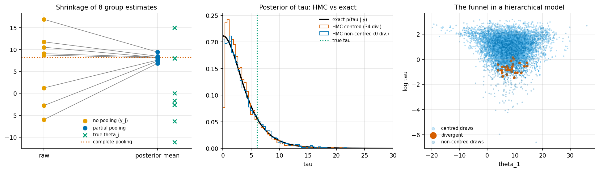
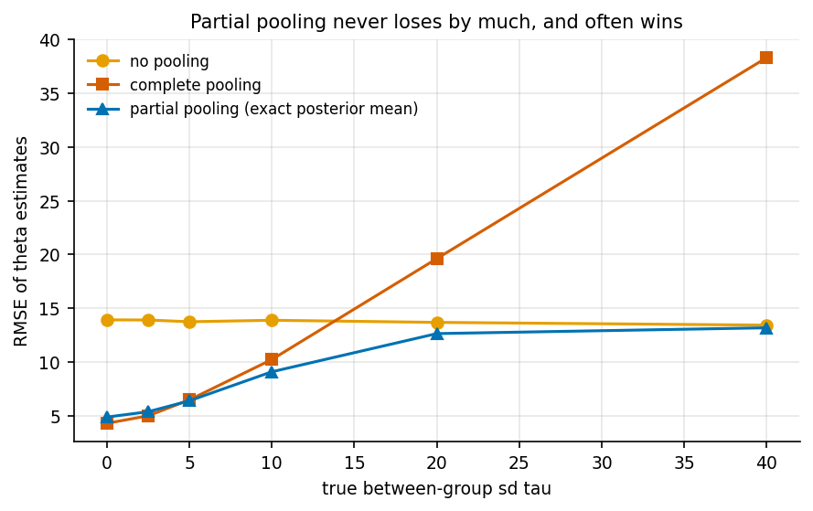

# 5. Hierarchical models and partial pooling

Code: [`examples/ch05_hierarchical_partial_pooling.py`](../examples/ch05_hierarchical_partial_pooling.py)

## The model

Each of J = 8 groups reports an estimate y_j with a known standard error s_j:

    y_j ~ N(theta_j, s_j²),   theta_j ~ N(mu, tau²),   p(mu) ∝ 1,   tau ~ half-Cauchy(0, 5)

The structure follows the "eight schools" example in BDA3 ch. 5. The data here are new and
synthetic: s_j ~ U(8, 18), true mu = 4, true tau = 6, and theta_j drawn from N(mu, tau²).
That gives a ground truth to score against.

## An exact reference, without MCMC

Given tau, both mu and theta are Gaussian and can be integrated out (BDA3 sec. 5.4):

* p(tau | y) ∝ p(tau) · V_mu(tau)^½ · Π_j N(y_j | mu_hat(tau), s_j² + tau²)
* E[theta_j | tau, y] = (1 − B_j) y_j + B_j mu_hat, where B_j = s_j² / (s_j² + tau²)

So the full posterior reduces to a 1-D quadrature over tau. The code uses 3000 log-spaced
points between 1e-3 and 300. The function `exact_posterior` returns exact means and sds of
mu, tau and every theta_j. These are the reference values for HMC.

## HMC, centred vs non-centred

Both versions sample log tau, with its Jacobian. The centred version samples theta directly.
The non-centred version samples eta ~ N(0, 1) and sets theta = mu + tau · eta. Each ran
4 chains × 2000 draws with a target acceptance of 0.9 (`results/ch05_hmc_vs_exact.csv`):

| param | exact mean | exact sd | centred: mean err | centred: sd err | centred: ESS | non-centred: mean err | non-centred: sd err | non-centred: ESS |
|---|---|---|---|---|---|---|---|---|
| mu | 8.04 | 4.59 | +0.03 | −0.26 | 141 | −0.04 | −0.02 | 929 |
| tau | 3.45 | 3.10 | −0.06 | −0.25 | 215 | +0.05 | +0.03 | 5179 |
| theta_1 | 8.11 | 5.86 | −0.23 | −0.48 | 175 | −0.13 | −0.07 | 1556 |
| theta_6 | 6.85 | 5.93 | +0.29 | −0.14 | 163 | −0.01 | −0.01 | 1465 |

The centred sampler produced 34 divergences and underestimated every posterior sd, by up to
about 8%. The non-centred sampler produced none and matches the exact sd to within 2%, with
7-24× more ESS. The bias comes from the funnel in (theta_j, log tau): the centred chain can't
go deep into small tau. That is the same geometry as Neal's funnel in chapter 3.

The left panel shows shrinkage. The posterior here favours small tau (posterior mean 3.5,
against a true value of 6), so the eight noisy estimates are pulled hard towards the pooled
mean. The middle panel compares p(tau | y) from quadrature with the two HMC runs.

## Repeated sampling: does partial pooling actually help?

For each true tau, 400 datasets with the same s_j. RMSE of the theta estimates
(`results/ch05_pooling_study.csv`):

| true tau | no pooling (y_j) | complete pooling | partial pooling (posterior mean) | 90% interval coverage |
|---|---|---|---|---|
| 0 | 13.9 | **4.3** | 4.9 | 0.97 |
| 2.5 | 13.9 | **5.0** | 5.4 | 0.95 |
| 5 | 13.8 | 6.5 | **6.4** | 0.91 |
| 10 | 13.9 | 10.2 | **9.1** | 0.82 |
| 20 | 13.7 | 19.6 | **12.7** | 0.81 |
| 40 | 13.4 | 38.3 | **13.2** | 0.89 |

Partial pooling is never far from the best of the two extremes, and it beats both when tau is
moderate. When tau is large, complete pooling is a disaster. When tau is near 0, no pooling
wastes data. The hierarchical model learns which of these situations it is in from the
spread of the y_j.

**The candid part:** the 90% intervals (posterior mean ± 1.645 sd) cover only 81-82% when the
true tau is 10-20. The half-Cauchy(0, 5) prior puts substantial mass below the true tau, and
with only 8 groups the data can't fully overrule it. The posterior is also not Gaussian, so a
normal-approximation interval is a further shortcut. Coverage under a *fixed* true parameter
is a frequentist property that a Bayesian posterior does not promise. Chapter 6 shows the
complementary case: coverage is nominal when the truth is drawn from the prior.

## Takeaways

* When you can integrate parameters out analytically, do it. It gives you an exact reference
  for the sampler.
* Non-centring is not a trick. It changes the geometry the sampler sees, and the effect shows
  up as ESS and unbiased sds.
* Partial pooling is a good default, not a free lunch. With few groups the prior on tau
  matters.
