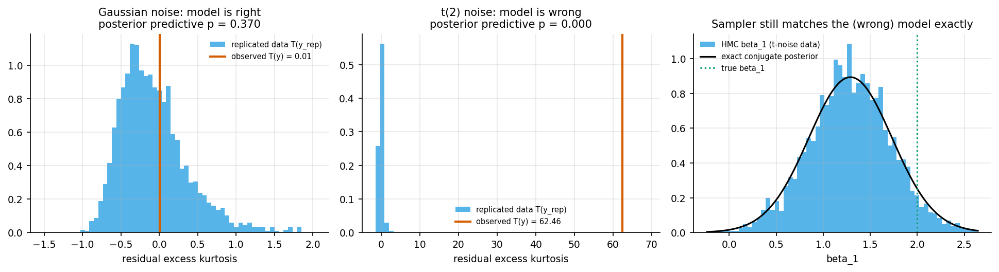
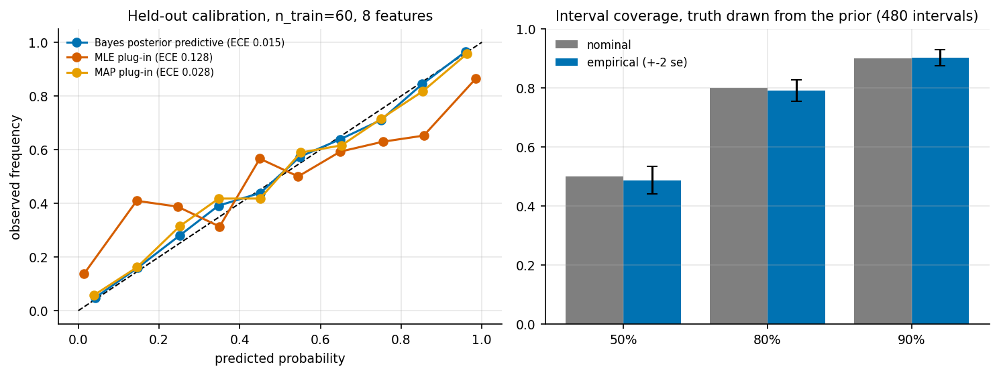

# 6. Bayesian regression with HMC: exactness, model checking, calibration

Code: [`examples/ch06_bayesian_regression.py`](../examples/ch06_bayesian_regression.py)

## 6.1 Linear regression against the exact posterior

The prior is conjugate normal-inverse-gamma: beta | sigma² ~ N(0, 100 sigma² I) and
sigma² ~ IG(2, 2). Under this prior the exact posterior is known. Marginally, beta follows a
multivariate Student-t with 2a_n dof, location m_n and scale (b_n / a_n) V_n, and sigma²
follows IG(a_n, b_n). HMC samples (beta, log sigma). The log-density adds the Jacobian
2 sigma², and the gradient is written by hand.

Synthetic data: n = 100, 3 features plus an intercept, noise sd 1.5. HMC ran 4 × 2000 draws
with no divergences (`results/ch06_linear_hmc_vs_exact.csv`):

| param | true | exact mean | HMC mean | exact sd | HMC sd | err / MCSE | bulk ESS |
|---|---|---|---|---|---|---|---|
| beta_0 | 1.0 | 1.043 | 1.043 | 0.152 | 0.154 | −0.38 | 7591 |
| beta_1 | 2.0 | 2.158 | 2.157 | 0.159 | 0.158 | −0.32 | 7569 |
| beta_2 | −1.0 | −0.931 | −0.934 | 0.189 | 0.191 | −1.58 | 8765 |
| beta_3 | 0.5 | 0.266 | 0.264 | 0.149 | 0.149 | −0.95 | 8040 |
| sigma² | 2.25 | 2.275 | 2.276 | 0.322 | 0.315 | 0.41 | 7140 |

Every error is within 1.6 MCSE of the exact answer.

## 6.2 Posterior predictive checks

A sampler can be exactly right about a wrong model. We fit the same Gaussian-noise model to
two datasets. One has Gaussian noise. The other has Student-t noise with 2 dof, scaled to a
similar spread. The test statistic T(y) is the excess kurtosis of the OLS residuals. It depends
only on the data, so it can be computed the same way on 2000 posterior predictive replicates
(`results/ch06_ppc.csv`):

| data | T(y) observed | T(y_rep) median | posterior predictive p | 90% predictive interval coverage |
|---|---|---|---|---|
| Gaussian noise (model correct) | 0.01 | −0.15 | 0.37 | 0.91 |
| t(2) noise (model wrong) | 62.5 | −0.14 | **0.000** | 0.98 |

The check catches the misfit at once. The right panel shows that on the t(2) data, the HMC
posterior for beta_1 still matches the exact conjugate posterior perfectly. Being *right
about the model* and *right about the world* are different checks. Notice too that the 90%
predictive intervals over-cover (0.98): a single huge outlier inflates sigma, so the intervals
are too wide everywhere else.

## 6.3 Logistic regression: calibration on a small sample

Synthetic data: 8 features, n_train = 60, 5000 held-out points. The true coefficients are
drawn from the N(0, 1) prior. The table compares four predictors
(`results/ch06_logistic_calibration.csv`):

| predictor | log loss | Brier | ECE (10 bins) |
|---|---|---|---|
| true coefficients (oracle) | 0.347 | 0.110 | 0.015 |
| Bayes posterior predictive (HMC) | **0.415** | **0.135** | **0.016** |
| MAP plug-in (same prior) | 0.418 | 0.136 | 0.028 |
| MLE plug-in | 0.639 | 0.163 | 0.128 |

With 60 points and 8 coefficients, the MLE is badly overconfident: its ECE is 8× the Bayesian
one and its log loss is 54% worse. Most of the gain comes from the prior, as the MAP row
shows. Averaging over the posterior instead of plugging in its mode halves the calibration
error again (0.028 → 0.016).

**Interval coverage when the truth comes from the prior.** For 60 datasets × 8 coefficients
(480 intervals), the coverage of central credible intervals was (`results/ch06_logistic_coverage.csv`):

| nominal | 50% | 80% | 90% |
|---|---|---|---|
| empirical | 0.488 | 0.792 | 0.902 |

Each is within one binomial standard error of nominal. This is a light version of
simulation-based calibration. It checks the whole pipeline (model code, gradient, sampler and
adaptation) at once. Any bug in the log-density or its gradient would show up here as
miscoverage.

## Takeaways

* Three different questions: did the sampler get the posterior right (compare with the exact
  answer, or use SBC)? Is the model adequate (PPC)? Are the predictions calibrated (held-out
  reliability)?
* A small-sample MLE is overconfident. A prior fixes most of that, and posterior averaging
  fixes more.
