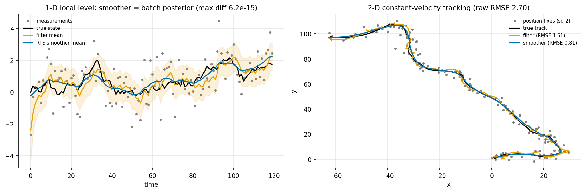
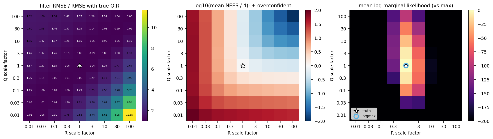

# 7. The Kalman filter as exact Bayesian inference

Code: [`examples/ch07_kalman_filter.py`](../examples/ch07_kalman_filter.py),
[`bayeslab/filters.py`](../bayeslab/filters.py)

## The model and the recursions

    x_t = F x_{t−1} + w_t,  w_t ~ N(0, Q)          y_t = H x_t + v_t,  v_t ~ N(0, R)

Everything is linear and Gaussian, so p(x_t | y_1..t) is Gaussian. Two steps keep it that way:

* **predict:** m⁻ = F m, P⁻ = F P Fᵀ + Q
* **update:** S = H P⁻ Hᵀ + R, K = P⁻ Hᵀ S⁻¹, m = m⁻ + K (y − H m⁻), P = P⁻ − K S Kᵀ

The innovations y − H m⁻ ~ N(0, S) give the exact marginal likelihood log p(y_1..T) as a
by-product. The Rauch-Tung-Striebel smoother runs backwards with gain
G = P_t Fᵀ (P⁻_{t+1})⁻¹ and returns p(x_t | y_1..T). The equations are written from Särkkä,
*Bayesian Filtering and Smoothing*, ch. 4 and 8.

## Check 1: the smoother is the batch posterior

For the 1-D local-level model, the whole trajectory x_1..T has a Gaussian prior with a
tridiagonal precision matrix. The batch posterior is then one linear solve. Against it, the
RTS smoother means differ by at most 6e-15 and the variances by 3e-16. The filtered mean at
t = T/2 equals the batch posterior that uses only y_1..T/2, to 2e-16 (`results/ch07_summary.json`).
So the filter really is exact Bayesian inference, not an approximation to it.

## Check 2: tracking, and is the filter honest?

The 2-D constant-velocity model uses discretised white-noise acceleration with q = 0.05, and
position fixes with noise variance r = 4. Results over T = 150 (`results/ch07_cv_tracking_rmse.csv`):

| estimate | position RMSE | velocity RMSE |
|---|---|---|
| raw fixes | 2.70 | n/a |
| Kalman filter | 1.61 | 0.62 |
| RTS smoother | 0.81 | 0.33 |

The **NEES** (normalised estimation error squared, eᵀP⁻¹e) checks whether the filter's
reported covariance P is honest. If it is, the NEES averages dim(x) = 4. Over 200 runs it
averaged 3.98.

## Robustness study: mis-specified Q and R

We ran the filter with Q and R each scaled by 0.01 to 100 relative to the truth, over 40
simulated tracks per cell (`results/ch07_misspecification.csv`):

| setting | filter RMSE | smoother RMSE | RMSE / true-model RMSE | mean NEES (ideal 4) |
|---|---|---|---|---|
| true Q, R | 1.71 | 0.99 | 1.00 | 3.9 |
| Q × 0.01 (model trusted too much) | 4.42 | 2.73 | 2.58 | 176 |
| Q × 100 (too little smoothing) | 2.34 | 1.49 | 1.37 | 2.3 |
| R × 0.01 (fixes trusted too much) | 2.34 | 1.50 | 1.37 | 226 |
| R × 100 (fixes ignored) | 4.57 | 2.71 | 2.67 | 1.8 |
| both × 0.1 | 1.73 | 0.99 | 1.01 | 38.9 |
| both × 10 | 1.69 | 0.98 | 0.99 | 0.39 |

What the three heatmaps show:

1. **RMSE depends mostly on the ratio Q/R.** Scaling both by the same factor leaves the gain K
   almost unchanged. Only the prior P0 breaks the tie. So the RMSE heatmap has a valley along
   the diagonal. In fact "both × 10" has a slightly *lower* RMSE than the truth, probably because
   the initial prior then carries relatively less weight (not separately verified). RMSE alone can't tell you whether the noise
   levels are right.
2. **NEES sees the scale.** Along that diagonal, "both × 0.1" is overconfident by about 10×
   (NEES 39) and "both × 10" is underconfident by about 10× (NEES 0.39). Even when the point
   estimate is fine, the uncertainty is wrong.
3. **The marginal likelihood finds the truth.** Its maximum over the 81-cell grid is exactly
   at Q × 1, R × 1. So the likelihood the filter computes for free is a sound way to tune the
   noise levels. RMSE on simulated data would pick the wrong cell (both × 10), and it needs
   the true states anyway.

## Takeaways

* For linear-Gaussian models the Kalman filter and RTS smoother are exact. They can be tested
  against a batch solve to machine precision.
* Mis-specifying Q against R hurts accuracy. Mis-specifying the overall scale leaves accuracy
  alone but makes the uncertainty dishonest. Check both, with RMSE and NEES.
* Tune noise levels by maximising the marginal likelihood (or by full Bayes over them), not by
  eye.
