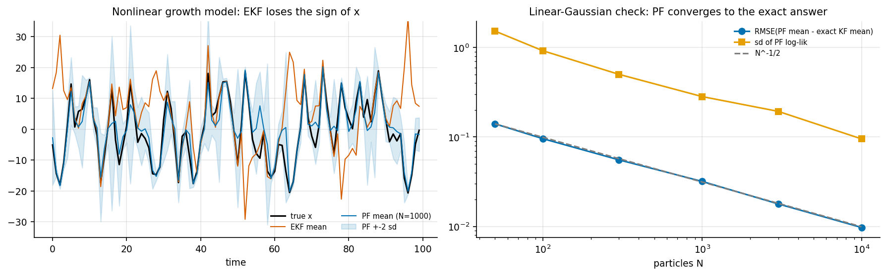
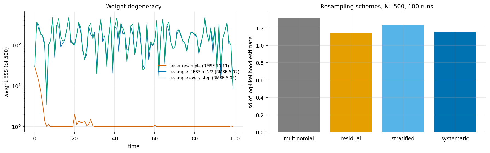

# 8. Particle filters: when the Gaussian assumption breaks

Code: [`examples/ch08_particle_filter.py`](../examples/ch08_particle_filter.py),
[`bayeslab/filters.py`](../bayeslab/filters.py) (`bootstrap_pf`, `resample`, `ekf`)

## The bootstrap filter

The bootstrap filter of Gordon, Salmond & Smith (1993) represents p(x_t | y_1..t) by N
weighted particles. Each step has three parts:

1. **propagate** every particle through the dynamics, x_t^i ~ p(x_t | x_{t−1}^i) (the
   proposal is the prior);
2. **weight** each particle by the likelihood, w_t^i ∝ w_{t−1}^i · p(y_t | x_t^i);
3. **resample** when the weight ESS = 1 / Σ w² drops below N/2.

The running product of Σ_i W_{t−1}^i p(y_t | x_t^i) is an unbiased estimate of the
likelihood p(y_1..T). Four resampling schemes are implemented: multinomial, residual,
stratified and systematic.

## Check: on a linear-Gaussian model the PF must converge to the Kalman filter

The test model is AR(1) with phi = 0.9, Q = 0.5, R = 1 and T = 100. The Kalman filter is exact
here, with log-likelihood −173.36. Each row is 40 runs (`results/ch08_pf_vs_kalman.csv`):

| N | RMSE(PF mean − KF mean) | log-lik bias | log-lik sd | ms/run |
|---|---|---|---|---|
| 50 | 0.140 | −0.94 | 1.53 | 4 |
| 300 | 0.056 | −0.09 | 0.50 | 6 |
| 1000 | 0.032 | −0.08 | 0.28 | 9 |
| 10000 | 0.0097 | −0.007 | 0.095 | 44 |

The filtering error follows N^(−1/2) closely. The *log*-likelihood is biased downward by
roughly sd²/2. That is expected: the PF's likelihood estimate is unbiased, so by Jensen's
inequality its log is biased downward. This matters for particle MCMC, where you need the
unbiased likelihood rather than an unbiased log-likelihood.

## Nonlinear benchmark: EKF vs PF

    x_t = x/2 + 25x/(1 + x²) + 8 cos(1.2 t) + v,  v ~ N(0, 10)       y_t = x²/20 + w,  w ~ N(0, 1)

This is the classic univariate growth model. y depends on x², so the sign of x is often
unidentified and the filtering distribution is bimodal. Over 50 series of length 100
(`results/ch08_ekf_vs_pf.csv`):

| filter | RMSE mean | RMSE median | RMSE sd |
|---|---|---|---|
| EKF | 19.5 | 17.9 | 6.6 |
| PF, N = 100 | 4.90 | 4.78 | 0.75 |
| PF, N = 1000 | 4.56 | 4.54 | 0.66 |
| PF, N = 10000 | 4.55 | 4.61 | 0.64 |

The EKF linearises around one mean. When the posterior has two modes of opposite sign, it
commits to one and is often wrong. Its RMSE is about 4× the PF's. The PF saturates by N = 1000. The remaining error of about
4.5 is the irreducible posterior uncertainty, not Monte Carlo error.

## Degeneracy and resampling

With N = 500 on one nonlinear series (`results/ch08_degeneracy.csv`):

| policy | RMSE | median weight ESS | resampling events |
|---|---|---|---|
| never resample | 10.1 | **1.0** | 0 |
| resample if ESS < N/2 | 5.02 | 151 | 78 |
| resample every step | 5.05 | 157 | 100 |

Without resampling, all the weight lands on a single particle within a few steps. The
"filter" then tracks one random path. Adaptive resampling costs nothing in accuracy here and
resamples 22% less often.

Resampling schemes, resampling every step, 100 runs (`results/ch08_resampling_schemes.csv`):

| scheme | log-lik sd | RMSE |
|---|---|---|
| multinomial | 1.32 | 5.00 |
| residual | 1.15 | 5.01 |
| stratified | 1.23 | 4.96 |
| systematic | 1.16 | 5.01 |

The three low-variance schemes reduce the log-likelihood sd by 7-13% relative to multinomial.
The effect is real but modest, and the differences among those three are within Monte Carlo
noise at 100 runs (the sd of an sd estimate is about 7%). The usual default, systematic, is
fine. Resampling *when* matters much more than resampling *how*.

## Takeaways

* Check a particle filter against the Kalman filter on a linear-Gaussian model first. Both
  N^(−1/2) convergence and a downward log-likelihood bias should appear.
* EKF and UKF assume a unimodal posterior. When the observation is many-to-one (here x²),
  they fail outright, not gradually.
* Resample adaptively. Pick systematic or stratified. Don't expect the scheme to rescue a bad
  proposal.
