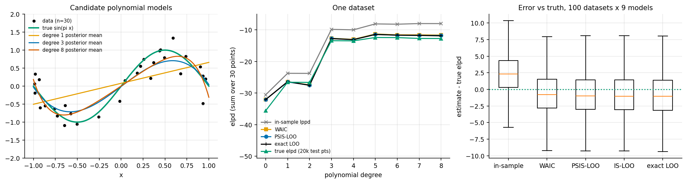
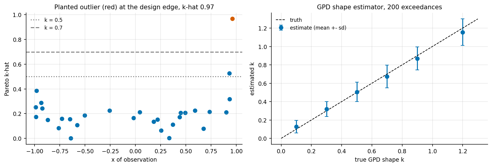

# 9. Model comparison: WAIC and PSIS-LOO against the truth

Code: [`examples/ch09_model_comparison.py`](../examples/ch09_model_comparison.py),
[`bayeslab/model_compare.py`](../bayeslab/model_compare.py)

## What we want to estimate

The expected log predictive density of a fitted model on new data:

    elpd = Σ_i E_{(x, y) ~ truth} [ log p(y | x, data) ]

The in-sample log predictive density (lppd) overestimates it, because the data were used to
fit the model. Three estimators try to correct for that:

* **WAIC** = lppd − p_waic, where p_waic = Σ_i Var_s[log p(y_i | theta_s)].
* **IS-LOO** importance-weights the posterior draws by 1 / p(y_i | theta_s) to approximate
  leaving point i out. Its weights can have infinite variance.
* **PSIS-LOO** applies the same weights after Pareto smoothing. A generalised Pareto
  distribution is fitted to the largest M = min(0.2 S, 3√S) ratios, those ratios are replaced
  by the fitted distribution's expected order statistics, and the result is truncated. The
  fitted shape **k-hat** doubles as a diagnostic: below 0.5 is fine, 0.5-0.7 is usable, and
  above 0.7 the estimate is unreliable.

The GPD fit is the Zhang & Stephens (2009) profile-likelihood estimator, shrunk towards 0.5 by
a prior worth 10 observations, as described by Vehtari et al.

## A test bed with three references

The data are x ~ U(−1, 1) and y = sin(πx) + N(0, 0.3²), with n = 30. The candidates are
polynomials of degree 0..8 with a conjugate NIG prior. Conjugacy gives three references:

1. **Exact posterior draws.** These are 4000 i.i.d. draws, so no MCMC error enters the
   comparison.
2. **Exact LOO.** The leave-one-out predictive is a closed-form Student-t, so all 30 refits
   are exact.
3. **True elpd.** This is the closed-form posterior predictive scored on 20000 fresh points
   from the true process.

## One dataset

The in-sample lppd keeps rising with the degree. All three LOO and WAIC estimators track exact
LOO closely and peak at degree 5, as does the true elpd. Full table: `results/ch09_one_dataset.csv`.

## 100 datasets × 9 models

Each estimator is scored against two targets: the true elpd, which is what we want, and exact
LOO, which is what the estimators approximate (`results/ch09_repeated_datasets.csv`):

| estimator | mean error vs true elpd | RMSE vs true elpd | RMSE vs exact LOO | regret of the model it picks | degree it picks most |
|---|---|---|---|---|---|
| in-sample lppd | **+2.78** | 4.69 | n/a | 0.284 | 8 |
| WAIC | −0.23 | 3.89 | 0.367 | 0.235 | 5 |
| PSIS-LOO | −0.39 | 3.92 | **0.190** | 0.229 | 5 |
| IS-LOO | −0.42 | 3.93 | 0.206 | 0.232 | 5 |
| exact LOO | −0.46 | 3.94 | 0 | 0.226 | 5 |

How to read it:

* PSIS-LOO approximates exact LOO about 2× more closely than WAIC (RMSE 0.19 vs 0.37), as
  reported by Vehtari et al.
* All the estimators sit about 3.9 nats from the true elpd. That spread is the sampling
  variability of a 30-point dataset, and no clever estimator removes it. The estimators differ
  far less from each other than from the truth. The LOO standard error (about 2.5 here) is the
  honest error bar.
* In-sample lppd is optimistic by 2.8 nats on average and picks the most complex model most
  often. The cross-validation-style estimators remove that optimism.

## What k-hat flags

We planted one high-leverage outlier (+2.5 at the largest x) and fitted degree 5
(`results/ch09_outlier.csv`):

| quantity | exact LOO | PSIS-LOO | IS-LOO | WAIC | k-hat |
|---|---|---|---|---|---|
| outlier point elpd_i | −12.75 | −10.54 | −10.95 | −10.49 | **0.97** |
| other 29 points (sum) | −20.73 | −20.56 | −20.47 | −20.47 | max 0.53 |

All three approximations are off by about 2 nats on the outlier. k-hat = 0.97 says so, which
is the point of the diagnostic: it does not fix the estimate, it tells you which point needs
an exact refit. On the other 29 points everything agrees to about 0.25 nats.

The GPD shape estimator itself was checked on 200 exceedances drawn from a GPD with known k
(`results/ch09_gpd_recovery.csv`). True k = 0.1, 0.5, 0.9 and 1.2 came back as 0.13, 0.51,
0.87 and 1.16. Small k is pulled up and large k pulled down slightly, which is the
weakly-informative shrinkage towards 0.5. The sd is 0.07-0.15.

## Takeaways

* Use PSIS-LOO by default and read its k-hat values. Refit exactly the points with k-hat > 0.7.
* Report elpd differences with their standard errors. The between-model differences here are
  often smaller than one SE.
* Never select models on in-sample fit.
