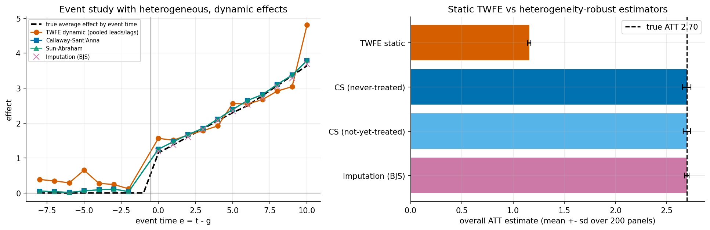
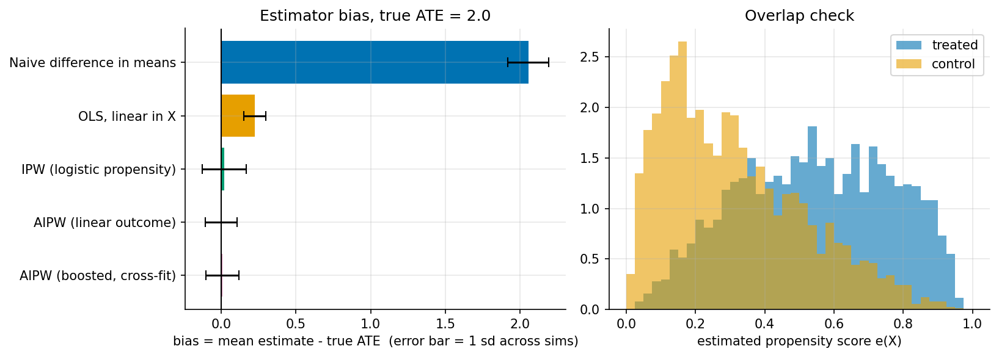
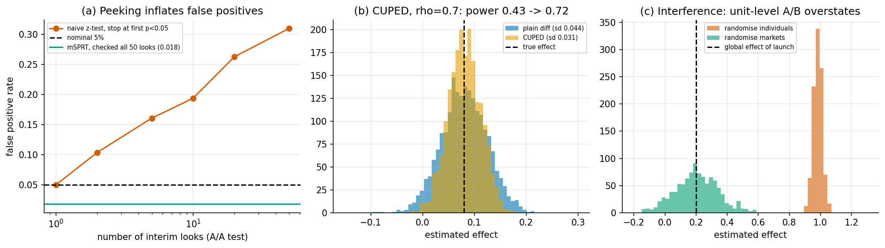
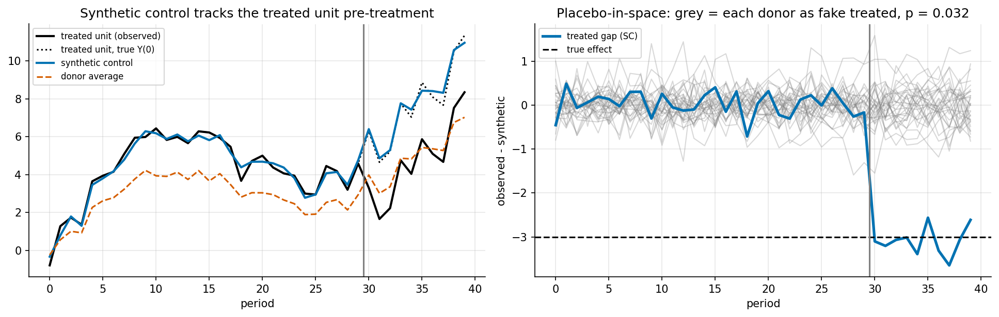
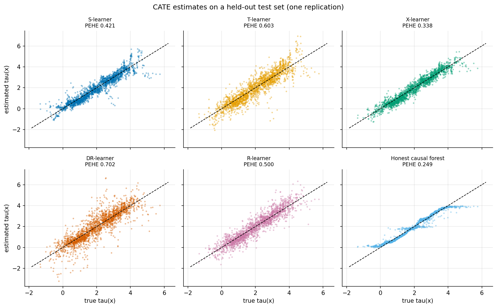
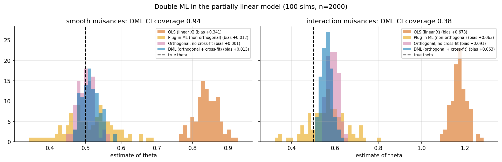
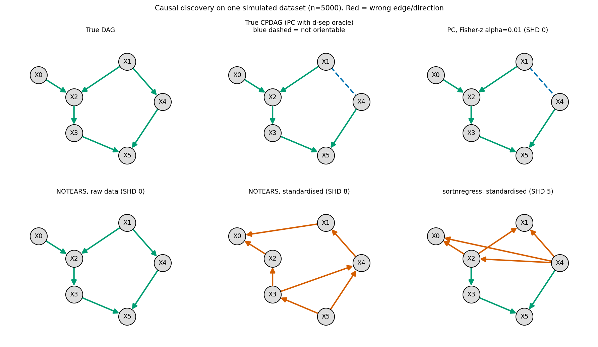
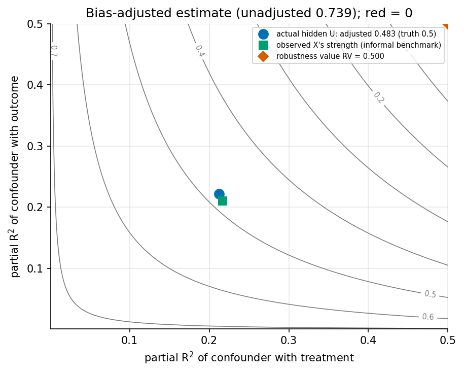

# causal-inference

**A guide to causal inference in 11 chapters, from Pearl's ladder and potential outcomes to double ML, staggered DiD, causal discovery and the 2024-2026 frontier. It comes with 12 runnable Python examples on synthetic data, so every estimator can be checked against a known true effect.**

The examples use only numpy, scipy, scikit-learn, matplotlib and networkx. AIPW, 2SLS, local-linear RD, Callaway-Sant'Anna, Sun-Abraham, imputation DiD, synthetic control, X/R/DR-learners, an honest causal forest, double ML, PC, NOTEARS, Cinelli-Hazlett sensitivity and an mSPRT are each implemented in about a page of readable code. Each script prints the truth next to every estimate, writes the numbers to `results/`, and writes the figure to `figures/`.



*Parallel trends holds exactly, yet static two-way fixed effects recovers 43% of the true effect, because effects differ across adoption cohorts and grow over time. Heterogeneity-robust estimators are unbiased ([Chapter 5](docs/05-panel-methods.md)).*

## Table of contents

| # | Chapter | What you will learn | Example |
|---|---|---|---|
| 0 | [Introduction](docs/00-intro.md) | The ladder of causation; identification vs estimation; notation | n/a |
| 1 | [Foundations: Pearl](docs/01-foundations-pearl.md) | SCMs, DAGs, d-separation, backdoor, front-door, do-calculus, bad controls | `ex02`, `ex03` |
| 2 | [Potential outcomes](docs/02-potential-outcomes.md) | Rubin model, SUTVA, ignorability, positivity, ATE/ATT/CATE/LATE | `ex01` |
| 3 | [Experiments](docs/03-experiments.md) | A/B tests, peeking, always-valid inference, CUPED, SRM, interference | `ex04` |
| 4 | [Observational methods](docs/04-observational-methods.md) | Regression, matching, propensity scores, IPW, AIPW, IV/LATE, weak IV, RDD | `ex01`, `ex05`, `ex08` |
| 5 | [Panel methods](docs/05-panel-methods.md) | DiD, Goodman-Bacon, Callaway-Sant'Anna, Sun-Abraham, imputation, event studies, synthetic control, SDID, CausalImpact | `ex06`, `ex07` |
| 6 | [Causal ML](docs/06-causal-ml.md) | Double ML, TMLE, S/T/X/DR/R-learners, causal forests and GRF, uplift | `ex09`, `ex10` |
| 7 | [Causal discovery](docs/07-causal-discovery.md) | PC, GES, LiNGAM, NOTEARS, varsortability, LLM-assisted discovery | `ex11` |
| 8 | [Sensitivity and validation](docs/08-sensitivity-and-validation.md) | Cinelli-Hazlett, E-values, Rosenbaum bounds, refutation, mediation, interference | `ex12` |
| 9 | [Frontier 2023-2026](docs/09-frontier-2024-2026.md) | Proximal CI, transportability, causal representation learning, causal foundation models, LLMs and causality | survey |
| 10 | [Tooling and cheat sheet](docs/10-tooling-and-cheatsheet.md) | Python/R/Stata package map, full cheat sheet, workflow, common mistakes | reference |
| | [Glossary](docs/glossary.md) | About 120 terms | reference |
| | [References](references.md) | All sources with links, and a beginner-to-advanced reading order | reference |

## How to read this

* **New to causal inference?** Read chapters 0 → 1 → 2 → 3 in order, then skim the cheat sheet below and pick the method chapter that matches your data.
* **Know the basics, want modern methods?** Go to 5 (staggered DiD), 6 (double ML and CATE) and 8 (sensitivity). Run the matching example and change its data-generating process.
* **ML background?** Chapter 6, then 7, then 9. Chapter 1's bad-controls section is the most common blind spot for ML people.
* **Need an answer for a real analysis now?** Use the [cheat sheet](#cheat-sheet), then follow the 7-step workflow in [Chapter 10](docs/10-tooling-and-cheatsheet.md#103-a-workflow-that-avoids-the-most-common-errors).

Every chapter ends with key takeaways and further reading. The maths is kept to the formulas you actually need to recognise.

## Cheat sheet

| Question | Method | Key assumptions | Estimand | Python tool |
|---|---|---|---|---|
| Can I randomise? | A/B test, difference in means (+ CUPED) | Randomisation, SUTVA | ATE / ITT | `statsmodels`, `scipy` |
| Monitoring an A/B test continuously | mSPRT / group-sequential | Pre-specified sequential design | ATE with anytime-valid error | custom |
| Spillovers between users | Cluster / switchback randomisation | Interference contained in clusters | Global effect | custom |
| All confounders measured | Regression, matching, IPW, **AIPW** | Ignorability, positivity | ATE, ATT | `DoWhy`, `EconML`, `DoubleML` |
| Many covariates, non-linear confounding | **Double ML**, TMLE | Ignorability; nuisances learnable | ATE / $\theta$ | `DoubleML`, `EconML` |
| Who benefits? Whom to target? | X/R/DR-learners, **causal forest**, uplift | Ignorability, overlap | CATE $\tau(x)$ | `EconML`, `CausalML` |
| Hidden confounder, valid instrument | IV / 2SLS | Relevance, exclusion, independence, monotonicity | **LATE** | `linearmodels`, `DoubleML` |
| Treatment assigned by a cutoff | Regression discontinuity | Continuity, no manipulation | Effect at the cutoff | `rdrobust` |
| Before/after with a control group | DiD | Parallel trends, no anticipation | ATT | `linearmodels`, `pyfixest` |
| Staggered rollout | **Callaway-Sant'Anna / Sun-Abraham / imputation** | Parallel trends per cohort | ATT(g,t) | `differences`, `csdid`, `pyfixest` |
| One treated region or market | **Synthetic control**, SDID, CausalImpact | Donors reproduce the pre-period; no spillover | ATT for that unit | `pysyncon`, `tfcausalimpact` |
| Hidden confounder, full mediator | Front-door | Front-door criterion | ATE | `DoWhy` |
| How robust is my estimate? | Cinelli-Hazlett, E-value, Rosenbaum, HonestDiD | Interpretable bound on confounding | Breakdown point | `sensemakr` |
| What is the causal graph? | PC/FCI, GES, LiNGAM, NOTEARS | Faithfulness (+ model assumptions) | CPDAG / DAG | `causal-learn`, `gCastle` |

The longer version, with a column pointing to the example in this repo, is in [Chapter 10](docs/10-tooling-and-cheatsheet.md#102-the-cheat-sheet).

## Results

All numbers below come from running `python3 examples/run_all.py` on an Apple-silicon Mac. Raw values are in `results/*.json`. Every dataset is synthetic with a known truth.

### 1. Confounding: four ways to adjust ([ex01](examples/ex01_confounding.py), 200 sims, n = 2000, true ATE = 2.0)



| Estimator | Mean | Bias | SD | RMSE |
|---|---|---|---|---|
| Naive difference | 4.055 | +2.055 | 0.137 | 2.060 |
| OLS, linear controls | 2.225 | +0.225 | 0.073 | 0.237 |
| IPW (logistic) | 2.021 | +0.021 | 0.147 | 0.148 |
| AIPW, *wrong* outcome model | 2.000 | +0.000 | 0.107 | **0.107** |
| AIPW, boosted, cross-fit | 2.008 | +0.008 | 0.110 | 0.110 |

Double robustness at work: AIPW stays unbiased when the outcome model is misspecified, because the propensity model is right. OLS is precise and wrong.

### 2. Bad controls ([ex02](examples/ex02_bad_controls.py), 500 sims)

| Adjusting for… | Truth | Without | With |
|---|---|---|---|
| a collider | 1.00 | 1.00 | **0.00** |
| a pre-treatment M-bias variable | 1.00 | 1.00 | **0.80** |
| a mediator | 1.30 (total) | 1.30 | 0.50 (direct only) |
| a real confounder | 1.00 | 1.50 | 1.00 |

### 3. A/B testing ([ex04](examples/ex04_ab_testing.py))



| Finding | Number |
|---|---|
| False-positive rate, stop at first p < .05 over 50 looks (A/A test) | **0.310** (nominal 0.05) |
| Same, with an always-valid mSPRT | 0.018 |
| CUPED variance ratio at $\rho = 0.7$ (theory 0.51) | 0.50; power 0.43 → **0.72** |
| Marketplace interference: individual vs market randomisation (true global effect 0.20) | 0.98 vs **0.20** |

### 4. IV, RD, panel and synthetic control

| Example | Result |
|---|---|
| Weak IV ([ex08](examples/ex08_iv.py)), strong endogeneity | F = 1.3: 2SLS median 2.23 (truth 1.0, OLS 2.83), CI coverage **72%**; F = 292: median 1.00, coverage 94% |
| LATE ([ex08](examples/ex08_iv.py)) | Wald = 1.995 = complier effect 2.0, not the ATE of 2.3 |
| RDD ([ex05](examples/ex05_rdd.py)), true jump 0.4 | Local linear (300 MC draws): 0.406, coverage 0.97; global linear: 0.640 |
| Staggered DiD ([ex06](examples/ex06_did_staggered.py)), true ATT 2.695 | TWFE **1.157**; Callaway-Sant'Anna 2.694; imputation 2.695 |
| Synthetic control ([ex07](examples/ex07_synthetic_control.py)), true effect −3.0 | DiD −1.94 (RMSE 1.21); SC **−2.96** (RMSE 0.16); placebo p = 0.032 |
| Front-door ([ex03](examples/ex03_dags_frontdoor.py)), confounder never observed | Naive 0.521; front-door **0.281**; truth 0.280 |



### 5. Causal ML ([ex09](examples/ex09_hte_metalearners.py), [ex10](examples/ex10_dml.py))



| CATE learner (5 reps) | PEHE ↓ |
|---|---|
| Honest causal forest (from scratch) | **0.275** |
| X-learner | 0.341 |
| S-learner | 0.416 |
| R-learner | 0.504 |
| T-learner | 0.600 |
| DR-learner | 0.649 |

| Double ML, $\theta = 0.5$, n = 2000, 100 sims | Smooth nuisances | Hard (interaction) nuisances |
|---|---|---|
| OLS, linear controls: bias | +0.341 | +0.673 |
| DML (orthogonal + cross-fit): bias | **+0.013** | +0.063 |
| DML 95% CI coverage | **0.94** | **0.38** |

DML delivers when the nuisances are learnable and visibly fails its rate condition when they are not. Report nuisance quality.



### 6. Causal discovery ([ex11](examples/ex11_causal_discovery.py), 6 nodes, 10 weight draws)



| Method | Mean SHD, raw data | Mean SHD, standardised data |
|---|---|---|
| PC (vs true CPDAG) | 1.10 | 1.10 |
| NOTEARS | **0.00** | **6.30** |
| sortnregress (no causal logic at all) | 0.60 | 6.40 |

NOTEARS's perfect score on raw data comes from variance sorting (varsortability 0.97), as Reisach et al. (2021) showed. Standardising removes it. PC is scale-invariant.

### 7. Sensitivity ([ex12](examples/ex12_sensitivity.py))



| Finding | Number |
|---|---|
| Estimate omitting the confounder / truth | 0.739 / 0.500 |
| Cinelli-Hazlett adjusted estimate at the confounder's real strength | 0.483, matching the oracle regression (0.483) |
| Robustness value (strength needed to reach zero) | 0.50 vs actual ≈ 0.22 |
| E-value for RR = 2 | 3.41 |
| Rosenbaum Γ* for a matched study with p = 1.5e-6 | **1.36** |

## Caveats

* **Synthetic data only.** Each simulation is built to demonstrate one mechanism. A method that wins here can lose on your data. These are demonstrations, not benchmarks.
* **From-scratch implementations are simplified.** The honest causal forest has no GRF gradient splits or variance estimates. The SDID omits the paper's exact regularisation details and, with the paper-scale penalty, kept part of DiD's bias in our SC-friendly design (bias +0.42). The RD bandwidth comes from a simple CV rather than `rdrobust`'s MSE-optimal selector. PC implements Meek rules R1-R3 only. Use the reference packages for real work.
* **Some results surprised us and are reported as found.** The orthogonal, non-cross-fitted estimator was *not* biased in the smooth DML design. DR- and R-learners were *worse* than the X-learner with default boosting. Simplified SDID was worse than SC. Explanations offered in the docs for these are hypotheses unless stated otherwise.
* **Small simulation counts.** 100-500 replications. Bias estimates below about 0.01-0.02 are within Monte Carlo noise.
* **Chapter 9 is a literature map.** Many cited works are 2025-2026 preprints, summarised from their abstracts and not reproduced here.
* **Package descriptions** in Chapter 10 reflect documentation at the time of writing. APIs change, so check before use.

## Run it

```bash
pip install -r requirements.txt
python3 examples/run_all.py                 # all 12 examples, ~3 min on an Apple-silicon laptop (measured: 173 s)
python3 examples/run_all.py ex06_did_staggered ex11_causal_discovery   # just some
cd examples && python3 ex05_rdd.py          # or one at a time
```

Each script writes `figures/<name>.png` and `results/<name>.json`. `examples/common.py` pins BLAS/OpenMP to one thread, because small models on small data run far faster that way (boosting was about 100× slower with thread oversubscription on a 14-core machine). It also silences a known spurious numpy 2.0 + Apple Accelerate "divide by zero in matmul" warning. `ex10_dml.py` parallelises simulations over 10 processes with joblib. `run_all.py` runs each example in its own process: in a single interpreter, ex11 ran about 70× slower after ex10's process pool had been created. All seeds are fixed, and two consecutive full runs produced byte-identical `results/*.json`.

Repository layout:

```
docs/        11 chapters + glossary (markdown, GitHub-rendered LaTeX)
examples/    ex01 ... ex12 + common.py + run_all.py
figures/     PNGs generated by the examples
results/     JSON numbers behind every table
references.md
```

## FAQ

**Why synthetic data instead of a real dataset?**
Because on real data the true effect is unknown, so you cannot tell whether an estimator is biased. Synthetic data with a known truth turns "which estimator is right?" into a measurement. The cost is realism, which the caveats above address.

**Why implement everything from scratch?**
To make the mechanics visible. Each estimator is about one screen of code, and the mapping to the maintained library is in [Chapter 10, §10.7](docs/10-tooling-and-cheatsheet.md#107-mapping-this-repos-code-to-library-calls). For real analyses, use the libraries.

**I only have observational data and no natural experiment. Is causal inference hopeless?**
No, but it rests on selection on observables. Draw a DAG, adjust with a doubly robust method, and report a sensitivity analysis that says how strong an unmeasured confounder would need to be ([Chapters 1, 4, 8](docs/01-foundations-pearl.md)).

**Is machine learning a substitute for identification?**
No. DML, causal forests and causal foundation models improve *estimation* once the effect is identified. None of them can fix a missing confounder ([Chapter 6](docs/06-causal-ml.md), [Chapter 9](docs/09-frontier-2024-2026.md)).

**Pearl or Rubin?**
Both. Graphs are best for deciding *what* to adjust for. Potential outcomes are best for defining *which* effect you want and for the statistics of estimating it ([Chapter 2, §2.6](docs/02-potential-outcomes.md)).

## Roadmap

* Add a semi-synthetic benchmark (IHDP or the ACIC data challenges) next to the purely synthetic ones.
* Cross-check the from-scratch estimators against `DoubleML`, `EconML`, `grf` and `did` on the same data.
* Add worked examples for proximal inference, transportability and mediation with sensitivity.
* Add Anderson-Rubin intervals to the weak-IV example and Rambachan-Roth bounds to the event study.

## References

All sources, with links and a beginner → advanced reading order, are in **[references.md](references.md)**. The core texts: Pearl, *Causality* and *The Book of Why*; Hernán & Robins, [*What If*](https://miguelhernan.org/whatifbook) (free); Imbens & Rubin (2015); Cunningham, [*The Mixtape*](https://mixtape.scunning.com/) (free); Huntington-Klein, [*The Effect*](https://theeffectbook.net/introduction.html) (free); Facure, [*Brave and True*](https://matheusfacure.github.io/python-causality-handbook/) (free); Angrist & Pischke, *Mostly Harmless Econometrics*.

## License

MIT © 2026 Abyn Scaria. See [LICENSE](LICENSE).
