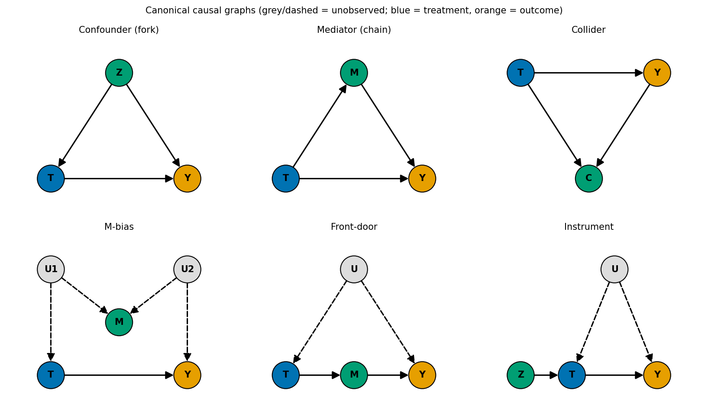
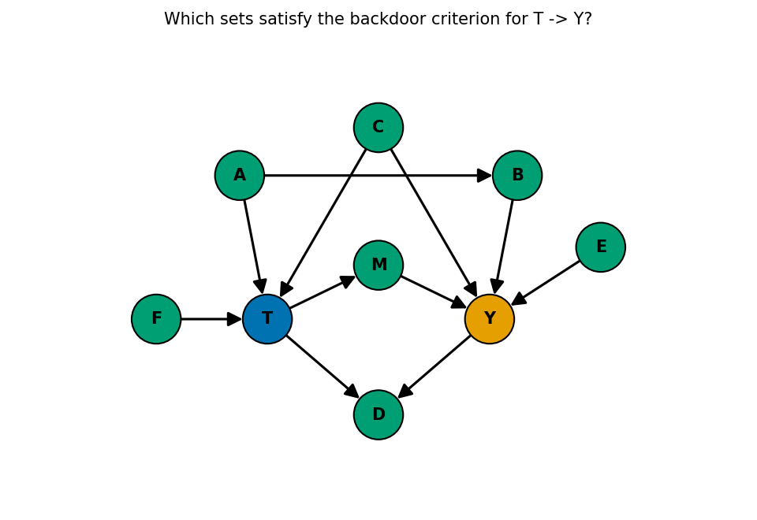
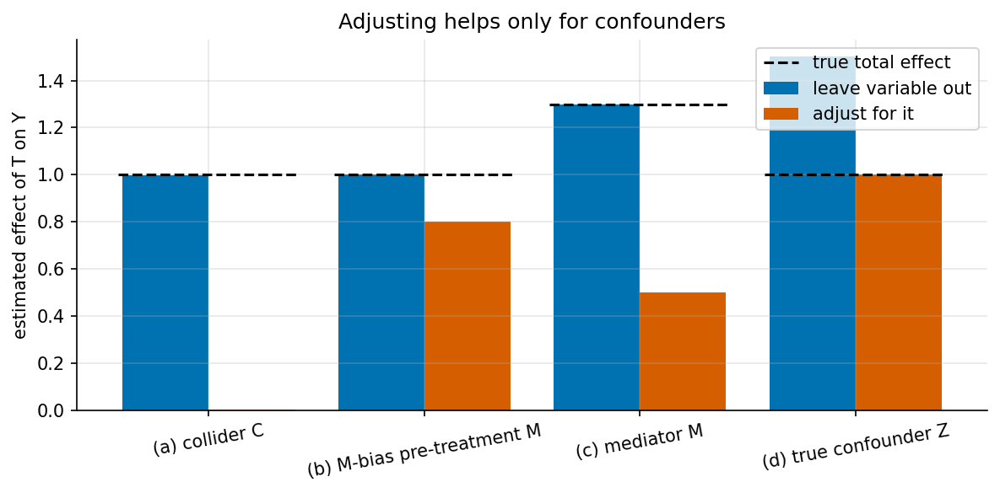
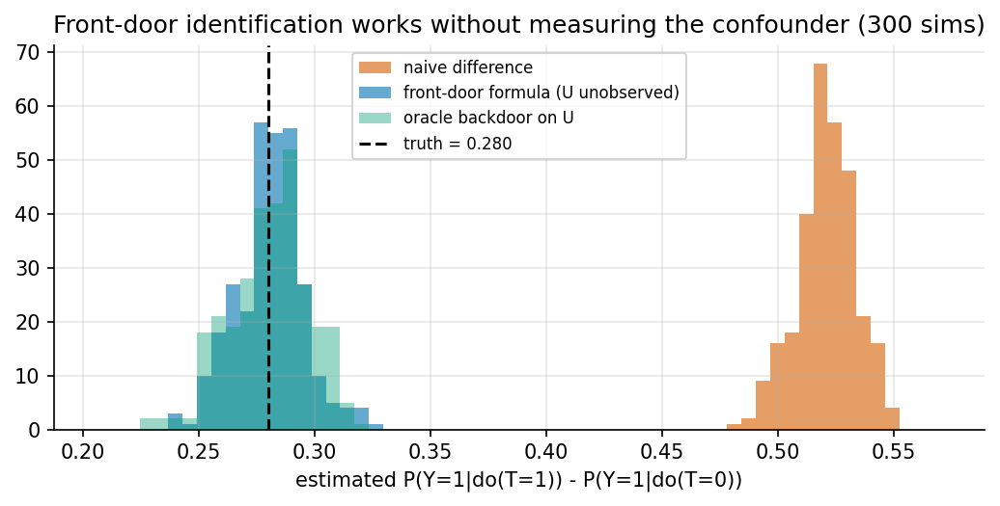

# 1. Foundations: Pearl's graphical view

> Previous: [0. Introduction](00-intro.md) · Next: [2. Potential outcomes](02-potential-outcomes.md)

## 1.1 Structural causal models

A **structural causal model (SCM)** describes how each variable is produced. It has three parts:

1. a set of **exogenous** (background) variables $U$, with a probability distribution $P(U)$;
2. a set of **endogenous** variables $V$;
3. one **structural assignment** per endogenous variable, $V_j := f_j(\mathrm{pa}_j, U_j)$, where $\mathrm{pa}_j$ are its direct causes (parents).

The assignments use $:=$ rather than $=$ because they are one-directional. $Y := 2T + U_Y$ says that $T$ causes $Y$. It does not let you rearrange for $T$. That asymmetry is the whole point.

A tiny example:

```
X := U_X                         # e.g. customer age
T := 1[0.8 X + U_T > 0]          # older customers more likely to get the offer
Y := 2 T + 1.5 X + U_Y           # offer raises spend by 2; age also raises spend
```

An SCM gives you all three rungs of the ladder:

* **Rung 1 (seeing).** Sample $U$, run the assignments, look at the joint distribution of $(X, T, Y)$.
* **Rung 2 (doing).** To compute $P(Y \mid do(T=1))$, replace the assignment for $T$ with $T := 1$, leave everything else alone, and resample. This "graph surgery" is the formal meaning of an intervention.
* **Rung 3 (imagining).** To ask what *this* customer would have spent without the offer, first infer their particular $U$ values from what you observed (abduction), then intervene, then recompute (prediction). Pearl calls this the three-step counterfactual procedure.

In the example, $E[Y \mid T=1] - E[Y \mid T=0]$ is larger than 2, because treated customers are older and age raises spend. $E[Y \mid do(T=1)] - E[Y \mid do(T=0)]$ is exactly 2. The gap is **confounding bias**. [Example 1](../examples/ex01_confounding.py) puts a number on it: a naive difference of 4.06 against a true effect of 2.0.

## 1.2 Causal DAGs

Draw each variable as a node and each direct cause as an arrow, and you get a **causal directed acyclic graph (DAG)**. An arrow $A \to B$ claims that $A$ might directly affect $B$. A missing arrow is the stronger claim: it says there is *no* direct effect. Most of a DAG's content lies in its missing arrows.



*Figure: the six patterns that come up again and again, drawn by `ex03_dags_frontdoor.py`. Grey dashed nodes are unobserved.*

Three-node building blocks determine how information flows along a path:

| Pattern | Shape | Path open by default? | Conditioning on the middle node |
|---|---|---|---|
| Chain (mediator) | $A \to M \to B$ | Open | Blocks it |
| Fork (confounder) | $A \leftarrow C \to B$ | Open | Blocks it |
| Collider | $A \to K \leftarrow B$ | **Blocked** | **Opens it** (and so does conditioning on any descendant of $K$) |

The collider row is the one people get wrong. Two independent causes of a common effect become dependent once you select on the effect. A standard example is "talent" and "looks" among film stars. They may be independent in the population, but if fame needs at least one of them, they become negatively correlated among the famous.

## 1.3 d-separation

A path between $A$ and $B$ is **blocked** by a set $Z$ if it contains either

* a chain or fork whose middle node is in $Z$, or
* a collider whose middle node is *not* in $Z$ and has *no descendant* in $Z$.

$A$ and $B$ are **d-separated** by $Z$ if every path between them is blocked. The central theorem says that if the data come from an SCM with that DAG, then d-separation implies conditional independence: $A \perp B \mid Z$. The converse, that every independence in the data comes from the graph, is the *faithfulness* assumption. It matters mostly for causal discovery ([Chapter 7](07-causal-discovery.md)).

d-separation is mechanical, so let software do it. `networkx` ships an implementation (`is_d_separator` in recent versions, `d_separated` in older ones), and `ex03_dags_frontdoor.py` uses it to check adjustment sets automatically.

## 1.4 The backdoor criterion

To estimate the effect of $T$ on $Y$, you want to block every non-causal path between them without disturbing the causal ones. A set $Z$ satisfies the **backdoor criterion** relative to $(T, Y)$ if:

1. no variable in $Z$ is a descendant of $T$, and
2. $Z$ blocks every path between $T$ and $Y$ that starts with an arrow *into* $T$ (a "backdoor path").

If $Z$ satisfies it, then

$$P(y \mid do(t)) = \sum_z P(y \mid t, z)\, P(z),$$

the **adjustment formula**. In potential-outcome language this is the same as saying $Z$ makes treatment ignorable ([Chapter 2](02-potential-outcomes.md)).

### Worked check



The busy graph above has a direct confounder $C$, a two-step backdoor $T \leftarrow A \to B \to Y$, a mediator $M$, a collider $D$, an outcome-only cause $E$, and a treatment-only cause $F$. Running every subset through the criterion (`ex03`, part B):

| Adjustment set | Valid? | Why |
|---|---|---|
| $\{\}$ | No | Both backdoor paths are open |
| $\{C\}$ | No | $T \leftarrow A \to B \to Y$ is still open |
| $\{A, C\}$ | **Yes** | Minimal |
| $\{B, C\}$ | **Yes** | Also minimal. You can block a path anywhere along it |
| $\{A, C, E\}$ | Yes | $E$ only affects $Y$. Including it is harmless and usually reduces variance |
| $\{A, C, M\}$ | No | $M$ is a descendant of $T$ (a mediator) |
| $\{A, C, D\}$ | No | $D$ is a descendant of $T$, and a collider |

Of the 128 subsets, 12 are valid and two are minimal. Two practical lessons follow. There is often more than one valid set, so you can choose one that is cheaper to measure or more precisely measured. And "control for everything" is not a valid strategy.

## 1.5 Bad controls, with numbers

`ex02_bad_controls.py` simulates four linear models and compares leaving a variable out with adjusting for it (500 simulations, n = 1000 each):



| Scenario | True total effect | Leave it out | Adjust for it | Verdict |
|---|---|---|---|---|
| (a) Collider $T \to C \leftarrow Y$ | 1.00 | 1.00 | **0.00** | Adjusting wipes out the effect |
| (b) M-bias: pre-treatment $M$ with $U_1 \to M \leftarrow U_2$ | 1.00 | 1.00 | **0.80** | Adjusting *creates* a 20% bias |
| (c) Mediator $T \to M \to Y$ | 1.30 | 1.30 | 0.50 | You get the direct effect only |
| (d) True confounder | 1.00 | **1.50** | 1.00 | Adjusting is required |

Case (b) is the subtle one. $M$ is measured *before* treatment, it correlates with both $T$ and $Y$, and it looks exactly like something you should control for. The DAG shows it is a collider of two hidden causes. In practice, strong M-bias is thought to be less common than ordinary confounding, so the usual advice is still to adjust for pre-treatment variables. Case (b) is why that advice needs a DAG behind it rather than a blanket rule.

Case (a) gives exactly zero for an algebraic reason. With $Y = T + e$ and $C = T + Y + u = 2T + e + u$, we have $E[Y \mid T, C] = T + \tfrac12(C - 2T) = \tfrac12 C$, so the coefficient on $T$ vanishes.

## 1.6 The front-door criterion

Sometimes the confounder of $T$ and $Y$ is unobserved, so no backdoor set exists. Pearl showed that the effect can still be identified if there is a mediator $M$ such that:

1. $M$ intercepts every directed path from $T$ to $Y$;
2. there is no unblocked backdoor path from $T$ to $M$;
3. every backdoor path from $M$ to $Y$ is blocked by $T$.

Then

$$P(y \mid do(t)) = \sum_m P(m \mid t) \sum_{t'} P(y \mid m, t')\, P(t').$$

Read it as two backdoor adjustments chained together. The effect of $T$ on $M$ is unconfounded. The effect of $M$ on $Y$ is confounded only through $T$, so adjusting for $T$ fixes it.

`ex03` part C simulates binary $U \to T$, $U \to Y$, $T \to M \to Y$ and never lets the estimator see $U$ (300 simulations, n = 5000):



| Estimator | Mean estimate | SD |
|---|---|---|
| True effect $P(Y{=}1 \mid do(1)) - P(Y{=}1 \mid do(0))$ | 0.280 | n/a |
| Naive difference | 0.521 | 0.012 |
| Front-door formula ($U$ unobserved) | **0.281** | 0.015 |
| Oracle backdoor on $U$ (only possible in simulation) | 0.281 | 0.017 |

Clean front-door structures are rare in real data, because a mediator that captures *all* of the effect and is itself unconfounded is a strong assumption. The idea matters more as a proof that "unobserved confounding" does not automatically mean "unidentifiable". Recent work extends it to debiased estimators of heterogeneous front-door effects ([Debiased front-door learners, 2025](https://arxiv.org/html/2509.22531v1)).

## 1.7 do-calculus

Backdoor and front-door are special cases. **do-calculus** is a set of three rewriting rules that turn expressions with $do(\cdot)$ into expressions without it, using d-separation checks in modified graphs:

1. **Insert/delete observations.** $P(y \mid do(x), z, w) = P(y \mid do(x), w)$ if $Y \perp Z \mid X, W$ in the graph with arrows *into* $X$ removed.
2. **Swap action and observation.** $P(y \mid do(x), do(z), w) = P(y \mid do(x), z, w)$ if $Y \perp Z \mid X, W$ in the graph with arrows into $X$ removed and arrows *out of* $Z$ removed.
3. **Insert/delete actions.** $P(y \mid do(x), do(z), w) = P(y \mid do(x), w)$ if $Y \perp Z \mid X, W$ in the graph with arrows into $X$ removed and arrows into $Z(W)$ removed, where $Z(W)$ is the set of $Z$-nodes that are not ancestors of any $W$-node in that graph.

The important result is **completeness**. Shpitser and Pearl, and independently Huang and Valtorta, showed that if a causal effect can be identified from observational data and a DAG with latent variables at all, these three rules are enough to find the formula, and the ID algorithm finds it automatically ([Shpitser & Pearl, 2006](https://arxiv.org/abs/1206.6876)). You almost never apply the rules by hand. Libraries such as DoWhy and the R package `causaleffect` run the algorithm for you. The conceptual takeaway is that given a DAG, "is this identifiable?" is a solved, decidable question.

## 1.8 Counterfactuals and their limits

Rung-three quantities, such as the probability that the treatment was *necessary* for this patient's recovery, generally need more than a DAG. They depend on the functional forms in the SCM and on how the exogenous noise terms are coupled, which observational or experimental data alone usually cannot pin down. You can often only bound them. Identification algorithms for counterfactual queries exist (ID* and IDC*, implemented in the R package `cfid`; see [Tikka, 2023](https://journal.r-project.org/articles/RJ-2023-053/RJ-2023-053.pdf)). They return "not identifiable" far more often than their interventional counterparts.

## 1.9 Where DAGs come from

DAGs encode domain knowledge, and that knowledge can be wrong. Three habits help:

* **Draw the graph before looking at outcome data.** Then list what it implies, such as "$A \perp D \mid C$", and test those implications. DoWhy and `dagitty` both automate this.
* **Draw latent variables explicitly** rather than leaving them out. A missing arrow is a strong claim, so make it on purpose.
* **Treat discovery algorithms as hypothesis generators**, not oracles ([Chapter 7](07-causal-discovery.md)).

## 1.10 Key takeaways

* An SCM is a set of one-way assignments. An intervention replaces one of them.
* Conditioning is not intervening. Confounding is the gap between the two.
* d-separation tells you which independences a graph implies. The collider rule is the counter-intuitive one.
* The backdoor criterion tells you what to adjust for. Mediators, colliders and descendants of treatment are bad controls.
* Front-door and do-calculus show that identification can survive unobserved confounding, given the right structure.

**Further reading:** Pearl, *Causality* (2nd ed., 2009), chapters 3-4. Pearl, Glymour & Jewell, *Causal Inference in Statistics: A Primer* (2016). Hernán & Robins, *What If*, chapters 6-8 ([free](https://miguelhernan.org/whatifbook)).

## Appendix A: code walkthrough

### Checking the backdoor criterion mechanically

The function in `examples/ex03_dags_frontdoor.py` is a direct translation of the definition: reject sets containing descendants of $T$, then delete $T$'s outgoing edges (so only backdoor paths remain) and ask whether $Z$ d-separates $T$ from $Y$.

```python
def satisfies_backdoor(G, t, y, Z):
    Z = set(Z)
    if Z & nx.descendants(G, t):          # (i) no descendants of the treatment
        return False
    G_back = G.copy()
    G_back.remove_edges_from(list(G.out_edges(t)))   # keep only paths *into* t
    return d_separated(G_back, {t}, {y}, Z)          # (ii) Z blocks them all
```

Looping this over all $2^7 = 128$ subsets of the seven non-treatment, non-outcome nodes gives the 12 valid sets reported in §1.4. The same approach works for any graph small enough to enumerate. For larger graphs, `dagitty` and DoWhy compute minimal adjustment sets directly.

### The front-door formula on discrete data

```python
def frontdoor_estimate(T, M, Y):
    p_t = {t: np.mean(T == t) for t in (0, 1)}
    p_m_given_t = {(m, t): np.mean(M[T == t] == m) for m in (0, 1) for t in (0, 1)}
    p_y_given_mt = {(m, t): Y[(M == m) & (T == t)].mean() for m in (0, 1) for t in (0, 1)}

    def p_y_do(t):   # sum_m P(m|t) * sum_t' P(y|m,t') P(t')
        return sum(p_m_given_t[(m, t)] *
                   sum(p_y_given_mt[(m, tp)] * p_t[tp] for tp in (0, 1)) for m in (0, 1))
    return p_y_do(1) - p_y_do(0)
```

The inner sum is a backdoor adjustment of the $M \to Y$ effect for $T$. The outer sum weights it by how $T$ shifts $M$.

## Appendix B: a d-separation drill

For the busy graph in §1.4 (edges $A{\to}T$, $A{\to}B$, $B{\to}Y$, $C{\to}T$, $C{\to}Y$, $T{\to}M$, $M{\to}Y$, $T{\to}D$, $Y{\to}D$, $E{\to}Y$, $F{\to}T$), decide each statement, then check your answer with `d_separated` from `examples/common.py`:

| Statement | Answer |
|---|---|
| $A \perp C$ | True. Their only connecting paths pass through colliders ($T$ or $Y$) |
| $A \perp C \mid T$ | False. Conditioning on the collider $T$ opens $A \to T \leftarrow C$ |
| $F \perp Y \mid C, A$ | False. The causal chain $F \to T \to M \to Y$ is open |
| $F \perp Y \mid T, C, A$ | True. $T$ blocks the chains $F \to T \to M$ and $F \to T \to Y$. Conditioning on $T$ opens the colliders $F \to T \leftarrow C$ and $F \to T \leftarrow A$, but $C$ and $A$ are themselves conditioned on, which blocks those paths again |
| $E \perp T$ | True. $E$'s only paths to $T$ go through the colliders $Y$ (e.g. $E \to Y \leftarrow C$) or $D$ |
| $E \perp T \mid D$ | False. $D$ is a descendant of the collider $Y$, so conditioning on it opens $E \to Y \leftarrow \ldots T$ |

## Appendix C: exercises

1. In `ex02_bad_controls.py`, change the collider to depend only on $Y$ ($C := Y + u$). Does adjusting still bias the estimate? Why? (Conditioning on a descendant of the *outcome* is still a problem: think about selecting on $Y$.)
2. Add a direct edge $T \to Y$ to the front-door simulation in `ex03`. Which front-door condition fails, and what does the formula estimate now?
3. Write the SCM of a product launch you know, list two variables that would be bad controls, and say which pattern (mediator, collider, M-bias) each is.
4. Use rule 2 of do-calculus to show that in the graph $Z \to T \to Y$ (no other edges), $P(y \mid do(t)) = P(y \mid t)$.
