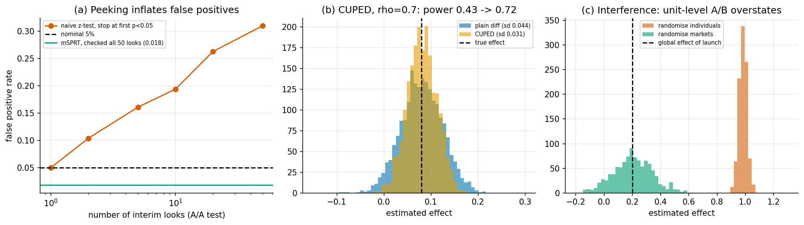

# 3. Randomised experiments and A/B testing

> Previous: [2. Potential outcomes](02-potential-outcomes.md) · Next: [4. Observational methods](04-observational-methods.md)

## 3.1 Why randomisation works

If treatment is assigned by a coin flip, then $T \perp \{Y(0), Y(1)\}$ by construction. No covariate can predict treatment, so the selection-bias term from [Chapter 2](02-potential-outcomes.md) is zero, and the difference in means is unbiased for the ATE:

$$\hat\tau = \bar Y_{T=1} - \bar Y_{T=0}, \qquad E[\hat\tau] = \text{ATE}.$$

Randomisation balances *unobserved* variables too, which no observational method can promise. That is why experiments sit at the top of most evidence hierarchies. It is also why, once you run one, most of the remaining risk comes from **analysis** mistakes rather than design.

## 3.2 Design basics

* **Unit of randomisation.** This is the level at which you flip the coin: user, session, device, store, market, time slot. It must match the unit at which interference stops (see 3.6), and your standard errors must be computed at that level.
* **Power and minimum detectable effect.** For a two-arm test with equal allocation, total sample $n$, outcome variance $\sigma^2$, and 80% power at $\alpha = 0.05$ (two-sided), the minimum detectable effect is about $\text{MDE} \approx 2.8 \cdot 2\sigma / \sqrt{n}$. Halving the MDE needs four times the sample. Halving the variance is worth the same as doubling the sample, which is why variance reduction (3.4) matters.
* **Stratified and blocked designs.** Randomise within strata, for example country by platform, so the arms are balanced on important predictors. This cuts variance for free.
* **Pre-registration.** Fix the primary metric, the analysis and the stopping rule before you start. Most of the pitfalls below come from making these decisions after seeing data.

## 3.3 Pitfall 1: peeking

Fixed-horizon tests guarantee a 5% false-positive rate *only if you look once*, at the planned sample size. If you check a dashboard every day and stop the first time $p < 0.05$, you are running many tests and keeping the most favourable one. Johari, Koomen, Pekelis and Walsh showed how badly this breaks inference under continuous monitoring, and introduced **always-valid p-values** that remain correct whenever you look ([Johari et al., 2017/2022](https://arxiv.org/abs/1512.04922)).

`ex04_ab_testing.py` runs A/A tests, with no true effect, of 50 batches of 100 pairs each:



| Monitoring strategy | False-positive rate |
|---|---|
| Look once at the end | 0.047 |
| Look 2 times, stop at first p < .05 | 0.104 |
| Look 5 times | 0.161 |
| Look 10 times | 0.194 |
| Look 20 times | 0.263 |
| Look 50 times | **0.310** |
| mSPRT (always-valid), look all 50 times | **0.018** |

The mixture sequential probability ratio test (mSPRT) computes a likelihood ratio averaged over a prior on the effect size and rejects when it crosses $1/\alpha$. Because the ratio is a non-negative martingale under the null, Ville's inequality bounds the chance it *ever* crosses, however often you look. The price is power. At a fixed sample size the mSPRT is more conservative than a single fixed-horizon test (0.018 here versus the allowed 0.05). Group-sequential designs with alpha spending (O'Brien-Fleming, Pocock) are the other standard answer when you plan a handful of interim looks in advance.

## 3.4 Variance reduction: CUPED

**CUPED** (Controlled-experiment Using Pre-Experiment Data; [Deng, Xu, Kohavi & Walker, 2013](https://dl.acm.org/doi/10.1145/2433396.2433413)) uses a covariate $X$ measured *before* the experiment, typically the same metric in a pre-period:

$$Y^{\text{cuped}} = Y - \theta\,(X - \bar X), \qquad \theta = \frac{\operatorname{Cov}(X, Y)}{\operatorname{Var}(X)}.$$

Because $X$ is pre-treatment, it is independent of assignment, so subtracting it does not change the expected difference between arms. It does remove the part of $Y$'s variance that $X$ explains, so $\operatorname{Var}(Y^{\text{cuped}}) = (1 - \rho^2)\operatorname{Var}(Y)$, where $\rho$ is the correlation between $X$ and $Y$. CUPED is regression adjustment, which Lin (2013) showed is safe in randomised experiments when the covariates are interacted with treatment, under a new name that suits online experiments.

Results from `ex04` part (b) (2000 simulations, n = 2000, $\rho = 0.7$, true effect 0.08):

| | Mean estimate | SD | Power |
|---|---|---|---|
| Plain difference in means | 0.080 | 0.044 | 0.43 |
| CUPED | 0.081 | 0.031 | **0.72** |
| Variance ratio (empirical vs theory $1-\rho^2$) | 0.50 vs 0.51 | | |

With $\rho = 0.7$, CUPED roughly doubles the effective sample size. Extensions include CUPAC (use an ML prediction of $Y$ from pre-period features as the covariate) and methods that also use in-experiment covariates unaffected by treatment ([Deng et al., 2024](https://arxiv.org/html/2410.09027v1)). The one hard rule is that the covariate must not be affected by treatment, or you are adjusting for a mediator.

## 3.5 Pitfall 2: sample-ratio mismatch and broken randomisation

If you planned a 50/50 split and see 50.6/49.4 on a million users, a chi-squared test will flag it. A **sample-ratio mismatch** (SRM) almost always means something removed users non-randomly: a crash in one arm, a redirect that loses some users, a bot filter that reacts to treatment. Check SRM before looking at any metric. If it fails, do not trust the results.

## 3.6 Pitfall 3: interference

SUTVA fails whenever treated units affect control units. Typical cases are two-sided marketplaces (treated buyers take inventory from control buyers), social features (a treated user's posts reach control friends), ad auctions (treated advertisers change prices for everyone), and ride-hailing (treated drivers change wait times for everyone).

`ex04` part (c) builds 200 markets of 50 units each. Treatment gives a direct benefit of 1.0, and each market loses 0.8 times its treated share to the rest of the market. Launching to everyone therefore yields only 0.2.

| Design | Mean estimate | SD | Target |
|---|---|---|---|
| Randomise individuals (50% in every market) | 0.983 | 0.028 | Measures roughly the direct effect, about 5x too large |
| Randomise whole markets | **0.204** | 0.140 | The global effect of a launch (0.2) |

Cluster randomisation is unbiased here but about five times noisier, since the effective sample is 200 markets rather than 10,000 units. That trade-off is unavoidable. Other designs include **switchback** experiments (randomise time slots within a market), graph-cluster randomisation for networks, and two-stage designs that randomise both the cluster treatment share and individual treatment, which lets you estimate direct and spillover effects separately. See [Chapter 8](08-sensitivity-and-validation.md) for the estimands.

## 3.7 Other pitfalls worth knowing

* **Novelty and primacy effects.** Short-run effects of a change can differ from long-run ones. Plot the effect by day since exposure.
* **Multiple metrics and segments.** With 20 metrics and 10 segments, some will be "significant" by chance. Decide the primary metric in advance and control the false discovery rate for the rest.
* **Heavy tails.** Revenue-like metrics are dominated by a few whales. Use winsorising, trimmed means or rank-based methods, and say so.
* **Ratio metrics.** Click-through rate per user versus per page view are different estimands. Use the delta method or a bootstrap for the standard error of a ratio.
* **Non-compliance.** If people assigned to treatment do not all take it, the intention-to-treat (ITT) effect is still unbiased for the effect of *assignment*. To get the effect of *taking* treatment you need IV/LATE ([Chapter 4](04-observational-methods.md)).
* **Triggering.** Analyse only users who could have been affected, such as those who reached the changed page, but decide the trigger condition the same way in both arms.

## 3.8 When you cannot randomise

Experiments are sometimes impossible (ethics, cost, a policy already rolled out), too slow, or too local to tell you about other populations (external validity). The rest of this guide covers what to do then. Two bridges between experiments and observational data deserve a mention:

* **Transportability** asks when experimental results from population A carry over to population B ([Bareinboim & Pearl, 2016](https://www.pnas.org/doi/10.1073/pnas.1510507113)). See [Chapter 9](09-frontier-2024-2026.md).
* **Surrogates and long-term effects.** Combining short experiments with observational data on how short-term metrics relate to long-term outcomes (Athey, Chetty, Imbens and others) is an active area.

## 3.9 Key takeaways

* Randomisation removes selection bias by design, including bias from unobserved variables.
* Peeking with fixed-horizon tests inflated the false-positive rate from 5% to 31% in our simulation. Use sequential tests or pre-planned looks.
* CUPED, which is pre-period regression adjustment, cut variance in half at $\rho = 0.7$ and raised power from 0.43 to 0.72.
* Under interference, randomise at the level where spillovers stop. In our simulation, individual randomisation overstated the launch effect about five-fold.

**Further reading:** Kohavi, Tang & Xu, *Trustworthy Online Controlled Experiments* (2020). Imbens & Rubin (2015), chapters 5-10. Facure, *Causal Inference for the Brave and True*, chapters on A/B testing and CUPED ([free](https://matheusfacure.github.io/python-causality-handbook/)).

## Appendix A: code walkthrough

### The mSPRT statistic

For per-pair differences $d_k$ with variance $\sigma^2$ and a normal mixing prior $N(0, \tau^2)$ on the mean, the mixture likelihood ratio after $n$ pairs has a closed form. `ex04_ab_testing.py`:

```python
def msprt_lambda(diff_sum, n, sigma2, tau2):
    mean = diff_sum / n
    return np.sqrt(sigma2 / (sigma2 + n * tau2)) * np.exp(
        n ** 2 * tau2 * mean ** 2 / (2 * sigma2 * (sigma2 + n * tau2)))
# reject H0 at any look where lambda >= 1 / alpha
```

The mixing variance $\tau^2$ is a tuning knob. It sets the effect size the test is most sensitive to, and a badly chosen value costs power but never validity.

### CUPED in four lines

```python
theta = np.cov(X, Y)[0, 1] / np.var(X, ddof=1)   # pooled across arms: does not use T
Y_cuped = Y - theta * (X - X.mean())
est = Y_cuped[T == 1].mean() - Y_cuped[T == 0].mean()
```

Estimating $\theta$ on the pooled data keeps the adjustment independent of assignment. With a single covariate this is numerically very close to the OLS coefficient on $T$ in `Y ~ T + X`.

## Appendix B: a pre-launch checklist

| Before launch | Check |
|---|---|
| Hypothesis and primary metric written down | ✓ / ✗ |
| Unit of randomisation matches the unit at which spillovers stop | ✓ / ✗ |
| Power analysis using the metric's real variance (after CUPED, if used) | ✓ / ✗ |
| Stopping rule: fixed horizon, group-sequential, or always-valid | ✓ / ✗ |
| Guardrail metrics and their thresholds | ✓ / ✗ |
| A/A test run on the pipeline recently | ✓ / ✗ |
| **During and after** | |
| Sample-ratio mismatch test passes | ✓ / ✗ |
| Effect by day since exposure (novelty) | ✓ / ✗ |
| Standard errors at the randomisation unit (clustered if needed) | ✓ / ✗ |
| Multiple-testing control for secondary metrics and segments | ✓ / ✗ |

## Appendix C: exercises

1. In `ex04`, change the batch size so the same total sample is split into 10 looks instead of 50. Predict the false-positive rate from the curve in the figure, then check.
2. Set $\rho = 0.3$ in the CUPED simulation. What variance ratio do you expect? How much does power improve?
3. In the interference simulation, set `spill = 0`. What do individual and cluster randomisation estimate now, and which is more precise?
4. Suppose only 60% of users assigned to a new feature actually open it. Which estimand does the difference in means estimate, and how would you get the effect of *using* the feature? (Hint: [Chapter 4, §4.9](04-observational-methods.md).)
