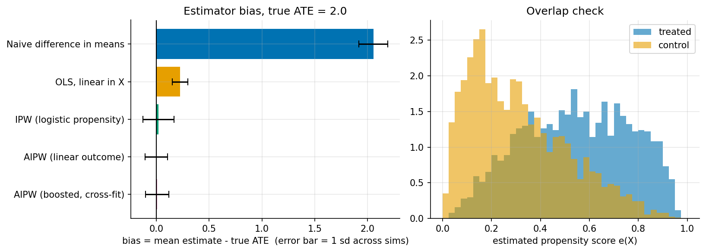
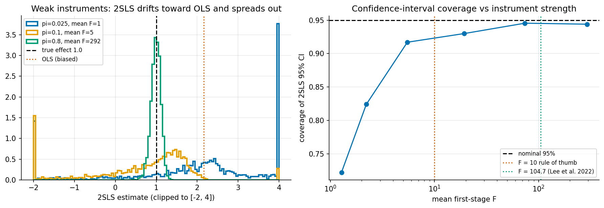
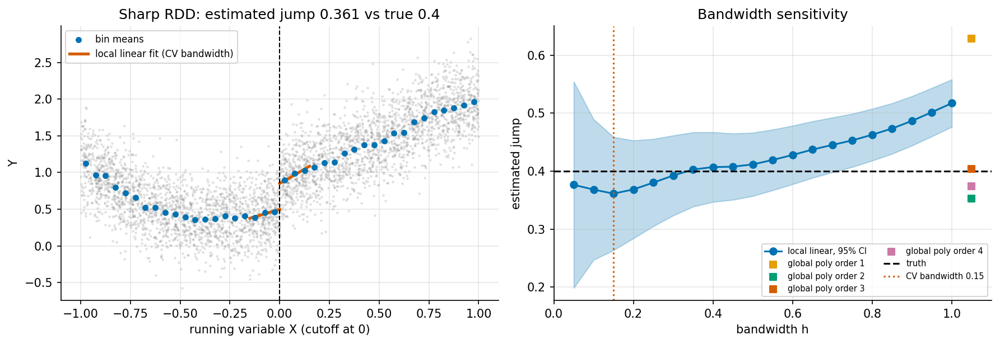

# 4. Observational methods: adjustment, weighting, instruments, discontinuities

> Previous: [3. Experiments](03-experiments.md) · Next: [5. Panel methods](05-panel-methods.md)

This chapter covers the cross-sectional toolkit. Part A assumes **selection on observables** (ignorability given $X$) and asks how best to adjust. Part B covers designs that work *without* ignorability by exploiting a source of as-good-as-random variation: instruments and discontinuities.

---

## Part A. Selection on observables

### 4.1 Regression adjustment

Fit $E[Y \mid T, X]$ and read off the treatment effect. The simplest version is

$$Y = \alpha + \tau T + \beta^\top X + \varepsilon.$$

This is unbiased for the ATE if the model is right *and* the effect is constant. Two problems arise in practice:

1. **Misspecification.** If $E[Y(0) \mid X]$ is non-linear and the treated and control groups have different $X$ distributions, a linear model extrapolates differently in each group and the bias does not cancel.
2. **Effect heterogeneity.** With a heterogeneous effect, the OLS coefficient on $T$ is a *weighted* average of $\tau(x)$ with weights proportional to $\operatorname{Var}(T \mid X) = e(X)(1 - e(X))$. Units with propensity near 0.5 count most. That weighted average is neither the ATE nor the ATT (Angrist, 1998, *Econometrica*; Słoczyński, 2022, *Review of Economics and Statistics*).

A more robust version fits separate regressions $\hat\mu_1(x)$ and $\hat\mu_0(x)$ and averages $\hat\mu_1(X_i) - \hat\mu_0(X_i)$ over the sample. This is the g-formula plug-in, also called "regression imputation" or, in ML terms, the T-learner ([Chapter 6](06-causal-ml.md)).

### 4.2 Matching

Match each treated unit to one or more control units with similar $X$, then compare outcomes. Choices include the distance (exact, Mahalanobis, propensity score), the number of matches, replacement, and calipers that drop poor matches. Matching makes the comparison transparent, and it makes overlap problems visible because unmatched units are dropped. It naturally targets the ATT, since every treated unit gets a counterfactual. The costs are inefficiency, since many controls are discarded, and a bias of order $n^{-1/d}$ with $d$ continuous covariates, which needs a bias correction (Abadie & Imbens, 2006/2011). Coarsened exact matching and genetic matching are popular variants. **Check balance after matching** (standardised mean differences below 0.1 is a common rule) rather than trusting the algorithm.

### 4.3 Propensity scores

Rosenbaum and Rubin proved that if ignorability holds given $X$, it also holds given the scalar $e(X) = P(T=1 \mid X)$ ([Rosenbaum & Rubin, 1983](https://www.math.mcgill.ca/dstephens/SISCR2017/Articles/Rosenbaum-Rubin-Bka83.pdf)). So you can match, stratify or weight on one number instead of a high-dimensional $X$. The score is unknown and must be estimated, usually by logistic regression or a classifier. Its job is **balance, not prediction**: a propensity model with a very high AUC means poor overlap, which is bad news, not good.

### 4.4 Inverse probability weighting (IPW)

Weight each treated unit by $1/e(X)$ and each control by $1/(1 - e(X))$. This creates a pseudo-population in which $T$ is independent of $X$:

$$\hat\tau_{\text{IPW}} = \frac{\sum_i T_i Y_i / \hat e_i}{\sum_i T_i / \hat e_i} - \frac{\sum_i (1-T_i) Y_i / (1-\hat e_i)}{\sum_i (1-T_i)/(1-\hat e_i)}.$$

This is the normalised (Hájek) version, which is more stable than the raw Horvitz-Thompson version. IPW is unbiased if the *propensity* model is right, whatever the outcome model. Its weakness is variance. Units with $\hat e$ near 0 or 1 get huge weights, so in practice people trim (drop units outside, say, [0.05, 0.95]), clip, or switch to overlap weights $e(1-e)$, which target a different estimand: the effect in the population where overlap is best. For the ATT, weight controls by $e/(1-e)$ and treated units by 1.

### 4.5 Doubly robust estimation: AIPW

The **augmented IPW** estimator combines both models:

$$
\hat\tau_{\text{AIPW}} = \frac{1}{n} \sum_i \Big[\hat\mu_1(X_i) - \hat\mu_0(X_i)
+ \frac{T_i\,(Y_i - \hat\mu_1(X_i))}{\hat e(X_i)}
- \frac{(1-T_i)\,(Y_i - \hat\mu_0(X_i))}{1 - \hat e(X_i)}\Big].
$$

Read it as the outcome-model prediction plus an IPW-weighted correction of that model's residuals. It has two properties:

* **Double robustness.** It is consistent if *either* the outcome model *or* the propensity model is correct.
* **Efficiency and orthogonality.** When both are estimated well, it reaches the semiparametric efficiency bound. Its error depends on the *product* of the two models' errors, so each nuisance can converge slowly (around $n^{-1/4}$) and the ATE still converges at $\sqrt{n}$. This is the "Neyman orthogonality" that double ML builds on ([Chapter 6](06-causal-ml.md)). It requires **cross-fitting** when the nuisances are flexible ML models.

### 4.6 The four estimators head to head

`ex01_confounding.py`: three confounders, a correctly specified logistic propensity, an outcome that is non-linear in $X_2$, and an effect that grows with $X_2$, with true ATE 2.0 (200 simulations, n = 2000):



| Estimator | Mean | Bias | SD | RMSE |
|---|---|---|---|---|
| Naive difference in means | 4.055 | +2.055 | 0.137 | 2.060 |
| OLS, linear in $X$ | 2.225 | +0.225 | 0.073 | 0.237 |
| IPW (logistic propensity) | 2.021 | +0.021 | 0.147 | 0.148 |
| AIPW (linear outcome models + logistic) | 2.000 | +0.000 | 0.107 | 0.107 |
| AIPW (boosted outcome models, cross-fit) | 2.008 | +0.008 | 0.110 | 0.110 |

What the table shows:

* The naive comparison is off by a factor of two.
* OLS with linear controls removes most of the bias but not all. Its outcome model is wrong and it weights heterogeneous effects by $e(1-e)$. Its small SD makes it look precise, so it is *confidently wrong*.
* IPW is nearly unbiased because its model is right, but it is the noisiest of the consistent estimators.
* AIPW with a *wrong* (linear) outcome model is still unbiased, because the propensity model is right. That is double robustness in action, and it beats IPW on variance because the outcome model soaks up some noise.
* AIPW with boosted, cross-fitted outcome models is also unbiased. In this design it is no more precise than linear AIPW.

The right panel of the figure is an overlap check. Estimated propensities span about 0.01-0.97, so there is support on both sides, but a few units carry large weights. That is why the code clips propensities to [0.01, 0.99].

### 4.7 Practical checklist for selection on observables

1. Draw the DAG and choose an adjustment set ([Chapter 1](01-foundations-pearl.md)).
2. Check overlap and trim or redefine the estimand if needed.
3. Use a doubly robust estimator with flexible nuisances and cross-fitting.
4. Check covariate balance after weighting.
5. Run a sensitivity analysis for unobserved confounding ([Chapter 8](08-sensitivity-and-validation.md)).

---

## Part B. Designs that do not need ignorability

### 4.8 Instrumental variables

An **instrument** $Z$ is a variable that:

1. **Relevance.** It moves treatment: $\operatorname{Cov}(Z, T) \neq 0$.
2. **Exclusion.** It affects $Y$ *only through* $T$.
3. **Independence.** It is as good as randomly assigned, i.e. unconfounded with $Y$.

Conditions 2 and 3 cannot be tested. Classic examples are lottery assignment with imperfect take-up, distance to a college, judge leniency, weather, and genetic variants (Mendelian randomisation). In the linear constant-effect model, the IV estimand is the ratio of the reduced form to the first stage:

$$\beta_{\text{IV}} = \frac{\operatorname{Cov}(Z, Y)}{\operatorname{Cov}(Z, T)},$$

and **two-stage least squares (2SLS)** computes it with covariates. Stage 1 regresses $T$ on $Z$ and $X$. Stage 2 regresses $Y$ on the fitted $\hat T$ and $X$. (Use the correct 2SLS standard errors, not the naive second-stage ones.)

### 4.9 LATE: what IV identifies when effects vary

With a binary instrument and binary treatment, units fall into four compliance types: **compliers** (take treatment iff $Z = 1$), **always-takers**, **never-takers**, and **defiers** (do the opposite of $Z$). Imbens and Angrist showed that under the three IV conditions plus **monotonicity** (no defiers), the Wald ratio identifies the **local average treatment effect**, the average effect among compliers ([Imbens & Angrist, 1994](https://www.nber.org/papers/t0118)):

$$\text{LATE} = \frac{E[Y \mid Z=1] - E[Y \mid Z=0]}{E[T \mid Z=1] - E[T \mid Z=0]} = E[Y(1) - Y(0) \mid \text{complier}].$$

`ex08_iv.py` part B (300 simulations, n = 20,000) has 60% compliers with effect 2.0, 20% always-takers with effect 5.0, and 20% never-takers with effect 0.5, so the population ATE is 2.3. The Wald estimate is **1.995** (SD 0.049), which is the complier effect and not the ATE. Naive OLS of $Y$ on $T$ gives 4.20, contaminated both by always-takers' higher baseline and by their larger effect. LATE is a well-defined and often policy-relevant number, but it is the effect for a subpopulation you cannot list by name. Different instruments define different complier groups.

### 4.10 Weak instruments

If $Z$ barely moves $T$, the IV ratio divides by something near zero. 2SLS is then biased toward OLS in finite samples, its distribution has fat tails, and the usual confidence intervals undercover. Diagnostics and fixes:

* **First-stage F-statistic.** The old rule of thumb is $F > 10$ ([Stock & Yogo, 2005](https://www.nber.org/papers/t0284)). Lee, McCrary, Moreira and Porter (2022) showed that a valid 5% t-test with the usual $\pm 1.96$ needs $F > 104.7$, and they provide an adjusted critical value (the "tF" procedure) for smaller F ([Lee et al., 2022](https://eml.berkeley.edu/~jmccrary/tfNBERfinal_main_v2.pdf)).
* **Weak-instrument-robust inference.** Anderson-Rubin tests and confidence sets remain valid however weak the instrument is.

`ex08` part A has a strongly endogenous treatment (the first-stage and structural errors correlate at about 0.95), true effect 1.0, n = 500, and 2000 simulations per instrument strength:



| First-stage coefficient $\pi$ | Mean first-stage F | 2SLS median | 2SLS IQR | 95% CI coverage | OLS mean |
|---|---|---|---|---|---|
| 0.025 | 1.3 | 2.231 | 1.943 | **0.722** | 2.834 |
| 0.05 | 2.2 | 1.596 | 1.714 | 0.824 | 2.831 |
| 0.1 | 5.5 | 1.062 | 1.230 | 0.917 | 2.818 |
| 0.2 | 19.3 | 1.001 | 0.637 | 0.930 | 2.770 |
| 0.4 | 74.0 | 0.990 | 0.306 | 0.946 | 2.601 |
| 0.8 | 292.3 | 0.996 | 0.152 | 0.944 | 2.159 |

With F around 1, the 2SLS median (2.23) sits most of the way toward the OLS bias (2.83), and nominal 95% intervals cover only 72% of the time. Even at F around 19, which passes the rule of thumb, coverage is 93% rather than 95%.

The same script reruns the sweep with milder endogeneity (noise SD 1.0, error correlation about 0.63). The point estimates are just as unreliable (median 1.87 at F = 1.2, 1.58 at F = 1.6), but coverage stays between 0.93 and 0.96 at every strength, because the robust standard errors widen enough to compensate. Size distortion depends on *both* instrument strength and the degree of endogeneity, which is why Lee et al. derive a whole critical-value function rather than a single cutoff.

### 4.11 Regression discontinuity

When treatment switches on at a known threshold of a **running variable**, such as a test score cutoff for a scholarship, an age limit, or a vote share of 50%, units just above and just below the cutoff are comparable. The jump in $E[Y \mid X]$ at the cutoff identifies the effect *at the cutoff*:

$$\tau_{\text{RD}} = \lim_{x \downarrow c} E[Y \mid X = x] - \lim_{x \uparrow c} E[Y \mid X = x].$$

* **Sharp RD.** Treatment is a deterministic function of $X$.
* **Fuzzy RD.** The *probability* of treatment jumps. Divide the outcome jump by the treatment jump, an IV with the threshold as instrument, giving a LATE at the cutoff.
* **Key assumption.** Potential outcomes are continuous in $X$ at $c$. Nothing else jumps there, and units cannot precisely manipulate $X$ to land on the preferred side. Test this with a density test (McCrary; Cattaneo-Jansson-Ma) and by checking that pre-treatment covariates do not jump.
* **Modern practice.** Use local linear regression with a triangular kernel, a data-driven MSE-optimal bandwidth, and robust bias-corrected confidence intervals (the `rdrobust` package, [Calonico, Cattaneo & Titiunik](https://journal.r-project.org/articles/RJ-2015-004)). Avoid high-order global polynomials, as argued by Gelman and Imbens (2019).

`ex05_rdd.py` has a cubic baseline and a true jump of 0.4, with n = 4000:



| Estimator | Estimate |
|---|---|
| Naive difference (above vs below) | 0.878 |
| Global linear (separate slopes) | 0.629 |
| Global quadratic | 0.352 |
| Global cubic | 0.404 |
| Global quartic | 0.374 |
| **Local linear, CV bandwidth h = 0.15** (SE 0.050, 657 obs) | **0.361** |
| Placebo cutoff at $X = -0.5$ | -0.017 (SE 0.038) |
| Monte Carlo, 300 draws: local linear mean (SD), CI coverage | 0.406 (0.051), 0.97 |
| Monte Carlo: global linear mean (SD) | 0.640 (0.020) |

On this one draw the local estimate (0.361) is 0.8 SE below the truth, which is ordinary sampling noise. Over 300 draws it averages 0.406 with correct coverage. The global linear fit is badly biased (0.640) with a deceptively small SD, the same "confidently wrong" pattern as linear OLS in 4.6. The bandwidth panel shows the usual bias-variance trade-off: narrow bandwidths are noisy, wide ones pull in curvature. The cross-validation used here is a simple Ludwig-Miller style one-sided CV. `rdrobust`'s MSE-optimal selector with bias correction is the standard in published work.

### 4.12 Key takeaways

* Under ignorability, prefer doubly robust estimators (AIPW) with cross-fitting. In our simulation AIPW stayed unbiased even with a wrong outcome model.
* OLS on $T$ plus controls does not target the ATE under heterogeneity, even with correct controls.
* IV gives a LATE, not an ATE, and weak instruments wreck inference. F > 10 is not enough when endogeneity is strong.
* RD is one of the most credible observational designs, but it identifies a local effect at the cutoff. Use local linear fits with careful bandwidths, never high-order global polynomials.

**Further reading:** Angrist & Pischke, *Mostly Harmless Econometrics* (2009), chapters 3-4 and 6. Huntington-Klein, *The Effect*, chapters 14-20 ([free](https://theeffectbook.net/)). Cattaneo, Idrobo & Titiunik, *A Practical Introduction to Regression Discontinuity Designs* (2019-2024).

## Appendix A: code walkthrough

### AIPW with cross-fitting

Condensed from `ex01_confounding.py` (hyperparameters omitted). The nuisances for each fold are trained on the *other* folds, then the AIPW score is averaged:

```python
for train, test in KFold(k, shuffle=True, random_state=seed).split(X):
    Xt, Tt, Yt = X[train], T[train], Y[train]
    e[test]   = clip(LogisticRegression().fit(Xt, Tt).predict_proba(X[test])[:, 1], 0.01, 0.99)
    mu1[test] = HistGradientBoostingRegressor().fit(Xt[Tt == 1], Yt[Tt == 1]).predict(X[test])
    mu0[test] = HistGradientBoostingRegressor().fit(Xt[Tt == 0], Yt[Tt == 0]).predict(X[test])

psi = mu1 - mu0 + T * (Y - mu1) / e - (1 - T) * (Y - mu0) / (1 - e)
ate, se = psi.mean(), psi.std(ddof=1) / np.sqrt(len(psi))
```

The standard error falls out of the score for free. `psi` is (an estimate of) the efficient influence function plus the ATE, so its sample standard deviation divided by $\sqrt n$ is a valid SE.

### 2SLS with robust standard errors

From `ex08_iv.py`, the just-identified case written as $\hat\beta = (Z^\top X)^{-1} Z^\top Y$:

```python
Zc = np.column_stack([np.ones(n), Z]); Xc = np.column_stack([np.ones(n), T])
b = np.linalg.solve(Zc.T @ Xc, Zc.T @ Y)
e = Y - Xc @ b                                     # residuals use the *actual* T, not T-hat
A = np.linalg.inv(Zc.T @ Xc)
cov = A @ ((Zc * e[:, None] ** 2).T @ Zc) @ A.T    # HC0 sandwich
```

A classic bug is computing residuals from the second-stage regression on $\hat T$, which gives wrong standard errors. Use the structural residual $Y - X\hat\beta$.

### Local linear RD

From `ex05_rdd.py`: triangular kernel weights, separate intercept and slope on each side, and the jump is the coefficient on the side indicator.

```python
w = np.clip(1 - np.abs((X - c) / h), 0, None)          # triangular kernel
x, d = X - c, (X >= c).astype(float)
Z = np.column_stack([np.ones_like(x), d, x, d * x])     # jump = coefficient on d
beta, se = wls(Y, Z, w)
```

## Appendix B: matching vs weighting vs regression, when to prefer which

| Situation | Prefer | Reason |
|---|---|---|
| Few covariates, want transparency, ATT | Matching (with bias correction) | Easy to inspect matched pairs; naturally targets ATT |
| Many covariates, decent overlap | AIPW / DML with cross-fitting | Doubly robust and efficient |
| Poor overlap | Overlap weights, or trimming with a redefined estimand | Avoid extreme weights; be explicit about the population |
| Strong prior on outcome model form | Regression adjustment (g-formula) | Efficient if the model is right |
| Rare outcome, binary | TMLE | Plug-in respects $[0, 1]$ bounds |

## Appendix C: exercises

1. In `ex01`, make the propensity model wrong (drop $X_2$ from the logistic regression) but give AIPW boosted outcome models. Is AIPW still unbiased? What about IPW?
2. Increase the propensity coefficients in `ex01` to worsen overlap. Watch IPW's SD and the effect of the clipping threshold.
3. In `ex08` part B, add 5% defiers. How far does the Wald estimate move from the complier effect?
4. In `ex05`, add a fake "manipulation" by moving 10% of units just below the cutoff to just above it. How does the estimate change, and what would a density test show?
