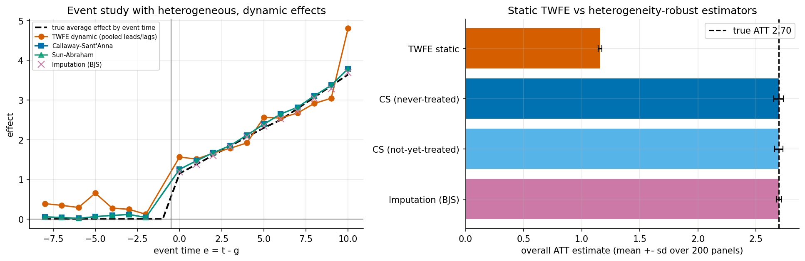
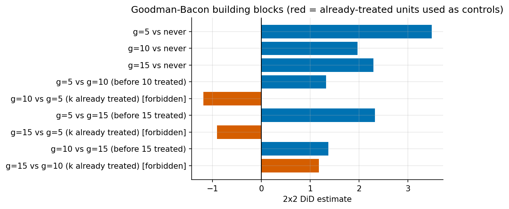
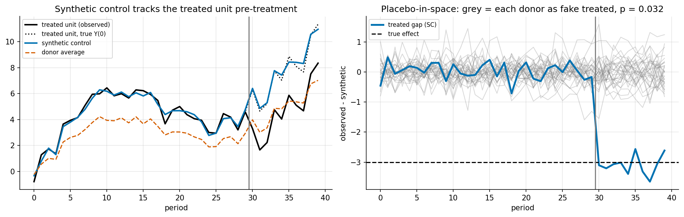

# 5. Panel methods: DiD, staggered adoption, event studies, synthetic control

> Previous: [4. Observational methods](04-observational-methods.md) · Next: [6. Causal ML](06-causal-ml.md)

When you observe the same units over time, before and after some of them are treated, you can difference out anything about a unit that does not change over time, observed or not. That is the core appeal of panel designs. The price is an assumption about *trends* in place of an assumption about *levels*.

## 5.1 Canonical 2×2 difference-in-differences

Two groups, two periods. The treated group is treated only in the second period:

$$\hat\tau_{\text{DiD}} = \big(\bar Y_{\text{treat, post}} - \bar Y_{\text{treat, pre}}\big) - \big(\bar Y_{\text{ctrl, post}} - \bar Y_{\text{ctrl, pre}}\big).$$

**Parallel trends.** Without treatment, the treated group's average outcome would have changed by the same amount as the control group's:

$$E[Y_{\text{post}}(0) - Y_{\text{pre}}(0) \mid \text{treated}] = E[Y_{\text{post}}(0) - Y_{\text{pre}}(0) \mid \text{control}].$$

Under that assumption, plus **no anticipation** (treatment does not change outcomes before it starts), the DiD identifies the **ATT in the post period**. Levels may differ between groups. Only the *changes* must match. Parallel trends depends on the scale: if it holds in levels it generally fails in logs, and vice versa. A recent practitioner's guide covers the whole family of designs and their assumptions in detail ([Baker et al., 2025](https://arxiv.org/html/2503.13323v3)).

The regression version is

$$Y_{it} = \alpha_i + \lambda_t + \tau D_{it} + \varepsilon_{it},$$

the **two-way fixed effects (TWFE)** model, with unit effects $\alpha_i$, time effects $\lambda_t$, and $D_{it} = 1$ if unit $i$ is treated at time $t$. In the 2×2 case, $\hat\tau_{\text{TWFE}} = \hat\tau_{\text{DiD}}$ exactly. Trouble starts when people use the same regression with many groups adopting at different times.

## 5.2 The staggered-adoption problem

Between roughly 2018 and 2021 a group of papers showed that TWFE with staggered treatment timing is **not** a clean average of treatment effects when effects vary across cohorts or over time:

* **Goodman-Bacon (2021)** showed that the TWFE coefficient is a weighted average of *every* possible 2×2 DiD in the data. That includes "forbidden" comparisons that use already-treated units as controls for later-treated units. If effects grow over time, those comparisons subtract part of the early group's still-growing effect, and they can push the estimate down or even flip its sign ([Goodman-Bacon, NBER w25018](https://www.nber.org/papers/w25018)).
* **de Chaisemartin & D'Haultfœuille (2020)** showed that the TWFE coefficient equals a weighted sum of group-time effects with weights that can be **negative**. The coefficient can be negative even when every individual effect is positive ([arXiv 1803.08807](https://arxiv.org/abs/1803.08807v7)).
* **Sun & Abraham (2021)** showed the same contamination in dynamic event-study regressions. The coefficient on a lead or lag picks up effects from other relative periods, so apparent pre-trends can appear purely from heterogeneity ([arXiv 1804.05785](https://arxiv.org/abs/1804.05785)).

None of this is about confounding. Parallel trends can hold perfectly and TWFE can still mislead. The problem is the *estimator*, not the design.

## 5.3 Heterogeneity-robust estimators

| Estimator | Idea | Controls used |
|---|---|---|
| **Callaway & Sant'Anna (2021)** | Estimate every group-time ATT(g, t) with a clean 2×2 comparison, then aggregate (overall, by event time, by cohort, by calendar time). Supports covariates via outcome regression, IPW or doubly robust estimation ([arXiv 1803.09015](https://arxiv.org/abs/1803.09015v3)) | Never-treated, or not-yet-treated |
| **Sun & Abraham (2021)** | Interaction-weighted event study: cohort × relative-time dummies in a TWFE regression, then average across cohorts with cohort-share weights | Never-treated (or last-treated) cohort |
| **Borusyak, Jaravel & Spiess (2024)** | Imputation: fit unit and time effects using **untreated observations only**, predict $Y(0)$ for treated cells, average the gaps. Efficient under homoskedastic errors ([arXiv 2108.12419](https://arxiv.org/abs/2108.12419)) | All untreated cells |
| **de Chaisemartin & D'Haultfœuille** | $DID_M$ and successors: compare switchers to non-switchers period by period; also handles treatment that turns on and off | Units whose treatment is stable |
| **Stacked DiD** | Build one clean 2×2 dataset per cohort, stack them, run TWFE with dataset-specific fixed effects | Clean controls per stack |
| **Synthetic DiD** (5.6) | Reweight units *and* periods, then DiD | Weighted donors |

### 5.3.1 Demonstration

`ex06_did_staggered.py` has 600 units over 20 periods, with cohorts adopting at $t = 5, 10, 15$ and 100 never-treated units. Parallel trends holds by construction. Effects differ by cohort and grow with time since adoption: early adopters start small (0.5) and grow fast (+0.4 per period), late adopters start large (2.0) and grow slowly. Results over 200 simulated panels:



| Estimator | Mean | Bias | SD |
|---|---|---|---|
| True ATT (average over treated cells) | 2.695 | n/a | n/a |
| **Static TWFE** | **1.157** | **−1.538** | 0.017 |
| Callaway-Sant'Anna, never-treated controls | 2.694 | −0.001 | 0.040 |
| Callaway-Sant'Anna, not-yet-treated controls | 2.695 | −0.001 | 0.035 |
| Imputation (Borusyak-Jaravel-Spiess) | 2.695 | −0.000 | 0.020 |

Static TWFE recovers **43%** of the true effect, with a tiny standard deviation that would yield a very confident and very wrong confidence interval. All three robust estimators are unbiased. Imputation is the most precise, as theory predicts when errors are i.i.d.

The event-study panel (one dataset) shows a second failure. The pooled **dynamic TWFE** regression with binned endpoints shows "pre-trends" of 0.12-0.65 even though the true pre-period effects are exactly zero, and its last coefficient (4.80) pools every lag $e \ge 10$, so it is not comparable with the true effect at exactly $e = 10$ (3.65). Binning endpoints is a modelling choice that silently changes what a coefficient means. Callaway-Sant'Anna, Sun-Abraham and imputation all track the true path.

### 5.3.2 Where the TWFE bias comes from



The 2×2 building blocks from the same dataset:

| Comparison | 2×2 DiD |
|---|---|
| g=5 vs never | +3.48 |
| g=10 vs never | +1.97 |
| g=15 vs never | +2.29 |
| g=5 vs g=10, before g=10 is treated (clean) | +1.32 |
| g=5 vs g=15, before g=15 is treated (clean) | +2.32 |
| g=10 vs g=15, before g=15 is treated (clean) | +1.37 |
| **g=10 vs g=5, after g=5 is treated (forbidden)** | **−1.19** |
| **g=15 vs g=5, after g=5 is treated (forbidden)** | **−0.91** |
| g=15 vs g=10, after g=10 is treated (forbidden) | +1.18 |

Every true effect is positive, yet two of the forbidden comparisons are negative. The cohort used as a control (g = 5) has a large, growing effect, and differencing against it subtracts that growth. TWFE averages these pieces with positive weights, which drags its estimate down to 1.16. (This script computes the 2×2 estimates but not the exact Goodman-Bacon weights. The `bacondecomp` packages in R and Stata do both.)

## 5.4 Event studies done right

An event study plots effects by time relative to treatment, $e = t - g$. It answers two questions: how does the effect evolve, and are there pre-trends? Good practice:

* Estimate with a heterogeneity-robust method (CS, SA or BJS), not pooled TWFE leads and lags.
* Choose the reference period deliberately, usually $e = -1$, and be aware of anticipation.
* **Pre-trend tests have low power** and condition the analysis on passing them. Rambachan & Roth (2023) suggest *sensitivity* instead: assume post-treatment violations of parallel trends are no more than $\bar M$ times the largest pre-period violation, report the resulting robust confidence set, and find the breakdown $\bar M$ at which the conclusion fails ([HonestDiD](https://github.com/asheshrambachan/HonestDiD/blob/master/README.md); [paper](https://economics.mit.edu/people/faculty/ashesh-rambachan/more-credible-approach-parallel-trends/)).

## 5.5 Synthetic control

With **one** treated unit (a state, a country, a market) and many untreated donors, DiD's equal weighting of controls is often a poor choice. **Synthetic control** builds a weighted combination of donors whose pre-treatment path matches the treated unit's, with non-negative weights that sum to 1, and uses its post-period path as the counterfactual ([Abadie, Diamond & Hainmueller, 2010](https://dspace.mit.edu/handle/1721.1/59447)). Their study of California's Proposition 99 estimated that by 2000, annual per-capita cigarette sales were about 26 packs lower than the synthetic California.

Why it can work when DiD fails: if outcomes follow a **factor model** $Y_{jt}(0) = \delta_t + \lambda_t^\top \mu_j + \varepsilon_{jt}$, units with different loadings $\mu_j$ follow different trends, so parallel trends fails. A synthetic unit whose weighted loadings match the treated unit's will track it. Matching a long pre-period approximately matches those loadings. Inference is usually by **placebo permutation**: pretend each donor was treated, recompute the gap, and see whether the real treated unit's post/pre RMSPE ratio is extreme.

`ex07_synthetic_control.py` has one treated unit with loadings equal to a convex combination of 4 high-loading donors, 30 donors, 30 pre and 10 post periods, and a true effect of −3.0 (100 simulations):



| Estimator | Mean | Bias | SD | RMSE |
|---|---|---|---|---|
| DiD vs equally weighted donors | −1.939 | +1.061 | 0.578 | 1.208 |
| **Synthetic control** | **−2.956** | +0.044 | 0.148 | **0.155** |
| Synthetic DiD (simplified, paper-scale ridge) | −2.579 | +0.421 | 0.294 | 0.513 |
| Synthetic DiD (simplified, ridge × 0.01) | −2.840 | +0.160 | 0.302 | 0.342 |

On one panel the SC estimate is −3.10 with pre-period RMSPE 0.28, and the placebo p-value is 1/31 ≈ 0.032, the smallest possible with 30 donors.

**Honest note on the SDID rows.** This design is deliberately favourable to synthetic control: the treated unit lies exactly in the convex hull of the donors and noise is low. Our *simplified* SDID uses a ridge penalty on unit weights at the paper's suggested scale. That spreads weight across donors, so it inherits part of DiD's bias. With a much smaller penalty it moves toward the SC answer. This is not a verdict on SDID in general. The paper shows it is more robust than SC across many realistic designs, especially when no exact convex match exists. Use the `synthdid` package rather than this sketch for real work.

**Practical cautions for SC:**

* You need a long pre-period and donors that are not themselves affected (no spillovers).
* The treated unit must not be extreme. If it lies outside the donors' convex hull, SC cannot match it. Augmented SC (Ben-Michael, Feller & Rothstein) adds an outcome model to correct the remaining imbalance.
* Report pre-period fit, the donor weights, leave-one-out checks and placebo-in-time tests.

## 5.6 Synthetic difference-in-differences

**SDID** ([Arkhangelsky, Athey, Hirshberg, Imbens & Wager, 2021](https://arxiv.org/abs/1812.09970)) combines the two ideas:

* **Unit weights** $\omega$ make the weighted donors' pre-trend parallel to the treated units' (an intercept is allowed, so levels can differ, unlike SC), with a ridge penalty for stability.
* **Time weights** $\lambda$ choose the pre-periods that best predict the post-period, among controls.
* The estimate is a weighted DiD using both sets of weights.

It reduces to DiD with uniform weights and is close to SC when the intercept and time weights are switched off. It handles multiple treated units, and the authors show it performs well in placebo studies built from real panels.

## 5.7 CausalImpact and Bayesian structural time series

For a single treated time series with control series that are not themselves treated, **CausalImpact** fits a Bayesian structural time-series model (local trend, seasonality, regression on control series with spike-and-slab priors) on the pre-period, forecasts the counterfactual, and reports the posterior of the cumulative effect ([Brodersen et al., 2015](https://arxiv.org/pdf/1506.00356.pdf); [R package](https://google.github.io/CausalImpact/CausalImpact.html)). Think of it as synthetic control with a time-series model and Bayesian uncertainty. The key assumptions are that the controls are unaffected by the intervention and that their relationship to the treated series is stable over time.

## 5.8 Choosing among panel designs

| Situation | Reach for |
|---|---|
| Two groups, two periods, plausible parallel trends | 2×2 DiD / TWFE |
| Staggered adoption, possibly heterogeneous effects | Callaway-Sant'Anna, Sun-Abraham, imputation, stacked DiD. **Not** static TWFE |
| Treatment switches on and off | de Chaisemartin-D'Haultfœuille estimators |
| One or a few treated aggregate units, long pre-period | Synthetic control (augmented SC), SDID |
| Many treated units, worry about parallel trends | SDID; matrix-completion methods |
| Single time series with good control series | CausalImpact / BSTS |
| Worried about parallel-trend violations | HonestDiD sensitivity bounds |
| Continuous treatment intensity | Callaway, Goodman-Bacon & Sant'Anna (2024) on continuous DiD ([arXiv 2107.02637](https://arxiv.org/pdf/2107.02637v7.pdf)) |

## 5.9 Key takeaways

* DiD swaps "no confounding" for "parallel trends". Both are assumptions.
* With staggered adoption and effects that change, static TWFE can be far off. In our simulation it recovered 43% of the true ATT with a tiny SE, while CS, SA and imputation were unbiased.
* Use Goodman-Bacon decompositions to diagnose and robust estimators to estimate.
* Synthetic control replaces "parallel trends on average" with "a weighted average of donors matches the pre-period". It beat DiD by a factor of eight in RMSE in our factor-model simulation.
* Prefer sensitivity analysis (HonestDiD) to pre-trend tests.

**Further reading:** Cunningham, *The Mixtape*, chapters 9-10 ([free](https://mixtape.scunning.com/09-difference_in_differences)). Roth, Sant'Anna, Bilinski & Poe, "What's trending in difference-in-differences?" (2023). Abadie, "Using synthetic controls" (JEL, 2021).

## Appendix A: code walkthrough

### TWFE in a balanced panel is one line after demeaning

For a balanced $N \times T$ panel, unit and time fixed effects can be removed exactly by two-way demeaning (Frisch-Waugh-Lovell), so TWFE needs no dummy matrix:

```python
def twoway_demean(M):
    return M - M.mean(1, keepdims=True) - M.mean(0, keepdims=True) + M.mean()

d, y = twoway_demean(D).ravel(), twoway_demean(Y).ravel()
tau_twfe = d @ y / (d @ d)
```

### Callaway-Sant'Anna ATT(g, t), unconditional version

Each group-time effect is a plain 2×2 DiD with base period $g-1$ and a clean control group:

```python
treat = g == gg
ctrl = (g == 0) if control == "never" else ((g == 0) | (g > max(tt, gg - 1))) & ~treat
base, col = gg - 2, tt - 1      # columns are 0-indexed: period p lives in column p - 1
att = (Y[treat, col] - Y[treat, base]).mean() - (Y[ctrl, col] - Y[ctrl, base]).mean()
```

Aggregation is a weighted average with cohort-size weights, over post-treatment cells for the overall ATT, or by $e = t - g$ for the event study.

### Imputation in 10 lines

Fit $\alpha_i + \lambda_t$ on untreated cells only, by alternating projections, then average $Y - \hat Y(0)$ over treated cells:

```python
mask = D == 0
for _ in range(200):
    a   = np.where(mask, Y - lam[None, :], 0).sum(1) / mask.sum(1)
    lam = np.where(mask, Y - a[:, None], 0).sum(0) / mask.sum(0)
att = (Y - (a[:, None] + lam[None, :]))[D == 1].mean()
```

### Synthetic control weights

A small constrained least-squares problem, solved with SciPy's SLSQP (condensed from `ex07`):

```python
minimize(lambda w: np.sum((y_treated_pre - donors_pre.T @ w) ** 2),
         x0=np.full(J, 1 / J), bounds=[(0, 1)] * J,
         constraints=({"type": "eq", "fun": lambda w: w.sum() - 1},), method="SLSQP")
```

## Appendix B: a DiD reporting template

1. **Design.** Who is treated, when, and how was timing determined? Why should untreated trends be parallel?
2. **Raw data plot.** Average outcomes by cohort over calendar time.
3. **Estimator.** Which robust estimator, which control group (never vs not-yet), base period, covariates.
4. **Event study.** With CIs and the reference period marked.
5. **Overall ATT.** With the aggregation scheme stated.
6. **Robustness.** Alternative control group, alternative estimator, HonestDiD breakdown $\bar M$, placebo outcomes.
7. **Anticipation and spillovers.** Argue them away or model them.

## Appendix C: exercises

1. In `ex06`, make all cohorts' effects identical and constant ($\tau = 1$). Does static TWFE become unbiased? Then make effects constant over time but different across cohorts. What happens?
2. Remove the never-treated units (`COHORTS[0] = 0`). Which estimators still work, and for which (g, t) cells?
3. In `ex07`, move the treated unit's loadings *outside* the donors' convex hull (scale them by 1.5). How do SC and DiD compare now? This is the situation augmented SC was designed for.
4. Add an anticipation effect (outcomes rise one period before adoption) to `ex06`. Which base-period choice protects against it?
