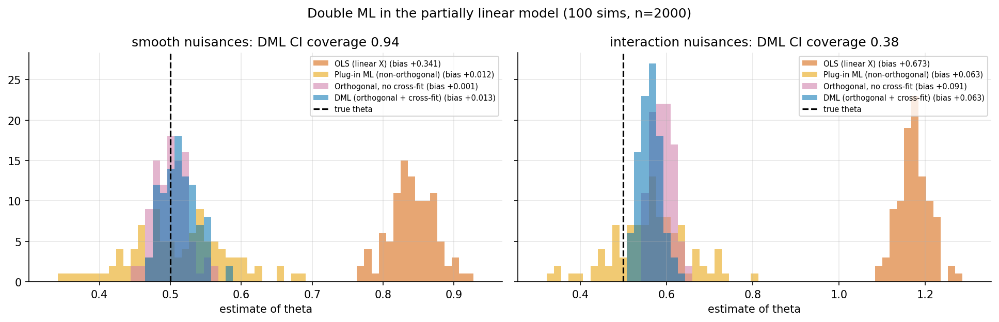
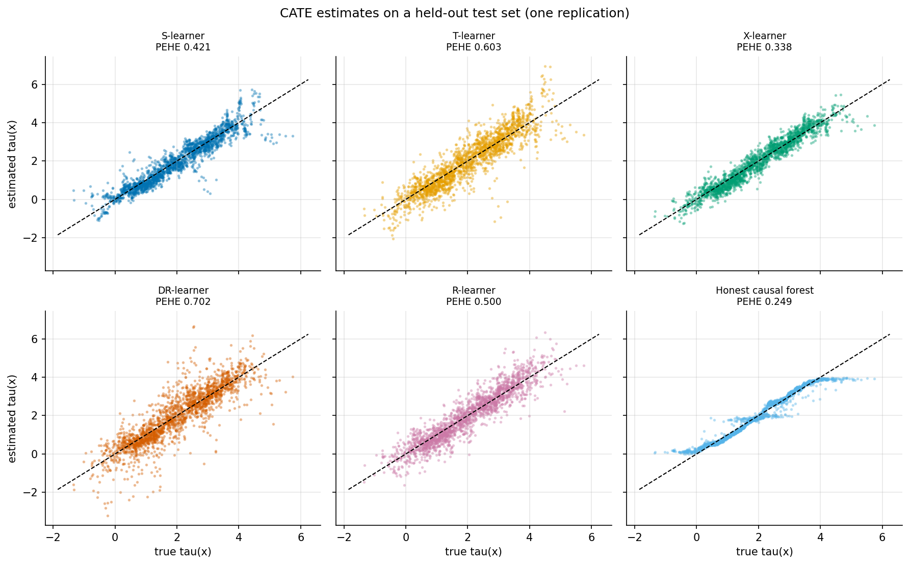
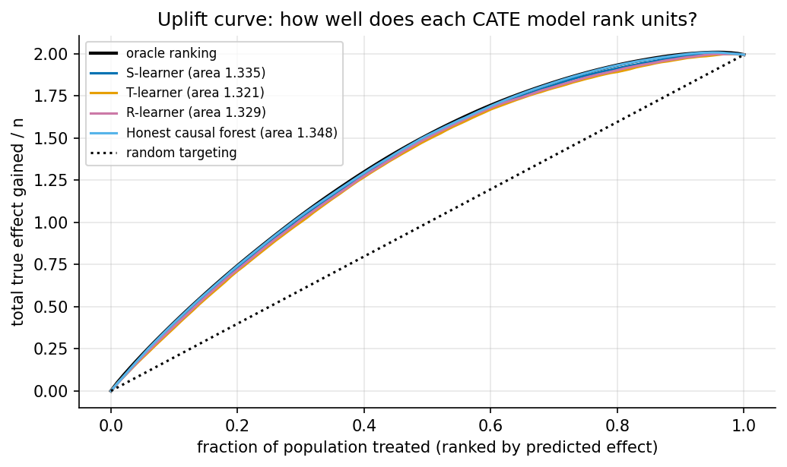

# 6. Machine learning for causal inference

> Previous: [5. Panel methods](05-panel-methods.md) · Next: [7. Causal discovery](07-causal-discovery.md)

Machine learning enters causal inference in two different places:

1. **As a nuisance estimator.** Causal estimands such as the ATE need auxiliary functions: $e(x)$, $\mu_t(x)$, $E[Y \mid X]$. Flexible ML can estimate them well in high dimensions, but plugging ML predictions naively into a causal formula gives biased, non-normal estimates. *Double/debiased ML* and *TMLE* fix this.
2. **As the target.** When the goal is the whole CATE function $\tau(x)$, for targeting, personalisation or uplift, ML is the estimator itself. *Meta-learners* and *causal forests* do this.

Neither use relaxes identification. All of this chapter assumes ignorability (or another identification strategy) already holds.

## 6.1 Why naive plug-in fails: regularisation bias

Take the **partially linear model**

$$Y = \theta D + g_0(X) + U, \qquad D = m_0(X) + V, \qquad E[U \mid X, D] = 0,\; E[V \mid X] = 0.$$

A natural idea is to estimate $g_0$ with a random forest and then regress $Y - \hat g(X)$ on $D$. The trouble is that $\hat g$ is *regularised*: it is shrunk and smoothed, so it is biased. Because $D$ depends on $X$, that bias leaks into $\hat\theta$ at first order. The estimate converges more slowly than $1/\sqrt n$ and is not centred on the truth, so confidence intervals are wrong.

## 6.2 Double / debiased machine learning (DML)

Chernozhukov, Chetverikov, Demirer, Duflo, Hansen, Newey and Robins (2018) give two ingredients that together restore $\sqrt n$-consistent, asymptotically normal inference ([arXiv 1608.00060](https://arxiv.org/abs/1608.00060)):

**Ingredient 1: a Neyman-orthogonal score.** Use an estimating equation whose derivative with respect to the nuisance functions is zero at the truth, so small nuisance errors have only a second-order effect. For the partially linear model this is Robinson's partialling-out:

$$\tilde Y = Y - \hat\ell(X), \quad \tilde D = D - \hat m(X), \qquad \hat\theta = \frac{\sum_i \tilde D_i \tilde Y_i}{\sum_i \tilde D_i^2},$$

where $\ell(X) = E[Y \mid X]$. The bias of $\hat\theta$ now scales with the *product* $\|\hat m - m_0\| \cdot \|\hat \ell - \ell_0\|$. Each nuisance only needs to converge faster than $n^{-1/4}$.

**Ingredient 2: cross-fitting.** Split the data into $K$ folds. Fit the nuisances on $K-1$ folds and compute residuals on the held-out fold, rotating through all folds. This removes the overfitting bias you get when the same observations are used to fit and evaluate a flexible model, and it lets you use almost any learner without Donsker-type complexity conditions.

The standard error comes from the score: with $\psi_i = (\tilde Y_i - \hat\theta \tilde D_i)\tilde D_i$,

$$\widehat{\operatorname{Var}}(\hat\theta) = \frac{1}{n}\,\frac{\overline{\psi^2}}{\big(\overline{\tilde D^2}\big)^2}.$$

The same recipe gives the **interactive model** (binary treatment, heterogeneous effects), whose orthogonal score is exactly the AIPW score from [Chapter 4](04-observational-methods.md). It also extends to IV (partially linear IV, LATE) and to DiD (doubly robust DiD).

### 6.2.1 Demonstration

`ex10_dml.py` has $\theta = 0.5$, 10 correlated covariates, n = 2000 and 100 simulations per design. The ML learner is gradient boosting. Two nuisance designs: **smooth** (additive non-linear terms) and **interaction** (the same plus products $X_3 X_4$ in both nuisances).



| Estimator | Smooth: bias | Smooth: SD | Smooth: RMSE | Interaction: bias | Interaction: SD | Interaction: RMSE |
|---|---|---|---|---|---|---|
| OLS, linear $X$ | +0.341 | 0.032 | 0.342 | +0.673 | 0.036 | 0.674 |
| Plug-in ML (non-orthogonal, sample-split) | +0.012 | 0.069 | 0.070 | +0.063 | 0.087 | 0.107 |
| Orthogonal, **no** cross-fitting (overfit forest) | +0.001 | 0.023 | 0.023 | +0.091 | 0.025 | 0.094 |
| **DML** (orthogonal + 5-fold cross-fit) | +0.013 | 0.024 | 0.027 | +0.063 | 0.025 | 0.068 |
| DML 95% CI coverage | **0.94** | | | **0.38** | | |

These results are more nuanced than the textbook picture:

* **OLS with linear controls fails badly** in both designs.
* In the **smooth** design DML works as advertised: small bias, correct coverage (0.94). The non-orthogonal plug-in is nearly unbiased here but about **3× noisier**, which is the efficiency cost of a non-orthogonal score.
* The in-sample orthogonal estimator with a fully grown random forest did *not* show the overfitting bias we expected in the smooth design (+0.001). A plausible explanation, which we did not test, is that averaging over bootstrap trees shrinks both residuals by similar factors, so their ratio survives. The failure is not guaranteed to show up, but it does in the harder design (+0.091, the worst of the ML estimators there). Cross-fitting is cheap insurance.
* In the **interaction** design, DML has the lowest RMSE but is still biased (+0.063), and its 95% intervals cover only **38%** of the time. The boosted nuisances do not learn $X_3 X_4$ fast enough at n = 2000, so the product-of-errors term stays large relative to the shrinking SE. That is the rate condition failing in plain sight. DML's guarantee is conditional on the nuisances being learned well. Report nuisance fit quality (out-of-fold $R^2$) along with $\hat\theta$, and compare several learners.

## 6.3 TMLE

**Targeted maximum likelihood estimation** (van der Laan & Rubin, 2006; [van der Laan & Rose, *Targeted Learning*](https://link.springer.com/chapter/10.1007/978-1-4419-9782-1_4)) reaches the same goal from another direction:

1. Fit an initial outcome model $\hat Q(T, X)$, usually with the **Super Learner**, a cross-validated ensemble.
2. Fit the propensity score $\hat e(X)$.
3. **Target:** run a one-parameter fluctuation of $\hat Q$ along the "clever covariate" $H(T, X) = T/\hat e - (1-T)/(1-\hat e)$, fit by maximum likelihood, so that the updated model solves the efficient influence-function estimating equation.
4. Plug the updated $\hat Q^*$ into the g-formula.

TMLE is doubly robust and efficient like AIPW. Because it is a *plug-in* estimator, it respects the bounds of the parameter, for example probabilities stay in [0, 1], which helps with rare outcomes and near-violations of positivity. Cross-validated TMLE (CV-TMLE) adds cross-fitting. TMLE dominates in epidemiology and biostatistics, DML in econometrics. Asymptotically they are equivalent.

## 6.4 Meta-learners for CATE

A meta-learner turns any supervised regressor into a CATE estimator ([Künzel, Sekhon, Bickel & Yu, 2019](https://www.pnas.org/doi/10.1073/pnas.1804597116)):

| Learner | Recipe | Strengths | Weaknesses |
|---|---|---|---|
| **S-learner** | One model $\hat\mu(x, t)$; $\hat\tau(x) = \hat\mu(x,1) - \hat\mu(x,0)$ | Simple; shares data across arms | Regularisation can shrink the treatment effect toward 0, since the model may ignore $t$ |
| **T-learner** | Separate $\hat\mu_1, \hat\mu_0$; take the difference | Simple, flexible | Errors in two separate models do not cancel; poor with unbalanced arms |
| **X-learner** | Impute effects, $D^1_i = Y_i - \hat\mu_0(X_i)$ for treated and $D^0_i = \hat\mu_1(X_i) - Y_i$ for controls; regress each on $X$; blend with $\hat e(x)$ | Good with unbalanced arms or a simpler CATE than $\mu$ | More stages, more tuning |
| **DR-learner** | Regress the cross-fitted AIPW pseudo-outcome on $X$ | Doubly robust; oracle rates (Kennedy, 2023) | Pseudo-outcomes are high-variance when $\hat e$ is near 0 or 1 |
| **R-learner** | Minimise $\sum_i \big[(Y_i - \hat\ell(X_i)) - \tau(X_i)(T_i - \hat e(X_i))\big]^2$ | Orthogonal; quasi-oracle rates ([Nie & Wager, 2021](https://arxiv.org/abs/1712.04912)) | Weighted regression with weights $(T-\hat e)^2$, which can be unstable |

## 6.5 Causal forests and generalized random forests

**Causal forests** (Wager & Athey, 2018) adapt random forests to estimate $\tau(x)$ directly. Splits are chosen to maximise *heterogeneity in treatment effects* rather than to predict $Y$, and **honesty** means one half of each subsample chooses the splits and the other half estimates the leaf effects. Honesty makes each tree's leaf estimate roughly unbiased and gives asymptotic normality and valid confidence intervals ([arXiv 1510.04342](https://arxiv.org/abs/1510.04342)). **Generalized random forests (GRF)** extend this to any parameter defined by local moment equations, such as quantiles, IV effects and survival, using forest-based adaptive neighbourhood weights ([Athey, Tibshirani & Wager, 2019](https://arxiv.org/abs/1610.01271)). The R package `grf` is the reference implementation, and EconML's `CausalForestDML` is a Python port. GRF also **locally centres** $Y$ and $T$ (subtracting $\hat\ell(X)$ and $\hat e(X)$) before growing the forest, which is the R-learner idea inside a forest. Recent work questions whether honesty is always worth its cost when effects vary a lot and the sample is large ([arXiv 2506.13107](https://arxiv.org/pdf/2506.13107v4)).

The `HonestCausalForest` class in `ex09_hte_metalearners.py` is a 40-line stand-in that keeps the key ideas: local centring with cross-fitted nuisances, trees grown on the R-loss (target $\tilde Y/\tilde T$ with weights $\tilde T^2$), leaves re-estimated on a held-out half as $\sum \tilde T\tilde Y / \sum \tilde T^2$, and averaging over 300 subsampled trees. It does not reproduce GRF's gradient-based splitting or its variance estimates.

### 6.5.1 Demonstration

`ex09` has 6 covariates, confounded treatment, and a CATE with a step and a slope, $\tau(x) = 1 + 2\cdot 1[x_1 > 0] + 0.75 x_2$. It uses 4000 training and 2000 test units, 5 replications, and HistGradientBoosting as every base learner:



| Learner | PEHE (mean ± sd) | ATE bias |
|---|---|---|
| S-learner | 0.416 ± 0.037 | −0.020 |
| T-learner | 0.600 ± 0.013 | +0.015 |
| X-learner | 0.341 ± 0.023 | +0.004 |
| DR-learner | 0.649 ± 0.063 | +0.011 |
| R-learner | 0.504 ± 0.021 | +0.009 |
| **Honest causal forest (from scratch)** | **0.275 ± 0.024** | +0.005 |

PEHE is the RMSE of $\hat\tau(x)$ against the true $\tau(x)$ on the test set. Every method gets the *average* effect nearly right (|ATE bias| ≤ 0.02). They differ a lot in how well they recover *who* benefits.

* The forest and the X-learner do best. The CATE here is a step function plus a slope, which suits tree-based effect models. A smooth, dense CATE could rank them differently.
* The T-learner's two separately regularised models leave errors that do not cancel.
* The DR- and R-learners do worst here despite their better theory. Their pseudo-outcomes are noisy, and a boosted final stage with default regularisation overfits that noise. In practice their final stage should be strongly regularised or a simple model. Their advantage shows up in rates, not necessarily at n = 4000 with default tuning.
* Treat these numbers as one design, one tuning, five seeds. They are not a benchmark.

## 6.6 Uplift modelling and evaluating CATE models

In marketing and product, CATE estimation is often called **uplift modelling**: rank users by predicted incremental effect and target the top of the list ([CausalML](https://github.com/uber/causalml)). The true CATE is never observed on real data, so evaluation uses ranking metrics computed on a randomised holdout:

* **Uplift / Qini curves.** Sort by predicted effect, then plot the cumulative incremental outcome against the fraction targeted.
* **AUUC.** The area under that curve, compared with random targeting.
* **Calibration by bins.** Within deciles of predicted effect, compare the predicted average with a difference in means estimated on experimental data.
* **RATE / TOC curves** (Yadlowsky et al.), with confidence intervals, in `grf`.



On the `ex09` test set (using true effects, which only a simulation allows), the areas under the uplift curve are: oracle 1.351, honest causal forest 1.348, S-learner 1.335, R-learner 1.329, T-learner 1.321, random targeting 0.998. The ranking is much more forgiving than PEHE. A model can rank units well while getting the size of their effects wrong, and for targeting, ranking is often all you need.

## 6.7 Other ML-for-causality tools worth knowing

* **Representation learning for CATE.** TARNet, CFRNet (balanced representations), DragonNet (joint propensity head plus targeted regularisation). Mostly useful for images, text or very large tabular data.
* **Bayesian additive regression trees (BART, BCF).** Bayesian Causal Forests (Hahn, Murray & Carvalho) separate a prognostic function from the treatment-effect function and regularise them differently. They are strong in competitions such as the ACIC data challenges.
* **Policy learning.** Instead of estimating $\tau(x)$ and thresholding it, learn a treatment rule $\pi(x)$ that maximises doubly robust value directly (Athey & Wager, 2021; `policytree`).
* **Off-policy evaluation** for bandits and recommendation systems. IPW, DR and switch estimators evaluate a new policy from logged data, which is the same mathematics as Chapter 4 applied to actions.
* **Automatic debiasing (Riesz representers).** Chernozhukov, Newey and Singh learn the debiasing correction directly, so the same machinery applies to many linear functionals without deriving a new score each time.

## 6.8 Key takeaways

* ML is a tool for nuisance functions and CATE. It does not supply identification.
* DML = orthogonal score + cross-fitting. In our smooth design it gave 0.94 coverage. When the nuisances were hard to learn, its coverage fell to 0.38, so check nuisance quality.
* Meta-learners differ much more in CATE accuracy than in ATE accuracy. Here the honest forest and the X-learner led.
* Evaluate CATE models on ranking (uplift, RATE) and calibration on held-out experimental data.

**Further reading:** Chernozhukov et al., *Applied Causal Inference Powered by ML and AI* (online book, 2024). Wager, *Causal Inference: A Statistical Learning Approach* (2024). Facure, *Brave and True*, part II ([free](https://matheusfacure.github.io/python-causality-handbook/)).

## Appendix A: code walkthrough

### DML for the partially linear model

From `ex10_dml.py`. Out-of-fold residuals, then a residual-on-residual regression, then the score-based SE:

```python
ry, rd = np.zeros(n), np.zeros(n)
for tr, te in KFold(5, shuffle=True, random_state=seed).split(X):
    ry[te] = Y[te] - ml(seed).fit(X[tr], Y[tr]).predict(X[te])   # Y - l_hat(X)
    rd[te] = D[te] - ml(seed).fit(X[tr], D[tr]).predict(X[te])   # D - m_hat(X)
theta = (rd @ ry) / (rd @ rd)
psi = (ry - theta * rd) * rd
se = np.sqrt(np.mean(psi ** 2) / np.mean(rd ** 2) ** 2 / n)
```

### The honest causal forest

From `ex09_hte_metalearners.py`. Each tree is grown on half A of a subsample using the R-loss, then its leaves are re-estimated on half B:

```python
tree = DecisionTreeRegressor(min_samples_leaf=30, max_features=0.7)
tree.fit(X[A], yr[A] / tr[A], sample_weight=tr[A] ** 2)      # splits that separate effects
leaves = tree.apply(X[B])
num = np.bincount(leaves, weights=tr[B] * yr[B], minlength=tree.tree_.node_count)
den = np.bincount(leaves, weights=tr[B] ** 2,   minlength=tree.tree_.node_count)
leaf_tau = num / den                                          # honest leaf effect
```

Here `yr = Y - m_hat(X)` and `tr = T - e_hat(X)` are cross-fitted residuals (local centring). The fitted target `yr / tr` with weights `tr**2` is algebraically the R-loss: $\sum_i \tilde T_i^2 (\tilde Y_i/\tilde T_i - \tau)^2 = \sum_i (\tilde Y_i - \tau \tilde T_i)^2$.

### X-learner

```python
d1 = Y[T == 1] - m0.predict(X[T == 1])     # imputed effects for the treated
d0 = m1.predict(X[T == 0]) - Y[T == 0]     # imputed effects for controls
tau = g * t0.predict(Xt) + (1 - g) * t1.predict(Xt)   # g = propensity: trust the bigger arm's imputations more
```

## Appendix B: which CATE learner, a rough guide

| Situation | Try first | Why |
|---|---|---|
| Randomised experiment, moderate n | T- or X-learner, causal forest | Propensity known; simple and robust |
| Very unbalanced arms (e.g. 5% treated) | X-learner | Borrows strength from the large arm |
| Observational, strong confounding | DR-learner or R-learner with a *regularised* final stage; causal forest with local centring | Orthogonality protects against nuisance errors |
| Need confidence intervals for $\tau(x)$ | `grf` causal forest | Honest forests have pointwise asymptotic normality |
| Need a targeting rule, not $\tau(x)$ | Policy learning, or rank by any CATE model and evaluate with RATE/Qini | The ranking is what drives value |
| Text, images | Representation learners (DragonNet, CFRNet) | Learn features and effects jointly |

## Appendix C: exercises

1. In `ex10`, raise n to 8000 in the interaction design. Does DML's coverage improve? This is a direct check of the rate condition.
2. In `ex09`, change the final-stage regressor of the R- and DR-learners to a heavily regularised one (e.g. `max_iter=50, max_leaf_nodes=4`). Does their PEHE improve relative to the X-learner?
3. Make the CATE smooth ($\tau(x) = 1 + 0.5 x_1 + 0.5 x_2$) and rerun `ex09`. Does the ranking of learners change?
4. Remove honesty from `HonestCausalForest` (use half A to estimate leaves too). Does PEHE get better or worse at n = 4000? At n = 1000?
