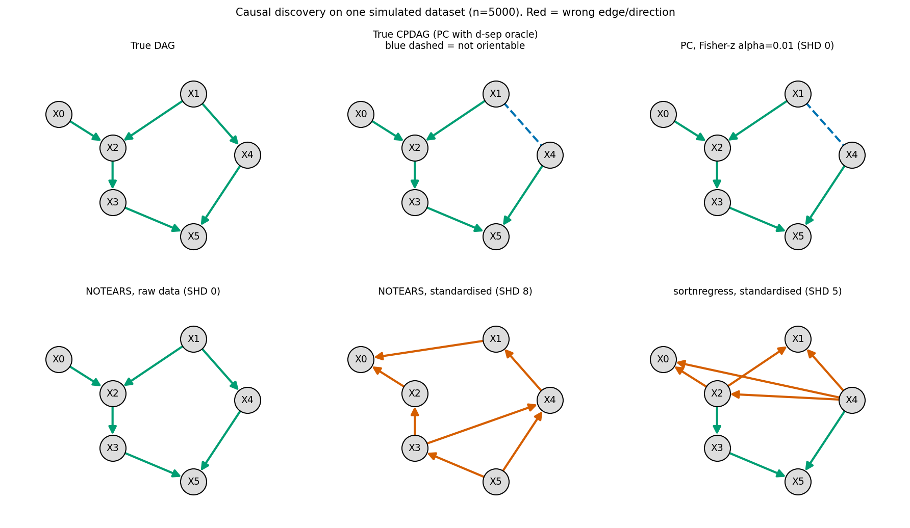
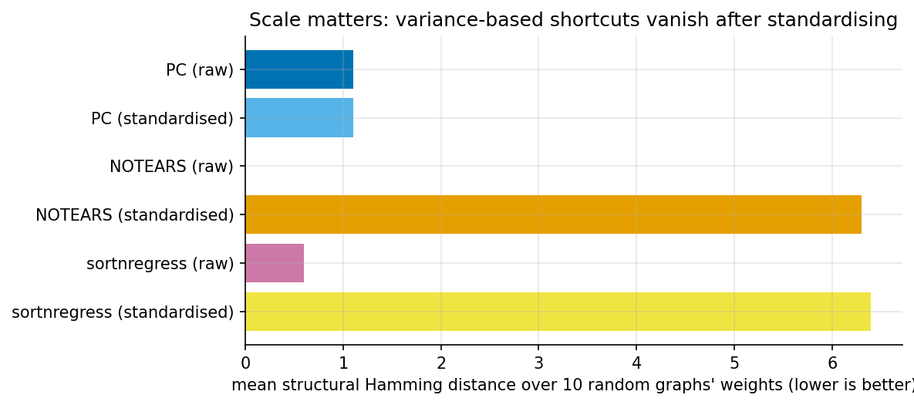

# 7. Causal discovery: learning the graph from data

> Previous: [6. Causal ML](06-causal-ml.md) · Next: [8. Sensitivity and validation](08-sensitivity-and-validation.md)

Chapters 1-6 assume you know the causal graph, or at least an adjustment set. **Causal discovery** (structure learning) tries to recover the graph from data. It is attractive and it is hard. This chapter covers what is possible in principle, the main algorithm families, and how easy it is to fool yourself when benchmarking them.

## 7.1 What data can and cannot tell you

From observational data alone, under the **causal Markov** and **faithfulness** assumptions, you can at best identify the **Markov equivalence class**: all DAGs that imply the same conditional independences. The class is summarised as a **CPDAG** (completed partially directed acyclic graph). Edges whose direction is fixed across the class are directed, and the rest are undirected. For example, $A \to B \to C$, $A \leftarrow B \leftarrow C$ and $A \leftarrow B \to C$ all imply only $A \perp C \mid B$, so their CPDAG is $A - B - C$. The collider $A \to B \leftarrow C$ implies something different ($A \perp C$ marginally, dependence given $B$), so **v-structures are identifiable**, and they anchor the orientation of other edges.

Going beyond the equivalence class requires extra assumptions:

| Extra assumption | What it buys | Example method |
|---|---|---|
| Linear model with **non-Gaussian** noise | Full DAG | LiNGAM |
| **Additive noise** model, non-linear $f$ | Full DAG (generically) | ANM, RESIT, CAM |
| **Equal noise variances** (linear Gaussian) | Full DAG | Equal-variance methods, which NOTEARS implicitly favours (7.5) |
| **Interventional data** | Orientations around intervened nodes | GIES, interventional PC, active learning |
| **Time order** | Edges cannot point back in time | Granger-style methods, PCMCI |
| Background knowledge | Required or forbidden edges | Any method with constraints |

Hidden confounders make things worse: you then need algorithms that output partial ancestral graphs (FCI and its relatives) and admit "there may be a latent common cause here".

## 7.2 Constraint-based: the PC algorithm

The **PC algorithm** (Spirtes & Glymour) works in three stages:

1. **Skeleton.** Start with a complete undirected graph. For each adjacent pair $(i, j)$, test $X_i \perp X_j \mid S$ for conditioning sets $S$ of size 0, 1, 2, … drawn from the current neighbours. Remove the edge as soon as some $S$ makes them independent, and record $S$ as the separating set.
2. **v-structures.** For every unshielded triple $i - k - j$ (with $i$, $j$ non-adjacent), orient $i \to k \leftarrow j$ if $k$ is *not* in $i$ and $j$'s separating set.
3. **Meek rules.** Propagate orientations that avoid new v-structures and cycles.

The conditional independence test is the main design choice. Fisher's z on partial correlations suits linear-Gaussian data. Kernel tests (KCI), conditional mutual information, or classifier-based tests suit non-linear data. PC is consistent under faithfulness, but errors cascade: one wrong test early can flip later orientations. Variants include PC-stable (order-independent), FCI (latent confounders), and RFCI and GFCI (faster or hybrid versions).

## 7.3 Score-based: GES

**Greedy equivalence search** scores whole equivalence classes, typically with BIC. It adds edges greedily in a forward phase and removes them in a backward phase. In the large-sample limit it finds the true equivalence class ([Chickering, 2002](https://jmlr.org/papers/v3/chickering02b.html)). Exact search, such as dynamic programming or integer programming (GOBNILP), works for small graphs, and hybrids (MMHC, GRaSP, BOSS) mix tests with scores.

## 7.4 Functional-causal-model methods: LiNGAM and friends

If $X_j = \sum_k b_{jk} X_k + e_j$ with **non-Gaussian, independent** noise, the full DAG is identifiable. Independent component analysis recovers the mixing matrix up to permutation and scaling, and only one permutation is acyclic ([Shimizu et al., 2006](https://jmlr.csail.mit.edu/papers/v7/shimizu06a.html)). DirectLiNGAM finds the causal order one variable at a time using independence measures, and the `lingam` package implements many variants: time series, multiple groups, and latent confounders ([JMLR 2023](https://jmlr.org/papers/volume24/21-0321/21-0321.pdf)). For non-linear models, **additive noise models** test both directions: regress $Y$ on $X$ and $X$ on $Y$, and pick the direction in which the residual is independent of the input.

## 7.5 Continuous optimisation: NOTEARS and its descendants

Zheng, Aragam, Ravikumar and Xing (2018) turned the combinatorial search over DAGs into a smooth problem ([arXiv 1803.01422](https://arxiv.org/abs/1803.01422)). The key fact is that a weighted adjacency matrix $W$ is acyclic if and only if

$$h(W) = \operatorname{tr}\big(e^{W \circ W}\big) - d = 0.$$

You then minimise a least-squares loss plus an L1 penalty subject to $h(W) = 0$ with an augmented Lagrangian, and threshold small weights. This opened a large literature: non-linear NOTEARS with MLPs, DAG-GNN, GraN-DAG, DAGMA (log-determinant acyclicity), and gradient-based methods in gCastle.

**The catch: varsortability.** Reisach, Seiler and Weichwald (2021) noticed that in standard simulated benchmarks, a variable's marginal variance tends to *increase along the causal order*, because each child adds its own noise to its parents' variance. Least-squares methods like NOTEARS can exploit this. A trivial baseline, **sortnregress** (sort variables by variance, then regress each on the earlier ones with a Lasso), matches them. After standardising the data to unit variance, which should not change the causal structure, the advantage disappears ([Reisach et al., 2021](https://arxiv.org/html/2102.13647v3)). A follow-up shows a scale-invariant version of the same leak via $R^2$-sortability ([Reisach et al., 2023](https://arxiv.org/html/2303.18211)).

## 7.6 Demonstration

`ex11_causal_discovery.py` implements PC (Fisher z, $\alpha = 0.01$, Meek rules R1-R3), linear NOTEARS (augmented Lagrangian with L-BFGS-B) and sortnregress, all from scratch. The true graph has 6 nodes and two v-structures, $X_0 \to X_2 \leftarrow X_1$ and $X_3 \to X_5 \leftarrow X_4$, with $|w| \in [0.8, 2.0]$. We use n = 5000 and 10 random weight draws.



| Method | Mean SHD | Exact recovery |
|---|---|---|
| PC, raw data (vs **true CPDAG**) | 1.10 | 5/10 |
| PC, standardised data | 1.10 | 5/10 |
| NOTEARS, raw data (vs true DAG) | **0.00** | 10/10 |
| NOTEARS, standardised data | **6.30** | 0/10 |
| sortnregress, raw data | 0.60 | 8/10 |
| sortnregress, standardised data | 6.40 | 1/10 |

SHD is the structural Hamming distance: missing, extra and reversed edges. Mean varsortability on the raw data was **0.97**: in 97% of edges the child had higher variance than the parent.



How to read this:

* **NOTEARS looks perfect on raw data and collapses after standardising.** Nothing causal changed between the two runs, only the units of measurement.
* **sortnregress, which contains no causal reasoning, nearly matches NOTEARS on raw data.** It fails in the same way on standardised data. Together these two rows reproduce the Reisach et al. finding.
* **PC is scale-invariant.** Partial correlations do not care about units, so raw and standardised results are identical. Its errors come from finite-sample test mistakes, and it is honest about what it cannot orient. In the true CPDAG the edge $X_1 - X_4$ stays undirected, because nothing in observational data can orient it. PC's SHD is measured against the CPDAG, NOTEARS's against the DAG, so the two columns are not directly comparable. Read each against its own target.
* The practical lesson: **standardise before running continuous-optimisation discovery**, and always include trivial baselines like sortnregress in a benchmark.

## 7.7 LLM-assisted causal discovery (2023-2026)

Large language models carry a lot of domain knowledge in text form ("smoking causes cancer", "altitude affects temperature"), so a natural idea is to use them as cheap experts:

* **Pairwise orientation from variable names.** Kıcıman, Ness, Sharma and Tan (2023) found that GPT-4-class models answered pairwise causal-direction benchmarks such as the Tübingen pairs with high accuracy, often beating data-driven methods. They also caution that the models fail unpredictably and may be recalling memorised benchmark answers ([arXiv 2305.00050](https://arxiv.org/abs/2305.00050)).
* **LLMs as priors or constraints** for statistical discovery: required or forbidden edges, order constraints, or soft priors on a score ([survey, arXiv 2402.11068](https://arxiv.org/abs/2402.11068)). Work on handling *imperfect* LLM priors is growing, for example by treating them as noisy experts and reconciling them with conditional-independence evidence ([arXiv 2405.13551](https://arxiv.org/pdf/2405.13551)).
* **Criticism.** "Causal parrots" (Zečević et al., 2023) argues that LLMs reproduce causal *statements* from their training data rather than doing causal inference, and that impressive benchmark numbers may reflect memorisation ([arXiv 2308.13067](https://arxiv.org/html/2308.13067)). A 2024 critical review makes a similar case that many causal benchmarks can be solved by retrieving domain knowledge ([arXiv 2407.08029](https://arxiv.org/html/2407.08029v1)).

A reasonable stance today: LLMs are useful for *eliciting candidate graphs and background knowledge quickly*, which is the step humans find tedious. Their output is a hypothesis to test against data and expert review, not a substitute for either.

## 7.8 Software

| Tool | Language | Covers |
|---|---|---|
| [causal-learn](https://github.com/py-why/causal-learn) (py-why) | Python | PC, FCI, GES, LiNGAM family, GRaSP, many CI tests; a Python port and extension of Tetrad ([JMLR 2024](https://jmlr.org/papers/volume25/23-0970/23-0970.pdf)) |
| [gCastle](https://arxiv.org/abs/2111.15155) | Python | Gradient-based methods (NOTEARS variants, GraN-DAG, RL-based), simulators, evaluation metrics |
| `lingam` | Python | LiNGAM variants |
| Tetrad | Java (GUI and py-tetrad) | The original CMU suite, very complete |
| `pcalg`, `bnlearn` | R | PC, FCI, GES, score-based Bayesian networks |
| Tigramite | Python | PCMCI for time series |

## 7.9 Key takeaways

* Without extra assumptions, observational data identify only an equivalence class. Expect undirected edges.
* PC and GES are consistent but brittle in finite samples. LiNGAM and ANMs buy identifiability with distributional assumptions.
* Benchmarks on simulated data can be gamed by variance sorting. Standardise and include trivial baselines.
* LLMs are a promising source of priors and a poor oracle.

**Further reading:** Peters, Janzing & Schölkopf, *Elements of Causal Inference* (2017, free PDF). Glymour, Zhang & Spirtes, "Review of causal discovery methods based on graphical models" (Frontiers in Genetics, 2019). Spirtes, Glymour & Scheines, *Causation, Prediction, and Search* (2000).

## Appendix A: code walkthrough

### Fisher-z conditional independence test

From `ex11_causal_discovery.py`. Invert the correlation sub-matrix to get the partial correlation, then use Fisher's z-transform:

```python
def fisher_z_test(C, n, i, j, S):
    idx = [i, j] + list(S)
    P = np.linalg.pinv(C[np.ix_(idx, idx)])
    r = -P[0, 1] / np.sqrt(P[0, 0] * P[1, 1])                  # partial correlation
    z = 0.5 * np.log((1 + r) / (1 - r)) * np.sqrt(n - len(S) - 3)
    return 2 * (1 - stats.norm.cdf(abs(z)))                    # p-value
```

### PC with an oracle: computing the true CPDAG

The same `pc()` function accepts any independence oracle. Passing true d-separation gives the CPDAG implied by the true DAG, which is the right target for scoring PC:

```python
oracle = pc(lambda i, j, S: d_separated(G_true, {i}, {j}, set(S)), D)
```

### The NOTEARS acyclicity function and its gradient

```python
def _h(W):
    E = scipy.linalg.expm(W * W)          # matrix exponential of the elementwise square
    return np.trace(E) - d, E.T * W * 2   # h(W) and its gradient
```

$h(W) = 0$ if and only if $W$ has no directed cycles, because $\operatorname{tr}(A^k)$ counts weighted closed walks of length $k$ and the exponential sums over all $k$. Squaring keeps the entries non-negative so the walks cannot cancel.

### sortnregress (the baseline that should not work)

```python
order = np.argsort(X.var(0))                     # assume: higher variance = later in causal order
for k in range(1, d):
    tgt, parents = order[k], order[:k]
    W[parents, tgt] = LassoLarsIC(criterion="bic").fit(X[:, parents], X[:, tgt]).coef_
```

(The code in the script also rescales by an OLS-based adaptive weight before the Lasso.)

## Appendix B: exercises

1. Make the noise non-Gaussian (e.g. uniform or Laplace) in `ex11` and add a LiNGAM-style direction test for one edge: regress each way and check which residual is independent of the input, using a simple independence statistic such as HSIC or the correlation of squares.
2. Decrease n to 500. How does PC's SHD change, and which edges does it get wrong first?
3. Change edge weights to $|w| \in [0.3, 0.7]$. Does varsortability drop, and does NOTEARS on raw data still look perfect?
4. Give an LLM the variable names of a real dataset you know and ask for a DAG. Compare it with your own. Which edges would you test first?
