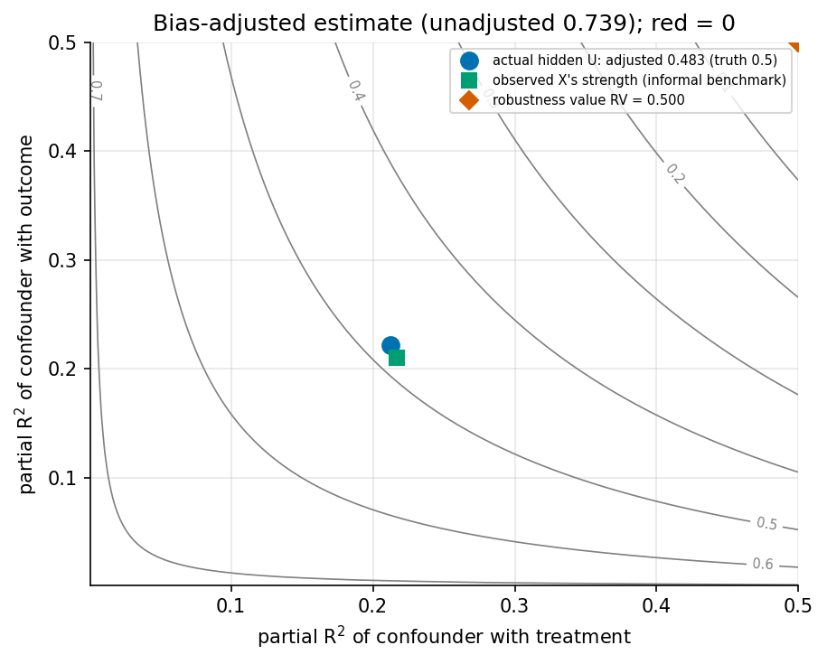
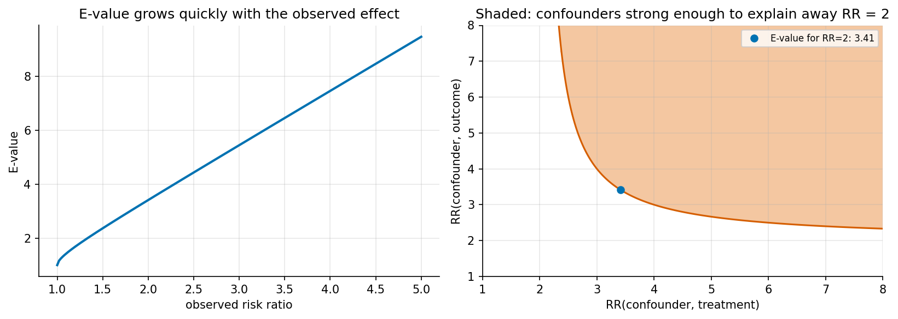
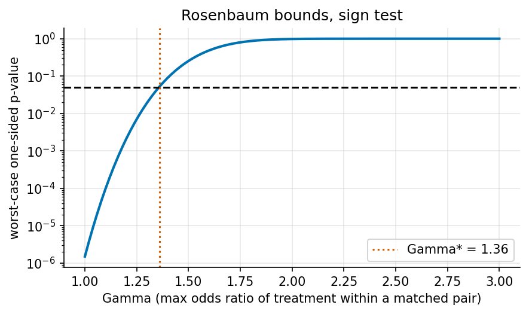

# 8. Sensitivity analysis, validation, mediation and interference

> Previous: [7. Causal discovery](07-causal-discovery.md) · Next: [9. The frontier](09-frontier-2024-2026.md)

Every observational estimate rests on an assumption that cannot be tested: no unmeasured confounding, exclusion, parallel trends. You cannot prove it, but you can answer a more useful question: **how wrong would it have to be to change my conclusion?** That is sensitivity analysis. This chapter also covers refutation tests, mediation and interference, three places where a clean estimate can mislead.

## 8.1 Omitted-variable bias, made interpretable (Cinelli & Hazlett)

In a linear regression of $Y$ on $D$ and $X$ with an omitted confounder $Z$, the bias in the coefficient on $D$ depends on just two numbers:

* $R^2_{D \sim Z \mid X}$: the share of the treatment's residual variance (after $X$) that $Z$ explains;
* $R^2_{Y \sim Z \mid D, X}$: the share of the outcome's residual variance (after $D$ and $X$) that $Z$ explains.

Cinelli and Hazlett (2020) showed that

$$|\widehat{\text{bias}}| = \operatorname{se}(\hat\tau)\,\sqrt{\text{df}}\;\sqrt{\frac{R^2_{Y \sim Z \mid D,X}\; R^2_{D \sim Z \mid X}}{1 - R^2_{D \sim Z \mid X}}},$$

and introduced two summaries for routine reporting ([Cinelli & Hazlett, 2020](https://escholarship.org/content/qt0pg6471b/qt0pg6471b.pdf); R/Python/Stata package [`sensemakr`](https://carloscinelli.com/sensemakr/articles/sensemakr.html)):

* **Robustness value** $RV_q$: the strength a confounder would need, *equally* in both partial $R^2$s, to reduce the estimate by $100q\%$. $RV_1$ brings it to zero:
  $RV_q = \tfrac12\big(\sqrt{f_q^4 + 4 f_q^2} - f_q^2\big)$ with $f_q = q\,|t| / \sqrt{\text{df}}$.
* **Partial $R^2$ of the treatment with the outcome**: the share of the outcome's residual variance that the treatment explains. An extreme confounder that explains *all* remaining outcome variance would need at least this much association with the treatment to erase the effect.

Their most useful idea is **benchmarking**: express the hypothetical confounder's strength as a multiple of an *observed* covariate's strength ("a confounder as strong as income"). That turns an abstract number into a judgement a domain expert can make.

### 8.1.1 Demonstration

`ex12_sensitivity.py` part A has an observed $X$, an unobserved $U$ that confounds $D \to Y$, a true effect of 0.5, and n = 2000:



| Quantity | Value |
|---|---|
| Estimate omitting $U$ (SE) | 0.739 (0.023), $t$ = 31.6 |
| Oracle estimate including $U$ | 0.483 |
| True effect | 0.500 |
| Actual partial $R^2$ of $U$ with $D$ / with $Y$ | 0.212 / 0.221 |
| **Bias-adjusted estimate at $U$'s actual strength** | **0.483**, exactly the oracle |
| Robustness value $RV_{q=1}$ | 0.500 |
| Partial $R^2$ of $D$ with $Y$ | 0.333 |
| Observed $X$'s partial $R^2$ with $D$ / with $Y$ | 0.217 / 0.210 |

The adjusted estimate at the real confounder's strength equals the oracle regression to four decimals. In OLS the formula is an identity, not an approximation. The robustness value says a confounder explaining 50% of the residual variance of both treatment and outcome would be needed to drive the estimate to zero. The real $U$ explains about 21-22%, enough to inflate the estimate by half but not to erase it. It is about as strong as the observed $X$, which is exactly the kind of statement benchmarking supports: "a confounder as strong as $X$ would bring the estimate to about 0.48, still clearly positive."

## 8.2 E-values

For a risk-ratio estimate RR > 1, the **E-value** is the minimum risk-ratio association an unmeasured confounder would need with *both* treatment and outcome, beyond the measured covariates, to fully explain away the estimate ([VanderWeele & Ding, 2017](https://pubmed.ncbi.nlm.nih.gov/28693043/)):

$$E = RR + \sqrt{RR\,(RR - 1)}.$$

It follows from the bias-factor bound $B = \dfrac{RR_{UD}\,RR_{UY}}{RR_{UD} + RR_{UY} - 1}$: a confounder can explain away the estimate only if $B \ge RR$.



| Observed RR | 1.2 | 1.5 | 2.0 | 3.0 | 4.0 |
|---|---|---|---|---|---|
| E-value | 1.69 | 2.37 | 3.41 | 5.45 | 7.46 |

E-values are easy to compute and report, which is why epidemiology journals adopted them quickly. Critics point out that they are nearly a monotone transformation of the estimate itself, so they add little information unless paired with a judgement about plausible confounder strengths ([Ioannidis et al., 2019](https://pubmed.ncbi.nlm.nih.gov/30597486)). Apply them to the confidence limit closest to the null as well as to the point estimate.

## 8.3 Rosenbaum bounds

For matched studies, Rosenbaum's approach asks how large a hidden bias $\Gamma$ could be, where $\Gamma$ bounds the odds ratio of treatment between two units in a matched pair who look identical on observed covariates. $\Gamma = 1$ is a randomised experiment. For each $\Gamma$ you compute the *worst-case* p-value and report the $\Gamma^*$ at which significance is lost.

`ex12` part C has 400 matched pairs with a modest true effect (0.25 SD). 247 of the 400 pairs favour treatment, and the sign-test p-value at $\Gamma = 1$ is $1.5 \times 10^{-6}$:



Significance at 5% is lost at $\Gamma^* \approx 1.36$. A hidden factor that made one member of a pair just 36% more likely to be treated would be enough to explain the result. A highly significant p-value does **not** mean a result is robust to hidden bias. Studies of smoking and lung cancer, for comparison, are famously robust to $\Gamma$ of about 5-6. Sign tests are the bluntest version. Wilcoxon signed-rank and M-statistics are more powerful and also have Rosenbaum bounds (`rbounds`, `sensitivitymv`).

## 8.4 Other sensitivity tools

* **Sensitivity for IV** ([Cinelli & Hazlett, IV extension](https://papers.ssrn.com/sol3/papers.cfm?abstract_id=4217915)) and for **DiD parallel trends** (HonestDiD, [Chapter 5](05-panel-methods.md)).
* **Marginal sensitivity models** (Tan; Zhao, Small & Bhattacharya; Dorn & Guo) bound IPW weights by a factor $\Lambda$ and give sharp bounds on the ATE.
* **Partial identification / Manski bounds**: report the range of effects consistent with weaker assumptions.
* **Negative controls**: an outcome the treatment *cannot* affect, or an exposure that *cannot* affect the outcome. A non-zero "effect" on either flags residual confounding. Proximal inference ([Chapter 9](09-frontier-2024-2026.md)) turns negative controls into an identification strategy.

## 8.5 Refutation tests (falsification checks)

DoWhy organises analysis into **model, identify, estimate, refute** ([DoWhy docs](https://www.pywhy.org/dowhy/main/user_guide/causal_tasks/estimating_causal_effects/index.html)). Useful refuters, whatever library you use:

| Check | What you do | What should happen |
|---|---|---|
| Placebo treatment | Replace $T$ with a random permutation | Effect ≈ 0 |
| Placebo outcome | Use an outcome measured *before* treatment | Effect ≈ 0 |
| Placebo cutoff / time | Fake RD cutoff, fake treatment date | Effect ≈ 0 (`ex05`: −0.017, SE 0.038) |
| Random common cause | Add a random covariate | Estimate unchanged |
| Data subset | Re-estimate on random subsamples | Estimate stable |
| Add an unobserved confounder | Simulate a confounder of given strength | Shows sensitivity |
| Covariate balance | Standardised mean differences after weighting or matching | All < 0.1 |
| Implied independences of the DAG | Test them, e.g. $A \perp D \mid C$ | Not rejected |

Passing refutation tests does not prove identification. Failing one is strong evidence of a problem.

## 8.6 Mediation

Mediation analysis splits a total effect into the part that goes *through* a mediator $M$ and the part that does not. With potential outcomes $Y(t, m)$ and $M(t)$:

* **Natural direct effect** $NDE = E[Y(1, M(0)) - Y(0, M(0))]$: change treatment, hold the mediator at its untreated value.
* **Natural indirect effect** $NIE = E[Y(1, M(1)) - Y(1, M(0))]$: hold treatment, move the mediator as treatment would.
* $TE = NDE + NIE$.
* **Controlled direct effect** $CDE(m) = E[Y(1, m) - Y(0, m)]$: fix the mediator at $m$ for everyone.

Identifying natural effects needs **sequential ignorability**: no unmeasured treatment-outcome, treatment-mediator, *or mediator-outcome* confounding, and no mediator-outcome confounder that is itself affected by treatment ([Imai, Keele & Tingley, 2010](https://lukekeele.net/wp-content/uploads/2016/03/mediationII.pdf)). The third condition is rarely guaranteed even in a randomised trial, because randomising $T$ does not randomise $M$. That is why mediation analyses need sensitivity analysis (the `mediation` R package has it built in).

`ex02` scenario (c) shows the simplest consequence. Regressing $Y$ on $T$ and $M$ returns the direct effect (0.50), not the total effect (1.30). That is fine if the direct effect is what you want, and a bug if you meant the total effect. In linear models without interactions, the "product of coefficients" ($0.8 \times 1.0$) equals the NIE. With interactions or non-linearities you need the counterfactual definitions above.

## 8.7 Interference and network effects

When SUTVA fails, effects need new definitions. With exposure mapping $f(\mathbf{T}, i)$:

* **Direct effect**: change your own treatment, holding others' fixed.
* **Spillover (indirect) effect**: change others' treatment, holding yours fixed.
* **Total / overall effect**: everyone treated versus no one treated, the quantity a launch decision needs.

Estimation strategies include cluster randomisation (`ex04` part (c): 0.204 versus the true 0.2, compared with 0.983 under individual randomisation), two-stage randomised saturation designs (Hudgens & Halloran, 2008), exposure-mapping IPW estimators with known interference structure ([Aronow & Samii, 2017](https://arxiv.org/html/1305.6156v3)), and switchback designs for marketplaces. Sävje, Aronow and Hudgens (2021) give some reassurance: with limited, unknown interference, standard estimators converge to a well-defined *expected* average effect that marginalises over spillovers ([arXiv 1711.06399](https://arxiv.org/html/1711.06399v2)). That is not the same as the global effect of a launch.

## 8.8 Key takeaways

* Report how strong a confounder would have to be, not just a p-value. In our example the robustness value was 0.50 against an actual confounder strength of about 0.22.
* Use benchmarking against observed covariates to make sensitivity numbers interpretable.
* A tiny p-value can coexist with fragility: significance vanished at $\Gamma = 1.36$ despite $p = 1.5 \times 10^{-6}$.
* Run refutation tests. They cannot prove you right but they often show you are wrong.
* Mediation and interference each need their own estimands and assumptions. Defaults silently pick one for you.

**Further reading:** Rosenbaum, *Observational Studies* (2002) and *Design of Observational Studies* (2020). VanderWeele, *Explanation in Causal Inference* (2015) on mediation and interaction. Cinelli, Forney & Pearl, "A crash course in good and bad controls" (2022).

## Appendix A: code walkthrough

### Bias-adjusted estimate and robustness value

From `ex12_sensitivity.py`:

```python
def adjusted_estimate(est, se, df, r2dz, r2yz):
    bias = se * np.sqrt(df) * np.sqrt(r2yz * r2dz / (1 - r2dz))
    return est - bias

def robustness_value(t, df, q=1.0):
    f = q * abs(t) / np.sqrt(df)
    return 0.5 * (np.sqrt(f ** 4 + 4 * f ** 2) - f ** 2)
```

Both need only the regression output you already have: the estimate, its SE, the t-statistic and the residual degrees of freedom. That is why `sensemakr` can produce a full sensitivity report from a fitted `lm` object.

### Rosenbaum bound for the sign test

```python
pos = (diffs > 0).sum()                      # pairs where the treated unit did better
for gamma in gammas:                          # worst case: each pair favours treatment w.p. gamma/(1+gamma)
    p_upper = 1 - stats.binom.cdf(pos - 1, n_pairs, gamma / (1 + gamma))
```

### E-value

```python
def e_value(rr):
    rr = np.where(rr < 1, 1 / rr, rr)        # protective effects: invert first
    return rr + np.sqrt(rr * (rr - 1))
```

## Appendix B: what to put in a sensitivity section

1. **The unadjusted-for-hidden-bias estimate**, with CI.
2. **One headline robustness number** suited to the design: robustness value (regression), E-value (risk ratios), Γ* (matched designs), breakdown $\bar M$ (DiD).
3. **A benchmark**: how strong would a confounder as strong as your strongest observed covariate be, and what would the estimate become?
4. **A contour or curve plot**, so readers can apply their own beliefs.
5. **Negative-control or placebo results**, if available.
6. **A plain-language sentence**: "To explain away this effect, an unmeasured factor would need to be about X times as strongly related to both treatment and outcome as [observed covariate]."

## Appendix C: exercises

1. In `ex12` part A, double $U$'s effect on $Y$. Recompute where the true $U$ sits on the contour plot. Does it cross the zero line?
2. Show algebraically that if $R^2_{D \sim Z \mid X} = R^2_{Y \sim Z \mid D,X} = RV_1$, the adjusted estimate is exactly zero.
3. In part C, raise the effect from 0.25 to 0.5 SD. How does $\Gamma^*$ change? What does that say about the link between effect size and robustness to hidden bias?
4. In `ex02` scenario (c), add an unmeasured confounder of $M$ and $Y$. Show that the "direct effect" from adjusting for $M$ is now biased even though $T$ is randomised.
